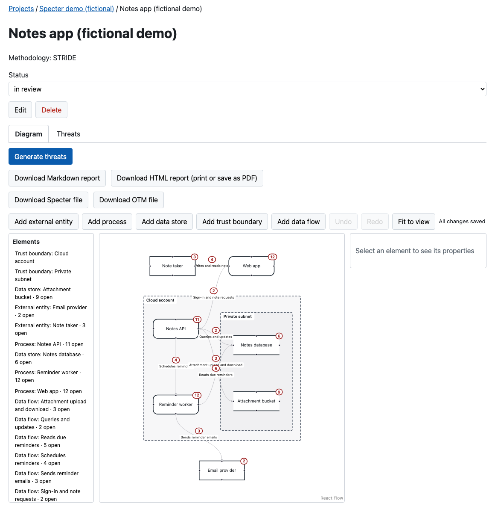

<div align="center">


# Scrylux

**Open-source, self-hosted threat modeling.**<br>
Draw your system, get STRIDE threats, and work them to a decision.

[](https://github.com/shivamsaraswat/scrylux/actions/workflows/ci.yml)
[](https://github.com/shivamsaraswat/scrylux/releases)
[](LICENSE)
[](#quickstart)

[Quickstart](#quickstart) · [Demo](#try-the-demo) · [Documentation](#documentation) · [Roadmap](docs/roadmap.md) · [Releases](https://github.com/shivamsaraswat/scrylux/releases)



</div>

## How it works

| 1. Draw | 2. Generate | 3. Decide |
| --- | --- | --- |
| Sketch the system as a data-flow diagram in the browser, with trust boundaries. | STRIDE threats come from rules, per element. Run it again and your edits stay. | Give each threat a status, a risk and mitigations, and a reason for every one you accept or dismiss. |

Then take the result with you: a Markdown or print-ready report, or a Scrylux, [Open Threat Model](https://github.com/iriusrisk/OpenThreatModel) or OWASP Threat Dragon file, in and out.

Everything runs on your own machine: one container and a PostgreSQL database, with a documented REST API. A threat model can also hold the design documents it was built from (`.md`, `.txt`, `.pdf`, `.docx`), which Scrylux reads and embeds with an embedding provider you choose, a local one included; an existing install should read [Upgrading to v0.2](docs/install.md#upgrading-to-v02) first.

> **Next, planned and not built:** AI drafts from your documents (which Scrylux can already read, but does not yet draft from) and code, always with citations and a human accept step, on the LLM you choose, a local one included. See the [roadmap](docs/roadmap.md).

## Quickstart

You need Docker with Compose.

```sh
curl -fsSLO https://github.com/shivamsaraswat/scrylux/releases/download/v0.1.0/docker-compose.yml
docker compose up -d
```

Open <http://localhost:3000> and sign in with `admin` / `admin`.

> [!WARNING]
> These defaults are for your own machine. Before you expose Scrylux anywhere else, set real secrets and put a TLS proxy in front. [Install and run](docs/install.md) says how.

## Try the demo

A finished, **fictional** example is attached to every release as `notes-app.scrylux.json`. In a project, choose **Import threat model** and pick it. [`docs/demo/`](docs/demo/) says what to look at, and there are [more screenshots](docs/screenshots.md).

## What v0.1 does not do

- **No roles.** Every account can read, change and delete everything.
- **No AI yet.** Nothing calls a language model.
- **No TLS of its own.** Put a proxy that terminates it in front.
- **The image is not signed.** Pin it by the digest on the release page.

Scrylux keeps its own threat model, built in Scrylux, with what is still open: [`docs/threat-model/`](docs/threat-model/). The [changelog](CHANGELOG.md) and the [releases](https://github.com/shivamsaraswat/scrylux/releases) say the rest.

## Documentation

| | |
| --- | --- |
| [Install and run](docs/install.md) | Version choice, upgrading, running without Docker, environment variables, deployment |
| [AI providers](docs/ai-providers.md) | Choose a model provider or a local model, what leaves your install, what a request costs |
| [API](API.md) · [File formats](docs/formats/) | The REST API, and the Scrylux, OTM and Threat Dragon files |
| [Roadmap](docs/roadmap.md) | What each phase builds, and when |
| [Development](docs/development.md) · [CI](docs/ci.md) | Run from source, the workspace, tests and checks |

## Contributing, security, license

Read [CONTRIBUTING.md](CONTRIBUTING.md) first; everyone taking part follows the [Code of Conduct](CODE_OF_CONDUCT.md). To report a vulnerability, follow [SECURITY.md](SECURITY.md) and do it privately, never in a public issue.

Scrylux is licensed under the [Apache License 2.0](LICENSE).
