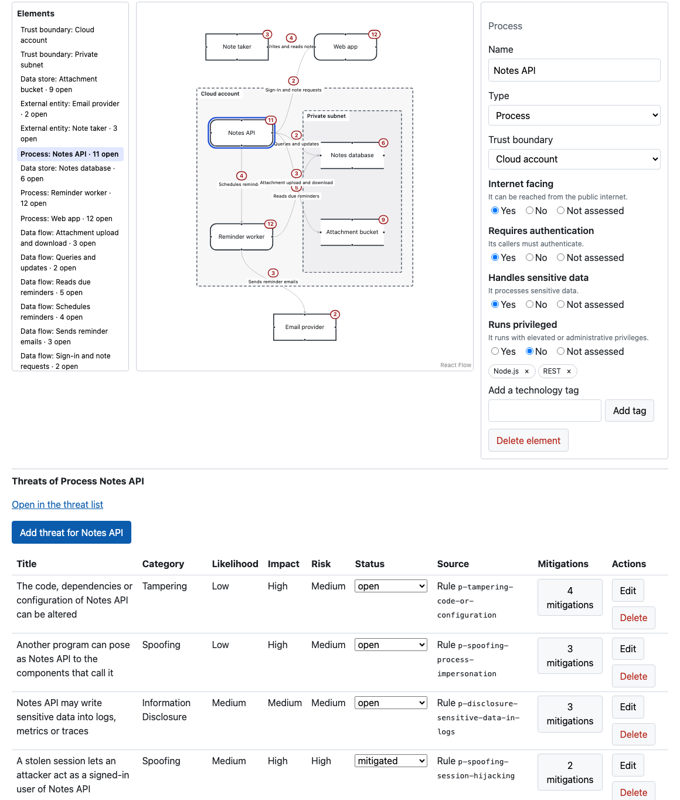
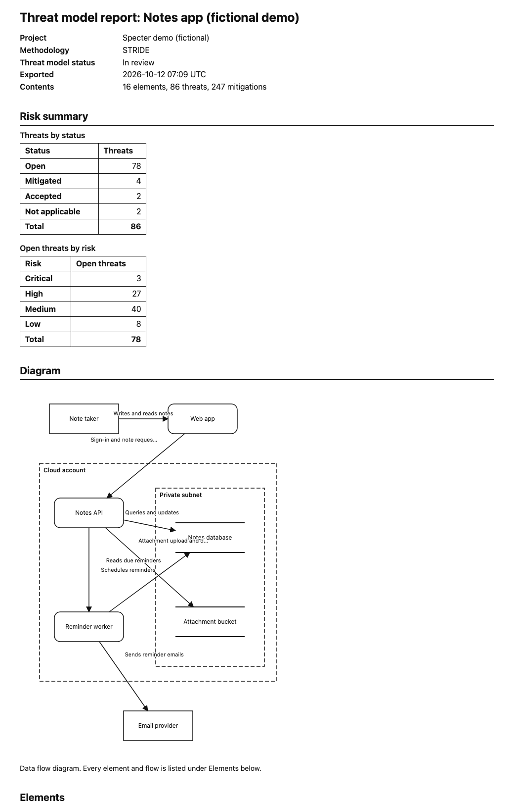
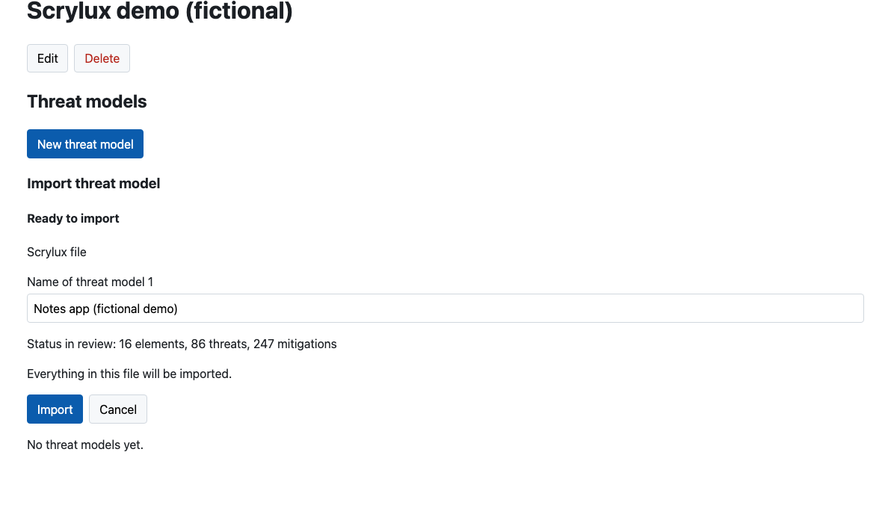

# Screenshots

The fictional demo threat model ([`demo/`](demo/)), a small note-taking app, in Scrylux. Back to the [README](../README.md).

## Retaking the screenshots

They are pictures of the demo, taken by hand, and nothing checks that they are current: retake them when the interface changes.

1. Start Scrylux from a clone ([CONTRIBUTING.md](../CONTRIBUTING.md) has the setup), sign in, create a project named `Scrylux demo (fictional)` and import [`demo/notes-app.scrylux.json`](demo/notes-app.scrylux.json) into it.
2. Use a browser window of **1400 × 900**. Crop each picture to the application area: no browser chrome, **no address bar, no account name** (crop below the page header), and nothing else on screen.
3. Take the four views and save them as PNG under `docs/images/` with these names:
   - `diagram-editor.png`: the threat model's **Diagram** tab after **Fit to view**, from the title down to the bottom of the canvas;
   - `threats-for-element.png`: select **Process: Notes API** in the elements list, then take from the top of the elements list down through the first few rows of the threat table;
   - `report.png`: download the HTML report, open the file, and take its top, through the diagram;
   - `import-export.png`: on the project's page, **Import threat model**, choose the demo file, and take the preview that says "Everything in this file will be imported."
4. Keep each file under **600 KB** and the folder under **3 MB** (optimise a PNG if you must); a check fails the build otherwise, and for a missing image or an empty description.
