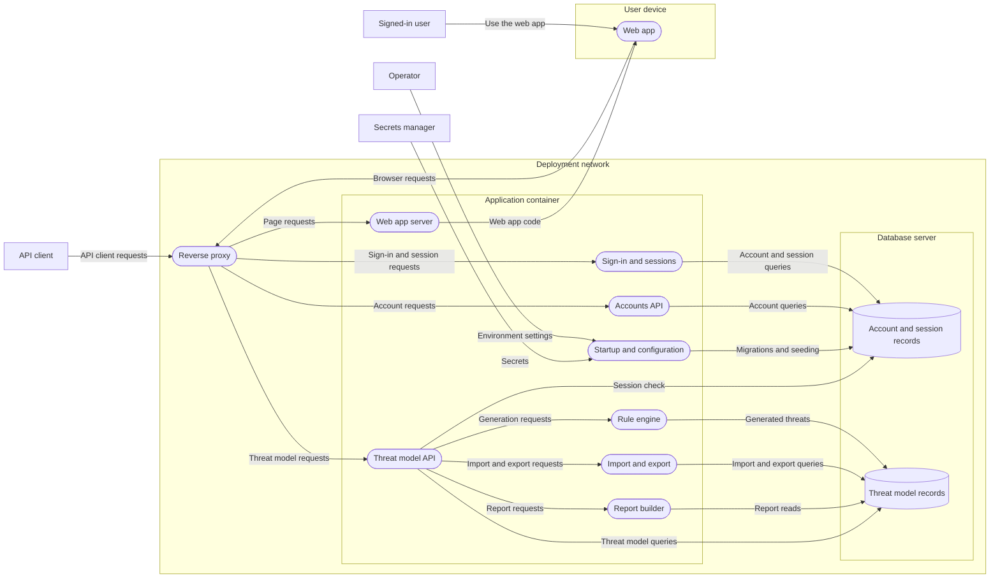

# Threat model report: Specter application

- **Project:** Specter
- **Methodology:** STRIDE
- **Threat model status:** In review
- **Exported:** 2026-10-12 07:14 UTC
- **Contents:** 41 elements, 264 threats, 203 mitigations

## Risk summary

| Status | Threats |
|---|---:|
| Open | 35 |
| Mitigated | 67 |
| Accepted | 94 |
| Not applicable | 68 |
| **Total** | **264** |

| Risk (open threats) | Threats |
|---|---:|
| Critical | 6 |
| High | 11 |
| Medium | 17 |
| Low | 1 |
| **Total** | **35** |

## Diagram

## Elements

### E1 · Trust boundary · Deployment network

#### E2 · Process · Reverse proxy

- **Tags:** Proxy or load balancer, Optional, TRUST\_PROXY
- **Internet facing:** Yes
- **Requires authentication:** No
- **Handles sensitive data:** Yes
- **Runs privileged:** Not assessed

##### Anyone on the internet can call Reverse proxy without proving who they are — Critical

- **Category:** Spoofing
- **Risk:** Critical (likelihood High × impact High)
- **Status:** Mitigated
- **Origin:** Rule-generated

> Reverse proxy accepts connections from the public internet and does not require callers to authenticate\. It cannot tell one caller from another\, so it cannot limit what any of them may do\, and every caller is effectively anonymous and equally trusted\.

**Mitigations**

1. **Verified** — \/api\/users accepts only an \/api\/login bearer token\; a browser access token is refused there for every method \(apps\/api\/src\/auth\.ts\, requireApiToken\; tests\: apps\/api\/test\/contract\/session\-tokens\.test\.ts\)
2. **Verified** — Every \/api\/v1 operation refuses a request without a valid bearer token\, and writes nothing when it does \(apps\/api\/src\/app\.ts\, requireV1Token\; tests\: apps\/api\/test\/contract\/v1\/auth\.test\.ts\)

##### Sensitive data handled by Reverse proxy is open to anyone who can reach it — Critical

- **Category:** Information Disclosure
- **Risk:** Critical (likelihood High × impact High)
- **Status:** Open
- **Origin:** Rule-generated

> Reverse proxy handles sensitive data and does not require callers to authenticate\. Anyone who can connect can ask for the data\, with nothing to tie the request to a person who is allowed to see it\.

**Mitigations**

1. **Proposed** — Terminate TLS at the proxy and redirect HTTP to HTTPS \(step10\-stretch\-guide\.md\)\; the session cookie is then marked Secure automatically \(apps\/api\/src\/session\/cookie\.ts\)

##### Crafted input from the internet can change what Reverse proxy does — High

- **Category:** Tampering
- **Risk:** High (likelihood Medium × impact High)
- **Status:** Accepted
- **Reason:**
  > The proxy or load balancer belongs to the operator\, not to Specter\: Specter ships none and has no control over it\; its handling of malformed requests is the operator\'s
- **Origin:** Rule-generated

> Reverse proxy takes input from the public internet\. Anyone can send it data shaped to be misread\: an oversized value\, a wrong type\, or text that looks like a command or query\. If the process trusts that input\, the attacker decides what it does\.

**Mitigations**

No mitigations.

##### Another program can pose as Reverse proxy to the components that call it — Medium

- **Category:** Spoofing
- **Risk:** Medium (likelihood Low × impact High)
- **Status:** Mitigated
- **Origin:** Rule-generated

> Components that call Reverse proxy need to be sure they are talking to the real one\. If an attacker can take over its name or address\, or sit on the path to it\, they can answer in its place and collect what callers send\.

**Mitigations**

1. **Implemented** — The AWS guide\'s security groups let only the load balancer reach the app\'s port \(deployment\.md\, step3\)
2. **Verified** — The app trusts X\-Forwarded\-For and X\-Forwarded\-Host only from the proxy hops named by TRUST\_PROXY\, and ignores them otherwise \(apps\/api\/src\/config\.ts\; tests\: apps\/api\/test\/contract\/throttle\.test\.ts\, \'ignores a spoofed X\-Forwarded\-For when no proxy is trusted\'\, apps\/api\/test\/contract\/session\.test\.ts\, \'ignores X\-Forwarded\-Host when no proxy is trusted\'\)

##### The code\, dependencies or configuration of Reverse proxy can be altered — Medium

- **Category:** Tampering
- **Risk:** Medium (likelihood Low × impact High)
- **Status:** Accepted
- **Reason:**
  > The proxy or load balancer belongs to the operator\, not to Specter\: Specter ships none and has no control over it\; its code and configuration are the operator\'s
- **Origin:** Rule-generated

> An attacker who can change what Reverse proxy runs gets everything the process can do\. The route can be a poisoned dependency\, a tampered build or image\, or a changed configuration or environment variable\.

**Mitigations**

No mitigations.

##### Access to sensitive data through Reverse proxy leaves no trail — Medium

- **Category:** Repudiation
- **Risk:** Medium (likelihood Medium × impact Medium)
- **Status:** Accepted
- **Reason:**
  > The proxy or load balancer belongs to the operator\, not to Specter\: Specter ships none and has no control over it\; its access log is the operator\'s record
- **Origin:** Rule-generated

> Reverse proxy handles sensitive data\. If reads\, exports and changes of that data are not recorded with who did them\, a leak or a misuse cannot be traced\, and a person who misused their access can deny it\.

**Mitigations**

No mitigations.

##### Actions taken through Reverse proxy cannot be reconstructed later — Medium

- **Category:** Repudiation
- **Risk:** Medium (likelihood Medium × impact Medium)
- **Status:** Accepted
- **Reason:**
  > The proxy or load balancer belongs to the operator\, not to Specter\: Specter ships none and has no control over it\; its access log\, if the operator enables one\, is the record of requests
- **Origin:** Rule-generated

> Without a record of security\-relevant events\, nobody can say afterwards who signed in\, who changed what or what an attacker did\. Reverse proxy may do the right thing and still be unable to prove it\.

**Mitigations**

No mitigations.

##### Reverse proxy may write sensitive data into logs\, metrics or traces — Medium

- **Category:** Information Disclosure
- **Risk:** Medium (likelihood Medium × impact Medium)
- **Status:** Mitigated
- **Origin:** Rule-generated

> Logs are copied\, indexed\, shipped and read by many people and tools\. If Reverse proxy writes sensitive values into them\, such as passwords\, tokens\, personal data or request bodies\, the data ends up in places with much weaker protection than the system it came from\.

**Mitigations**

1. **Implemented** — No credential or token is ever put in a URL\: the bearer travels in a header and the session credential in a path\-scoped cookie\, so a proxy\'s access log holds none \(constitution Principle I\; apps\/api\/src\/session\/cookie\.ts\)

##### Anyone on the internet can overwhelm Reverse proxy — Medium

- **Category:** Denial of Service
- **Risk:** Medium (likelihood Medium × impact Medium)
- **Status:** Accepted
- **Reason:**
  > The proxy or load balancer belongs to the operator\, not to Specter\: Specter ships none and has no control over it\; an ALB scales with load \(deployment\.md\)\, and its protection is the operator\'s
- **Origin:** Rule-generated

> Reverse proxy accepts work from the public internet\. Without limits\, a flood of requests\, a few very expensive ones or a slow connection held open on purpose can use up its CPU\, memory or connections and shut out real users\.

**Mitigations**

No mitigations.

##### Reverse proxy stops working when something it depends on fails — Medium

- **Category:** Denial of Service
- **Risk:** Medium (likelihood Medium × impact Medium)
- **Status:** Mitigated
- **Origin:** Rule-generated

> Reverse proxy relies on other components such as databases\, queues and other services\. If one of them is slow or down and the process waits for it without a limit\, requests pile up and the failure spreads\.

**Mitigations**

1. **Verified** — \/health answers 200 with no authentication and no database dependency\, so a load balancer can tell the app from the database \(apps\/api\/src\/app\.ts\; tests\: apps\/api\/test\/contract\/health\.test\.ts\)

##### Input from the internet could make Reverse proxy run an attacker\'s code — Medium

- **Category:** Elevation of Privilege
- **Risk:** Medium (likelihood Low × impact High)
- **Status:** Accepted
- **Reason:**
  > The proxy or load balancer belongs to the operator\, not to Specter\: Specter ships none and has no control over it\; keeping it patched is the operator\'s job
- **Origin:** Rule-generated

> Reverse proxy is reachable from the internet\. If it evaluates input as code\, deserializes untrusted data\, handles uploaded files unsafely or uses a vulnerable dependency\, an attacker can make it run their code and gain whatever the process itself can do\.

**Mitigations**

No mitigations.

##### Reverse proxy may reveal its internals in error messages — Low

- **Category:** Information Disclosure
- **Risk:** Low (likelihood Medium × impact Low)
- **Status:** Accepted
- **Reason:**
  > The proxy or load balancer belongs to the operator\, not to Specter\: Specter ships none and has no control over it\; Specter sends fixed error bodies and no X\-Powered\-By\, but the proxy\'s own error pages are whatever the operator configured
- **Origin:** Rule-generated

> Detailed errors help developers and attackers alike\. Stack traces\, query text\, file paths and version numbers in a response show an attacker how Reverse proxy is built and where to push\.

**Mitigations**

No mitigations.

#### E3 · Data flow · Account and session queries

- **From:** E20 Sign\-in and sessions
- **To:** E28 Account and session records
- **Crosses a trust boundary:** Yes (from Application container to Database server)
- **Tags:** PostgreSQL protocol
- **Encrypted in transit:** Not assessed
- **Authenticated:** Yes
- **Carries sensitive data:** Yes

##### Data crossing a trust boundary into Account and session records may carry content that corrupts it — High

- **Category:** Tampering
- **Risk:** High (likelihood Medium × impact High)
- **Status:** Mitigated
- **Origin:** Rule-generated

> Account and session queries brings data from outside a trust boundary straight toward Account and session records\, a data store\. Content that is malformed or crafted to be misread\, such as injected query fragments\, oversized values or unexpected structure\, can corrupt what is stored\.

**Mitigations**

1. **Implemented** — Account input is validated before it is used\: a username of at most 64 characters and a password of 8 to 72 bytes\, and the password is hashed with bcrypt at cost 10 or more \(apps\/api\/src\/routes\/users\.ts\, auth\.ts\)\. apps\/api\/test\/contract\/users\.test\.ts checks a username over 64 characters and a password under 8 bytes are refused\; the upper bound and the cost are not tested
2. **Implemented** — Every statement is parameterized or built with Kysely\; no value is concatenated into SQL \(constitution Principle I\; apps\/api\/src\/v1\/\, routes\/\, auth\.ts\)

##### Data from Sign\-in and sessions to Account and session records can be changed in transit across a trust boundary — Medium

- **Category:** Tampering
- **Risk:** Medium (likelihood Low × impact High)
- **Status:** Accepted
- **Reason:**
  > TLS to PostgreSQL is not Specter\'s setting but the operator\'s\, through the PG\* variables\. The AWS guide\'s RDS forces TLS\, but the app runs with PGSSLMODE\=no\-verify\, which encrypts without checking the server\'s certificate \(\'verify with the RDS CA bundle later\'\, deployment\.md\, step6\-ec2\-guide\.md\)\; the compose defaults use plain TCP inside Docker\'s network
- **Origin:** Rule-generated

> Account and session queries carries data from Sign\-in and sessions to Account and session records without encryption\, and the connection leaves one trust zone for another\. Anyone on the path between the zones can modify the data before it arrives\, and neither end can tell\.

**Mitigations**

No mitigations.

##### Data from Sign\-in and sessions to Account and session records readable in transit across a trust boundary — Medium

- **Category:** Information Disclosure
- **Risk:** Medium (likelihood Low × impact High)
- **Status:** Accepted
- **Reason:**
  > TLS to PostgreSQL is not Specter\'s setting but the operator\'s\, through the PG\* variables\. The AWS guide\'s RDS forces TLS\, but the app runs with PGSSLMODE\=no\-verify\, which encrypts without checking the server\'s certificate \(\'verify with the RDS CA bundle later\'\, deployment\.md\, step6\-ec2\-guide\.md\)\; the compose defaults use plain TCP inside Docker\'s network
- **Origin:** Rule-generated

> Account and session queries carries data from Sign\-in and sessions to Account and session records without encryption\, and the connection leaves one trust zone for another\. Anyone on the network path between the zones can read it\.

**Mitigations**

No mitigations.

##### A captured message from Sign\-in and sessions to Account and session records can be sent again — Low

- **Category:** Tampering
- **Risk:** Low (likelihood Low × impact Medium)
- **Status:** Not applicable
- **Reason:**
  > A database connection is its own authenticated session\; there is no standalone message to capture and send again outside it
- **Origin:** Rule-generated

> Account and session queries is authenticated\, but authentication proves who sent a message\, not that it is fresh\. Someone who captures a valid message\, for example a payment or a command\, can send it again and Account and session records will accept it a second time\.

**Mitigations**

No mitigations.

##### Sign\-in and sessions can flood Account and session records with messages across a trust boundary — Low

- **Category:** Denial of Service
- **Risk:** Low (likelihood Low × impact Medium)
- **Status:** Accepted
- **Reason:**
  > The application is the database\'s only client in the reference deployment\, and it opens at most the connection pool\'s size \(the pg default of 10 connections\, apps\/api\/src\/db\.ts\)\; a flood would need an unbounded stream of authenticated requests\, which is the open rate\-limiting threat of Threat model API
- **Origin:** Rule-generated

> Account and session queries crosses a trust boundary\. The sending side is less trusted than the receiving side\, so it can send more than Account and session records can handle\, by mistake or on purpose\, and crowd out other work\.

**Mitigations**

No mitigations.

#### E4 · Data flow · Account queries

- **From:** E16 Accounts API
- **To:** E28 Account and session records
- **Crosses a trust boundary:** Yes (from Application container to Database server)
- **Tags:** PostgreSQL protocol
- **Encrypted in transit:** Not assessed
- **Authenticated:** Yes
- **Carries sensitive data:** Yes

##### Data crossing a trust boundary into Account and session records may carry content that corrupts it — High

- **Category:** Tampering
- **Risk:** High (likelihood Medium × impact High)
- **Status:** Mitigated
- **Origin:** Rule-generated

> Account queries brings data from outside a trust boundary straight toward Account and session records\, a data store\. Content that is malformed or crafted to be misread\, such as injected query fragments\, oversized values or unexpected structure\, can corrupt what is stored\.

**Mitigations**

1. **Implemented** — Account input is validated before it is used\: a username of at most 64 characters and a password of 8 to 72 bytes\, and the password is hashed with bcrypt at cost 10 or more \(apps\/api\/src\/routes\/users\.ts\, auth\.ts\)\. apps\/api\/test\/contract\/users\.test\.ts checks a username over 64 characters and a password under 8 bytes are refused\; the upper bound and the cost are not tested
2. **Implemented** — Every statement is parameterized or built with Kysely\; no value is concatenated into SQL \(constitution Principle I\; apps\/api\/src\/v1\/\, routes\/\, auth\.ts\)

##### Data from Accounts API to Account and session records can be changed in transit across a trust boundary — Medium

- **Category:** Tampering
- **Risk:** Medium (likelihood Low × impact High)
- **Status:** Accepted
- **Reason:**
  > TLS to PostgreSQL is not Specter\'s setting but the operator\'s\, through the PG\* variables\. The AWS guide\'s RDS forces TLS\, but the app runs with PGSSLMODE\=no\-verify\, which encrypts without checking the server\'s certificate \(\'verify with the RDS CA bundle later\'\, deployment\.md\, step6\-ec2\-guide\.md\)\; the compose defaults use plain TCP inside Docker\'s network
- **Origin:** Rule-generated

> Account queries carries data from Accounts API to Account and session records without encryption\, and the connection leaves one trust zone for another\. Anyone on the path between the zones can modify the data before it arrives\, and neither end can tell\.

**Mitigations**

No mitigations.

##### Data from Accounts API to Account and session records readable in transit across a trust boundary — Medium

- **Category:** Information Disclosure
- **Risk:** Medium (likelihood Low × impact High)
- **Status:** Accepted
- **Reason:**
  > TLS to PostgreSQL is not Specter\'s setting but the operator\'s\, through the PG\* variables\. The AWS guide\'s RDS forces TLS\, but the app runs with PGSSLMODE\=no\-verify\, which encrypts without checking the server\'s certificate \(\'verify with the RDS CA bundle later\'\, deployment\.md\, step6\-ec2\-guide\.md\)\; the compose defaults use plain TCP inside Docker\'s network
- **Origin:** Rule-generated

> Account queries carries data from Accounts API to Account and session records without encryption\, and the connection leaves one trust zone for another\. Anyone on the network path between the zones can read it\.

**Mitigations**

No mitigations.

##### A captured message from Accounts API to Account and session records can be sent again — Low

- **Category:** Tampering
- **Risk:** Low (likelihood Low × impact Medium)
- **Status:** Not applicable
- **Reason:**
  > A database connection is its own authenticated session\; there is no standalone message to capture and send again outside it
- **Origin:** Rule-generated

> Account queries is authenticated\, but authentication proves who sent a message\, not that it is fresh\. Someone who captures a valid message\, for example a payment or a command\, can send it again and Account and session records will accept it a second time\.

**Mitigations**

No mitigations.

##### Accounts API can flood Account and session records with messages across a trust boundary — Low

- **Category:** Denial of Service
- **Risk:** Low (likelihood Low × impact Medium)
- **Status:** Accepted
- **Reason:**
  > The application is the database\'s only client in the reference deployment\, and it opens at most the connection pool\'s size \(the pg default of 10 connections\, apps\/api\/src\/db\.ts\)\; a flood would need an unbounded stream of authenticated requests\, which is the open rate\-limiting threat of Threat model API
- **Origin:** Rule-generated

> Account queries crosses a trust boundary\. The sending side is less trusted than the receiving side\, so it can send more than Account and session records can handle\, by mistake or on purpose\, and crowd out other work\.

**Mitigations**

No mitigations.

#### E5 · Data flow · Account requests

- **From:** E2 Reverse proxy
- **To:** E16 Accounts API
- **Crosses a trust boundary:** Yes (from Deployment network to Application container)
- **Tags:** HTTP, Bearer token
- **Encrypted in transit:** No
- **Authenticated:** Yes
- **Carries sensitive data:** Yes

##### A captured message from Reverse proxy to Accounts API can be sent again — Medium

- **Category:** Tampering
- **Risk:** Medium (likelihood Medium × impact Medium)
- **Status:** Accepted
- **Reason:**
  > A captured bearer token can be sent again until it expires\: the web app\'s access token lives 5 minutes \(apps\/api\/src\/auth\.ts\, ACCESS\_TOKEN\_SECONDS\) and an \/api\/login token lives for the configured JWT\_EXPIRES\_IN\, and there is no nonce\. Capture needs the traffic in the clear\, which is the open TLS threat on Browser requests and API client requests
- **Origin:** Rule-generated

> Account requests is authenticated\, but authentication proves who sent a message\, not that it is fresh\. Someone who captures a valid message\, for example a payment or a command\, can send it again and Accounts API will accept it a second time\.

**Mitigations**

1. **Verified** — Every \/api\/v1 call is checked against its still\-active session\, so a logged\-out or signed\-out\-everywhere access token stops working at once \(apps\/api\/src\/auth\.ts\, requireV1Token\; tests\: apps\/api\/test\/contract\/session\-tokens\.test\.ts\)

##### Data from Reverse proxy to Accounts API can be changed in transit across a trust boundary — Medium

- **Category:** Tampering
- **Risk:** Medium (likelihood Low × impact High)
- **Status:** Accepted
- **Reason:**
  > Between the proxy and the app the traffic is plain HTTP\: Specter has no TLS listener of its own \(its HSTS header is left to the TLS\-terminating proxy\, apps\/api\/src\/security\-headers\.ts\)\, and the AWS guide\'s load balancer forwards to the app over HTTP inside private subnets that only the load balancer\'s security group can reach \(deployment\.md\, step3\, step7\)
- **Origin:** Rule-generated

> Account requests carries data from Reverse proxy to Accounts API without encryption\, and the connection leaves one trust zone for another\. Anyone on the path between the zones can modify the data before it arrives\, and neither end can tell\.

**Mitigations**

No mitigations.

##### Data from Reverse proxy to Accounts API readable in transit across a trust boundary — Medium

- **Category:** Information Disclosure
- **Risk:** Medium (likelihood Low × impact High)
- **Status:** Accepted
- **Reason:**
  > Between the proxy and the app the traffic is plain HTTP\: Specter has no TLS listener of its own \(its HSTS header is left to the TLS\-terminating proxy\, apps\/api\/src\/security\-headers\.ts\)\, and the AWS guide\'s load balancer forwards to the app over HTTP inside private subnets that only the load balancer\'s security group can reach \(deployment\.md\, step3\, step7\)
- **Origin:** Rule-generated

> Account requests carries data from Reverse proxy to Accounts API without encryption\, and the connection leaves one trust zone for another\. Anyone on the network path between the zones can read it\.

**Mitigations**

No mitigations.

##### Reverse proxy can flood Accounts API with messages across a trust boundary — Medium

- **Category:** Denial of Service
- **Risk:** Medium (likelihood Medium × impact Medium)
- **Status:** Accepted
- **Reason:**
  > The proxy only forwards what the internet sends it\, so a flood here is the flood of the Browser requests and API client requests threats\, which are open\: the sign\-in throttle covers sign\-in\, and general rate limiting is planned for Phase 6 \(plan\.md\)
- **Origin:** Rule-generated

> Account requests crosses a trust boundary\. The sending side is less trusted than the receiving side\, so it can send more than Accounts API can handle\, by mistake or on purpose\, and crowd out other work\.

**Mitigations**

No mitigations.

#### E6 · Data flow · Generated threats

- **From:** E19 Rule engine
- **To:** E29 Threat model records
- **Crosses a trust boundary:** Yes (from Application container to Database server)
- **Tags:** PostgreSQL protocol, One transaction
- **Encrypted in transit:** Not assessed
- **Authenticated:** Yes
- **Carries sensitive data:** Yes

##### Data crossing a trust boundary into Threat model records may carry content that corrupts it — High

- **Category:** Tampering
- **Risk:** High (likelihood Medium × impact High)
- **Status:** Mitigated
- **Origin:** Rule-generated

> Generated threats brings data from outside a trust boundary straight toward Threat model records\, a data store\. Content that is malformed or crafted to be misread\, such as injected query fragments\, oversized values or unexpected structure\, can corrupt what is stored\.

**Mitigations**

1. **Verified** — The database enforces the integrity of threat model records for every writer\: references inside one model\, flow ends\, acyclic boundaries\, the element limit and an immutable origin \(packages\/db\/migrations\/\; tests\: packages\/db\/test\/\)
2. **Verified** — The rule engine is the only writer of origin rule\, and a generated threat\'s element and rule cannot change \(packages\/db\/migrations\/014\_rule\_threats\.sql\; tests\: packages\/db\/test\/rule\-threats\.test\.ts\)

##### Data from Rule engine to Threat model records can be changed in transit across a trust boundary — Medium

- **Category:** Tampering
- **Risk:** Medium (likelihood Low × impact High)
- **Status:** Accepted
- **Reason:**
  > TLS to PostgreSQL is not Specter\'s setting but the operator\'s\, through the PG\* variables\. The AWS guide\'s RDS forces TLS\, but the app runs with PGSSLMODE\=no\-verify\, which encrypts without checking the server\'s certificate \(\'verify with the RDS CA bundle later\'\, deployment\.md\, step6\-ec2\-guide\.md\)\; the compose defaults use plain TCP inside Docker\'s network
- **Origin:** Rule-generated

> Generated threats carries data from Rule engine to Threat model records without encryption\, and the connection leaves one trust zone for another\. Anyone on the path between the zones can modify the data before it arrives\, and neither end can tell\.

**Mitigations**

No mitigations.

##### Data from Rule engine to Threat model records readable in transit across a trust boundary — Medium

- **Category:** Information Disclosure
- **Risk:** Medium (likelihood Low × impact High)
- **Status:** Accepted
- **Reason:**
  > TLS to PostgreSQL is not Specter\'s setting but the operator\'s\, through the PG\* variables\. The AWS guide\'s RDS forces TLS\, but the app runs with PGSSLMODE\=no\-verify\, which encrypts without checking the server\'s certificate \(\'verify with the RDS CA bundle later\'\, deployment\.md\, step6\-ec2\-guide\.md\)\; the compose defaults use plain TCP inside Docker\'s network
- **Origin:** Rule-generated

> Generated threats carries data from Rule engine to Threat model records without encryption\, and the connection leaves one trust zone for another\. Anyone on the network path between the zones can read it\.

**Mitigations**

No mitigations.

##### A captured message from Rule engine to Threat model records can be sent again — Low

- **Category:** Tampering
- **Risk:** Low (likelihood Low × impact Medium)
- **Status:** Not applicable
- **Reason:**
  > A database connection is its own authenticated session\; there is no standalone message to capture and send again outside it
- **Origin:** Rule-generated

> Generated threats is authenticated\, but authentication proves who sent a message\, not that it is fresh\. Someone who captures a valid message\, for example a payment or a command\, can send it again and Threat model records will accept it a second time\.

**Mitigations**

No mitigations.

##### Rule engine can flood Threat model records with messages across a trust boundary — Low

- **Category:** Denial of Service
- **Risk:** Low (likelihood Low × impact Medium)
- **Status:** Accepted
- **Reason:**
  > The application is the database\'s only client in the reference deployment\, and it opens at most the connection pool\'s size \(the pg default of 10 connections\, apps\/api\/src\/db\.ts\)\; a flood would need an unbounded stream of authenticated requests\, which is the open rate\-limiting threat of Threat model API
- **Origin:** Rule-generated

> Generated threats crosses a trust boundary\. The sending side is less trusted than the receiving side\, so it can send more than Threat model records can handle\, by mistake or on purpose\, and crowd out other work\.

**Mitigations**

No mitigations.

#### E7 · Data flow · Import and export queries

- **From:** E17 Import and export
- **To:** E29 Threat model records
- **Crosses a trust boundary:** Yes (from Application container to Database server)
- **Tags:** PostgreSQL protocol, One transaction
- **Encrypted in transit:** Not assessed
- **Authenticated:** Yes
- **Carries sensitive data:** Yes

##### Data crossing a trust boundary into Threat model records may carry content that corrupts it — High

- **Category:** Tampering
- **Risk:** High (likelihood Medium × impact High)
- **Status:** Mitigated
- **Origin:** Rule-generated

> Import and export queries brings data from outside a trust boundary straight toward Threat model records\, a data store\. Content that is malformed or crafted to be misread\, such as injected query fragments\, oversized values or unexpected structure\, can corrupt what is stored\.

**Mitigations**

1. **Verified** — An import is bounded first \(64 levels\, 2\,000\,000 values\, by a walk with no recursion\)\, parsed by shared schemas\, checked across records\, and written all or nothing in one transaction \(packages\/core\/src\/exchange\/bounds\.ts\, apps\/api\/src\/exchange\/import\/\; tests\: packages\/core\/test\/exchange\/bounds\.test\.ts\, \'walks a 1\,000\,000\-deep nesting without recursing\, and quickly\'\, apps\/api\/test\/exchange\/\, apps\/api\/test\/contract\/v1\/exchange\.test\.ts\)
2. **Verified** — The database enforces the integrity of threat model records for every writer\: references inside one model\, flow ends\, acyclic boundaries\, the element limit and an immutable origin \(packages\/db\/migrations\/\; tests\: packages\/db\/test\/\)

##### Data from Import and export to Threat model records can be changed in transit across a trust boundary — Medium

- **Category:** Tampering
- **Risk:** Medium (likelihood Low × impact High)
- **Status:** Accepted
- **Reason:**
  > TLS to PostgreSQL is not Specter\'s setting but the operator\'s\, through the PG\* variables\. The AWS guide\'s RDS forces TLS\, but the app runs with PGSSLMODE\=no\-verify\, which encrypts without checking the server\'s certificate \(\'verify with the RDS CA bundle later\'\, deployment\.md\, step6\-ec2\-guide\.md\)\; the compose defaults use plain TCP inside Docker\'s network
- **Origin:** Rule-generated

> Import and export queries carries data from Import and export to Threat model records without encryption\, and the connection leaves one trust zone for another\. Anyone on the path between the zones can modify the data before it arrives\, and neither end can tell\.

**Mitigations**

No mitigations.

##### Data from Import and export to Threat model records readable in transit across a trust boundary — Medium

- **Category:** Information Disclosure
- **Risk:** Medium (likelihood Low × impact High)
- **Status:** Accepted
- **Reason:**
  > TLS to PostgreSQL is not Specter\'s setting but the operator\'s\, through the PG\* variables\. The AWS guide\'s RDS forces TLS\, but the app runs with PGSSLMODE\=no\-verify\, which encrypts without checking the server\'s certificate \(\'verify with the RDS CA bundle later\'\, deployment\.md\, step6\-ec2\-guide\.md\)\; the compose defaults use plain TCP inside Docker\'s network
- **Origin:** Rule-generated

> Import and export queries carries data from Import and export to Threat model records without encryption\, and the connection leaves one trust zone for another\. Anyone on the network path between the zones can read it\.

**Mitigations**

No mitigations.

##### A captured message from Import and export to Threat model records can be sent again — Low

- **Category:** Tampering
- **Risk:** Low (likelihood Low × impact Medium)
- **Status:** Not applicable
- **Reason:**
  > A database connection is its own authenticated session\; there is no standalone message to capture and send again outside it
- **Origin:** Rule-generated

> Import and export queries is authenticated\, but authentication proves who sent a message\, not that it is fresh\. Someone who captures a valid message\, for example a payment or a command\, can send it again and Threat model records will accept it a second time\.

**Mitigations**

No mitigations.

##### Import and export can flood Threat model records with messages across a trust boundary — Low

- **Category:** Denial of Service
- **Risk:** Low (likelihood Low × impact Medium)
- **Status:** Accepted
- **Reason:**
  > The application is the database\'s only client in the reference deployment\, and it opens at most the connection pool\'s size \(the pg default of 10 connections\, apps\/api\/src\/db\.ts\)\; a flood would need an unbounded stream of authenticated requests\, which is the open rate\-limiting threat of Threat model API
- **Origin:** Rule-generated

> Import and export queries crosses a trust boundary\. The sending side is less trusted than the receiving side\, so it can send more than Threat model records can handle\, by mistake or on purpose\, and crowd out other work\.

**Mitigations**

No mitigations.

#### E8 · Data flow · Migrations and seeding

- **From:** E21 Startup and configuration
- **To:** E28 Account and session records
- **Crosses a trust boundary:** Yes (from Application container to Database server)
- **Tags:** PostgreSQL protocol, SQL migrations
- **Encrypted in transit:** Not assessed
- **Authenticated:** Yes
- **Carries sensitive data:** Yes

##### Data crossing a trust boundary into Account and session records may carry content that corrupts it — High

- **Category:** Tampering
- **Risk:** High (likelihood Medium × impact High)
- **Status:** Mitigated
- **Origin:** Rule-generated

> Migrations and seeding brings data from outside a trust boundary straight toward Account and session records\, a data store\. Content that is malformed or crafted to be misread\, such as injected query fragments\, oversized values or unexpected structure\, can corrupt what is stored\.

**Mitigations**

1. **Implemented** — Schema changes are forward\-only SQL files tracked in schema\_migrations and never edited once merged \(constitution Principle IV\; packages\/db\/src\/migrate\.ts\)\. packages\/db\/test\/migrate\.test\.ts checks the recorded history\; that a merged file is never edited is held by review

##### Data from Startup and configuration to Account and session records can be changed in transit across a trust boundary — Medium

- **Category:** Tampering
- **Risk:** Medium (likelihood Low × impact High)
- **Status:** Accepted
- **Reason:**
  > TLS to PostgreSQL is not Specter\'s setting but the operator\'s\, through the PG\* variables\. The AWS guide\'s RDS forces TLS\, but the app runs with PGSSLMODE\=no\-verify\, which encrypts without checking the server\'s certificate \(\'verify with the RDS CA bundle later\'\, deployment\.md\, step6\-ec2\-guide\.md\)\; the compose defaults use plain TCP inside Docker\'s network
- **Origin:** Rule-generated

> Migrations and seeding carries data from Startup and configuration to Account and session records without encryption\, and the connection leaves one trust zone for another\. Anyone on the path between the zones can modify the data before it arrives\, and neither end can tell\.

**Mitigations**

No mitigations.

##### Data from Startup and configuration to Account and session records readable in transit across a trust boundary — Medium

- **Category:** Information Disclosure
- **Risk:** Medium (likelihood Low × impact High)
- **Status:** Accepted
- **Reason:**
  > TLS to PostgreSQL is not Specter\'s setting but the operator\'s\, through the PG\* variables\. The AWS guide\'s RDS forces TLS\, but the app runs with PGSSLMODE\=no\-verify\, which encrypts without checking the server\'s certificate \(\'verify with the RDS CA bundle later\'\, deployment\.md\, step6\-ec2\-guide\.md\)\; the compose defaults use plain TCP inside Docker\'s network
- **Origin:** Rule-generated

> Migrations and seeding carries data from Startup and configuration to Account and session records without encryption\, and the connection leaves one trust zone for another\. Anyone on the network path between the zones can read it\.

**Mitigations**

No mitigations.

##### A captured message from Startup and configuration to Account and session records can be sent again — Low

- **Category:** Tampering
- **Risk:** Low (likelihood Low × impact Medium)
- **Status:** Not applicable
- **Reason:**
  > A database connection is its own authenticated session\; there is no standalone message to capture and send again outside it
- **Origin:** Rule-generated

> Migrations and seeding is authenticated\, but authentication proves who sent a message\, not that it is fresh\. Someone who captures a valid message\, for example a payment or a command\, can send it again and Account and session records will accept it a second time\.

**Mitigations**

No mitigations.

##### Startup and configuration can flood Account and session records with messages across a trust boundary — Low

- **Category:** Denial of Service
- **Risk:** Low (likelihood Low × impact Medium)
- **Status:** Accepted
- **Reason:**
  > The application is the database\'s only client in the reference deployment\, and it opens at most the connection pool\'s size \(the pg default of 10 connections\, apps\/api\/src\/db\.ts\)\; a flood would need an unbounded stream of authenticated requests\, which is the open rate\-limiting threat of Threat model API
- **Origin:** Rule-generated

> Migrations and seeding crosses a trust boundary\. The sending side is less trusted than the receiving side\, so it can send more than Account and session records can handle\, by mistake or on purpose\, and crowd out other work\.

**Mitigations**

No mitigations.

#### E9 · Data flow · Page requests

- **From:** E2 Reverse proxy
- **To:** E23 Web app server
- **Crosses a trust boundary:** Yes (from Deployment network to Application container)
- **Tags:** HTTP
- **Encrypted in transit:** No
- **Authenticated:** No
- **Carries sensitive data:** No

##### Anyone who can reach Web app server can send it forged data that claims to come from Reverse proxy — Medium

- **Category:** Tampering
- **Risk:** Medium (likelihood Low × impact High)
- **Status:** Not applicable
- **Reason:**
  > A page request carries no data a forger could gain by faking its origin\: the pages are the same for everyone
- **Origin:** Rule-generated

> Page requests does not authenticate the sender\, and it crosses a trust boundary\. Web app server cannot tell data really sent by Reverse proxy from data sent by someone else\, so it may act on forged input\.

**Mitigations**

No mitigations.

##### Data from Reverse proxy to Web app server can be changed in transit across a trust boundary — Medium

- **Category:** Tampering
- **Risk:** Medium (likelihood Low × impact High)
- **Status:** Accepted
- **Reason:**
  > Between the proxy and the app the traffic is plain HTTP\: Specter has no TLS listener of its own \(its HSTS header is left to the TLS\-terminating proxy\, apps\/api\/src\/security\-headers\.ts\)\, and the AWS guide\'s load balancer forwards to the app over HTTP inside private subnets that only the load balancer\'s security group can reach \(deployment\.md\, step3\, step7\)
- **Origin:** Rule-generated

> Page requests carries data from Reverse proxy to Web app server without encryption\, and the connection leaves one trust zone for another\. Anyone on the path between the zones can modify the data before it arrives\, and neither end can tell\.

**Mitigations**

No mitigations.

##### Reverse proxy can flood Web app server with messages across a trust boundary — Medium

- **Category:** Denial of Service
- **Risk:** Medium (likelihood Medium × impact Medium)
- **Status:** Accepted
- **Reason:**
  > The proxy only forwards what the internet sends it\, so a flood here is the flood of the Browser requests and API client requests threats\, which are open\: the sign\-in throttle covers sign\-in\, and general rate limiting is planned for Phase 6 \(plan\.md\)
- **Origin:** Rule-generated

> Page requests crosses a trust boundary\. The sending side is less trusted than the receiving side\, so it can send more than Web app server can handle\, by mistake or on purpose\, and crowd out other work\.

**Mitigations**

No mitigations.

##### Data from Reverse proxy to Web app server readable in transit across a trust boundary — Low

- **Category:** Information Disclosure
- **Risk:** Low (likelihood Low × impact Low)
- **Status:** Accepted
- **Reason:**
  > Between the proxy and the app the traffic is plain HTTP\: Specter has no TLS listener of its own \(its HSTS header is left to the TLS\-terminating proxy\, apps\/api\/src\/security\-headers\.ts\)\, and the AWS guide\'s load balancer forwards to the app over HTTP inside private subnets that only the load balancer\'s security group can reach \(deployment\.md\, step3\, step7\)
- **Origin:** Rule-generated

> Page requests carries data from Reverse proxy to Web app server without encryption\, and the connection leaves one trust zone for another\. Anyone on the network path between the zones can read it\.

**Mitigations**

No mitigations.

#### E10 · Data flow · Report reads

- **From:** E18 Report builder
- **To:** E29 Threat model records
- **Crosses a trust boundary:** Yes (from Application container to Database server)
- **Tags:** PostgreSQL protocol, Read\-only snapshot
- **Encrypted in transit:** Not assessed
- **Authenticated:** Yes
- **Carries sensitive data:** Yes

##### Data crossing a trust boundary into Threat model records may carry content that corrupts it — Medium

- **Category:** Tampering
- **Risk:** Medium (likelihood Low × impact High)
- **Status:** Not applicable
- **Reason:**
  > This flow only reads\: a lookup of the session\, or a read\-only snapshot for a report\; it writes nothing into the store
- **Origin:** Rule-generated

> Report reads brings data from outside a trust boundary straight toward Threat model records\, a data store\. Content that is malformed or crafted to be misread\, such as injected query fragments\, oversized values or unexpected structure\, can corrupt what is stored\.

**Mitigations**

No mitigations.

##### Data from Report builder to Threat model records can be changed in transit across a trust boundary — Medium

- **Category:** Tampering
- **Risk:** Medium (likelihood Low × impact High)
- **Status:** Accepted
- **Reason:**
  > TLS to PostgreSQL is not Specter\'s setting but the operator\'s\, through the PG\* variables\. The AWS guide\'s RDS forces TLS\, but the app runs with PGSSLMODE\=no\-verify\, which encrypts without checking the server\'s certificate \(\'verify with the RDS CA bundle later\'\, deployment\.md\, step6\-ec2\-guide\.md\)\; the compose defaults use plain TCP inside Docker\'s network
- **Origin:** Rule-generated

> Report reads carries data from Report builder to Threat model records without encryption\, and the connection leaves one trust zone for another\. Anyone on the path between the zones can modify the data before it arrives\, and neither end can tell\.

**Mitigations**

No mitigations.

##### Data from Report builder to Threat model records readable in transit across a trust boundary — Medium

- **Category:** Information Disclosure
- **Risk:** Medium (likelihood Low × impact High)
- **Status:** Accepted
- **Reason:**
  > TLS to PostgreSQL is not Specter\'s setting but the operator\'s\, through the PG\* variables\. The AWS guide\'s RDS forces TLS\, but the app runs with PGSSLMODE\=no\-verify\, which encrypts without checking the server\'s certificate \(\'verify with the RDS CA bundle later\'\, deployment\.md\, step6\-ec2\-guide\.md\)\; the compose defaults use plain TCP inside Docker\'s network
- **Origin:** Rule-generated

> Report reads carries data from Report builder to Threat model records without encryption\, and the connection leaves one trust zone for another\. Anyone on the network path between the zones can read it\.

**Mitigations**

No mitigations.

##### A captured message from Report builder to Threat model records can be sent again — Low

- **Category:** Tampering
- **Risk:** Low (likelihood Low × impact Medium)
- **Status:** Not applicable
- **Reason:**
  > A database connection is its own authenticated session\; there is no standalone message to capture and send again outside it
- **Origin:** Rule-generated

> Report reads is authenticated\, but authentication proves who sent a message\, not that it is fresh\. Someone who captures a valid message\, for example a payment or a command\, can send it again and Threat model records will accept it a second time\.

**Mitigations**

No mitigations.

##### Report builder can flood Threat model records with messages across a trust boundary — Low

- **Category:** Denial of Service
- **Risk:** Low (likelihood Low × impact Medium)
- **Status:** Accepted
- **Reason:**
  > The application is the database\'s only client in the reference deployment\, and it opens at most the connection pool\'s size \(the pg default of 10 connections\, apps\/api\/src\/db\.ts\)\; a flood would need an unbounded stream of authenticated requests\, which is the open rate\-limiting threat of Threat model API
- **Origin:** Rule-generated

> Report reads crosses a trust boundary\. The sending side is less trusted than the receiving side\, so it can send more than Threat model records can handle\, by mistake or on purpose\, and crowd out other work\.

**Mitigations**

No mitigations.

#### E11 · Data flow · Session check

- **From:** E22 Threat model API
- **To:** E28 Account and session records
- **Crosses a trust boundary:** Yes (from Application container to Database server)
- **Tags:** PostgreSQL protocol
- **Encrypted in transit:** Not assessed
- **Authenticated:** Yes
- **Carries sensitive data:** Yes

##### Data crossing a trust boundary into Account and session records may carry content that corrupts it — Medium

- **Category:** Tampering
- **Risk:** Medium (likelihood Low × impact High)
- **Status:** Not applicable
- **Reason:**
  > This flow only reads\: a lookup of the session\, or a read\-only snapshot for a report\; it writes nothing into the store
- **Origin:** Rule-generated

> Session check brings data from outside a trust boundary straight toward Account and session records\, a data store\. Content that is malformed or crafted to be misread\, such as injected query fragments\, oversized values or unexpected structure\, can corrupt what is stored\.

**Mitigations**

No mitigations.

##### Data from Threat model API to Account and session records can be changed in transit across a trust boundary — Medium

- **Category:** Tampering
- **Risk:** Medium (likelihood Low × impact High)
- **Status:** Accepted
- **Reason:**
  > TLS to PostgreSQL is not Specter\'s setting but the operator\'s\, through the PG\* variables\. The AWS guide\'s RDS forces TLS\, but the app runs with PGSSLMODE\=no\-verify\, which encrypts without checking the server\'s certificate \(\'verify with the RDS CA bundle later\'\, deployment\.md\, step6\-ec2\-guide\.md\)\; the compose defaults use plain TCP inside Docker\'s network
- **Origin:** Rule-generated

> Session check carries data from Threat model API to Account and session records without encryption\, and the connection leaves one trust zone for another\. Anyone on the path between the zones can modify the data before it arrives\, and neither end can tell\.

**Mitigations**

No mitigations.

##### Data from Threat model API to Account and session records readable in transit across a trust boundary — Medium

- **Category:** Information Disclosure
- **Risk:** Medium (likelihood Low × impact High)
- **Status:** Accepted
- **Reason:**
  > TLS to PostgreSQL is not Specter\'s setting but the operator\'s\, through the PG\* variables\. The AWS guide\'s RDS forces TLS\, but the app runs with PGSSLMODE\=no\-verify\, which encrypts without checking the server\'s certificate \(\'verify with the RDS CA bundle later\'\, deployment\.md\, step6\-ec2\-guide\.md\)\; the compose defaults use plain TCP inside Docker\'s network
- **Origin:** Rule-generated

> Session check carries data from Threat model API to Account and session records without encryption\, and the connection leaves one trust zone for another\. Anyone on the network path between the zones can read it\.

**Mitigations**

No mitigations.

##### A captured message from Threat model API to Account and session records can be sent again — Low

- **Category:** Tampering
- **Risk:** Low (likelihood Low × impact Medium)
- **Status:** Not applicable
- **Reason:**
  > A database connection is its own authenticated session\; there is no standalone message to capture and send again outside it
- **Origin:** Rule-generated

> Session check is authenticated\, but authentication proves who sent a message\, not that it is fresh\. Someone who captures a valid message\, for example a payment or a command\, can send it again and Account and session records will accept it a second time\.

**Mitigations**

No mitigations.

##### Threat model API can flood Account and session records with messages across a trust boundary — Low

- **Category:** Denial of Service
- **Risk:** Low (likelihood Low × impact Medium)
- **Status:** Accepted
- **Reason:**
  > The application is the database\'s only client in the reference deployment\, and it opens at most the connection pool\'s size \(the pg default of 10 connections\, apps\/api\/src\/db\.ts\)\; a flood would need an unbounded stream of authenticated requests\, which is the open rate\-limiting threat of Threat model API
- **Origin:** Rule-generated

> Session check crosses a trust boundary\. The sending side is less trusted than the receiving side\, so it can send more than Account and session records can handle\, by mistake or on purpose\, and crowd out other work\.

**Mitigations**

No mitigations.

#### E12 · Data flow · Sign\-in and session requests

- **From:** E2 Reverse proxy
- **To:** E20 Sign\-in and sessions
- **Crosses a trust boundary:** Yes (from Deployment network to Application container)
- **Tags:** HTTP
- **Encrypted in transit:** No
- **Authenticated:** No
- **Carries sensitive data:** Yes

##### Anyone who can reach Sign\-in and sessions can send it forged data that claims to come from Reverse proxy — Critical

- **Category:** Tampering
- **Risk:** Critical (likelihood High × impact High)
- **Status:** Mitigated
- **Origin:** Rule-generated

> Sign\-in and session requests does not authenticate the sender\, and it crosses a trust boundary\. Sign\-in and sessions cannot tell data really sent by Reverse proxy from data sent by someone else\, so it may act on forged input\.

**Mitigations**

1. **Verified** — The session endpoints require an Origin whose host matches the request\'s\, and a JSON content type\; the cookie is SameSite\=Strict and scoped to \/api\/session\; \/api\/v1 and \/api\/users take only an explicit bearer\, never a cookie \(apps\/api\/src\/session\/cookie\.ts\, requireSameOriginJson\; tests\: apps\/api\/test\/contract\/session\.test\.ts\)

##### Data from Reverse proxy to Sign\-in and sessions can be changed in transit across a trust boundary — Medium

- **Category:** Tampering
- **Risk:** Medium (likelihood Low × impact High)
- **Status:** Accepted
- **Reason:**
  > Between the proxy and the app the traffic is plain HTTP\: Specter has no TLS listener of its own \(its HSTS header is left to the TLS\-terminating proxy\, apps\/api\/src\/security\-headers\.ts\)\, and the AWS guide\'s load balancer forwards to the app over HTTP inside private subnets that only the load balancer\'s security group can reach \(deployment\.md\, step3\, step7\)
- **Origin:** Rule-generated

> Sign\-in and session requests carries data from Reverse proxy to Sign\-in and sessions without encryption\, and the connection leaves one trust zone for another\. Anyone on the path between the zones can modify the data before it arrives\, and neither end can tell\.

**Mitigations**

No mitigations.

##### Data from Reverse proxy to Sign\-in and sessions readable in transit across a trust boundary — Medium

- **Category:** Information Disclosure
- **Risk:** Medium (likelihood Low × impact High)
- **Status:** Accepted
- **Reason:**
  > Between the proxy and the app the traffic is plain HTTP\: Specter has no TLS listener of its own \(its HSTS header is left to the TLS\-terminating proxy\, apps\/api\/src\/security\-headers\.ts\)\, and the AWS guide\'s load balancer forwards to the app over HTTP inside private subnets that only the load balancer\'s security group can reach \(deployment\.md\, step3\, step7\)
- **Origin:** Rule-generated

> Sign\-in and session requests carries data from Reverse proxy to Sign\-in and sessions without encryption\, and the connection leaves one trust zone for another\. Anyone on the network path between the zones can read it\.

**Mitigations**

No mitigations.

##### Reverse proxy can flood Sign\-in and sessions with messages across a trust boundary — Medium

- **Category:** Denial of Service
- **Risk:** Medium (likelihood Medium × impact Medium)
- **Status:** Accepted
- **Reason:**
  > The proxy only forwards what the internet sends it\, so a flood here is the flood of the Browser requests and API client requests threats\, which are open\: the sign\-in throttle covers sign\-in\, and general rate limiting is planned for Phase 6 \(plan\.md\)
- **Origin:** Rule-generated

> Sign\-in and session requests crosses a trust boundary\. The sending side is less trusted than the receiving side\, so it can send more than Sign\-in and sessions can handle\, by mistake or on purpose\, and crowd out other work\.

**Mitigations**

No mitigations.

#### E13 · Data flow · Threat model queries

- **From:** E22 Threat model API
- **To:** E29 Threat model records
- **Crosses a trust boundary:** Yes (from Application container to Database server)
- **Tags:** PostgreSQL protocol
- **Encrypted in transit:** Not assessed
- **Authenticated:** Yes
- **Carries sensitive data:** Yes

##### Data crossing a trust boundary into Threat model records may carry content that corrupts it — High

- **Category:** Tampering
- **Risk:** High (likelihood Medium × impact High)
- **Status:** Mitigated
- **Origin:** Rule-generated

> Threat model queries brings data from outside a trust boundary straight toward Threat model records\, a data store\. Content that is malformed or crafted to be misread\, such as injected query fragments\, oversized values or unexpected structure\, can corrupt what is stored\.

**Mitigations**

1. **Implemented** — Every statement is parameterized or built with Kysely\; no value is concatenated into SQL \(constitution Principle I\; apps\/api\/src\/v1\/\, routes\/\, auth\.ts\)
2. **Verified** — One shared schema validates an element\'s properties and layout on every write\, and a batch is one transaction \(packages\/core\/src\/element\-properties\.ts\; tests\: apps\/api\/test\/contract\/v1\/elements\-batch\.test\.ts\, packages\/db\/test\/elements\.test\.ts\)
3. **Verified** — The database enforces the integrity of threat model records for every writer\: references inside one model\, flow ends\, acyclic boundaries\, the element limit and an immutable origin \(packages\/db\/migrations\/\; tests\: packages\/db\/test\/\)

##### Data from Threat model API to Threat model records can be changed in transit across a trust boundary — Medium

- **Category:** Tampering
- **Risk:** Medium (likelihood Low × impact High)
- **Status:** Accepted
- **Reason:**
  > TLS to PostgreSQL is not Specter\'s setting but the operator\'s\, through the PG\* variables\. The AWS guide\'s RDS forces TLS\, but the app runs with PGSSLMODE\=no\-verify\, which encrypts without checking the server\'s certificate \(\'verify with the RDS CA bundle later\'\, deployment\.md\, step6\-ec2\-guide\.md\)\; the compose defaults use plain TCP inside Docker\'s network
- **Origin:** Rule-generated

> Threat model queries carries data from Threat model API to Threat model records without encryption\, and the connection leaves one trust zone for another\. Anyone on the path between the zones can modify the data before it arrives\, and neither end can tell\.

**Mitigations**

No mitigations.

##### Data from Threat model API to Threat model records readable in transit across a trust boundary — Medium

- **Category:** Information Disclosure
- **Risk:** Medium (likelihood Low × impact High)
- **Status:** Accepted
- **Reason:**
  > TLS to PostgreSQL is not Specter\'s setting but the operator\'s\, through the PG\* variables\. The AWS guide\'s RDS forces TLS\, but the app runs with PGSSLMODE\=no\-verify\, which encrypts without checking the server\'s certificate \(\'verify with the RDS CA bundle later\'\, deployment\.md\, step6\-ec2\-guide\.md\)\; the compose defaults use plain TCP inside Docker\'s network
- **Origin:** Rule-generated

> Threat model queries carries data from Threat model API to Threat model records without encryption\, and the connection leaves one trust zone for another\. Anyone on the network path between the zones can read it\.

**Mitigations**

No mitigations.

##### A captured message from Threat model API to Threat model records can be sent again — Low

- **Category:** Tampering
- **Risk:** Low (likelihood Low × impact Medium)
- **Status:** Not applicable
- **Reason:**
  > A database connection is its own authenticated session\; there is no standalone message to capture and send again outside it
- **Origin:** Rule-generated

> Threat model queries is authenticated\, but authentication proves who sent a message\, not that it is fresh\. Someone who captures a valid message\, for example a payment or a command\, can send it again and Threat model records will accept it a second time\.

**Mitigations**

No mitigations.

##### Threat model API can flood Threat model records with messages across a trust boundary — Low

- **Category:** Denial of Service
- **Risk:** Low (likelihood Low × impact Medium)
- **Status:** Accepted
- **Reason:**
  > The application is the database\'s only client in the reference deployment\, and it opens at most the connection pool\'s size \(the pg default of 10 connections\, apps\/api\/src\/db\.ts\)\; a flood would need an unbounded stream of authenticated requests\, which is the open rate\-limiting threat of Threat model API
- **Origin:** Rule-generated

> Threat model queries crosses a trust boundary\. The sending side is less trusted than the receiving side\, so it can send more than Threat model records can handle\, by mistake or on purpose\, and crowd out other work\.

**Mitigations**

No mitigations.

#### E14 · Data flow · Threat model requests

- **From:** E2 Reverse proxy
- **To:** E22 Threat model API
- **Crosses a trust boundary:** Yes (from Deployment network to Application container)
- **Tags:** HTTP, Bearer token
- **Encrypted in transit:** No
- **Authenticated:** Yes
- **Carries sensitive data:** Yes

##### A captured message from Reverse proxy to Threat model API can be sent again — Medium

- **Category:** Tampering
- **Risk:** Medium (likelihood Medium × impact Medium)
- **Status:** Accepted
- **Reason:**
  > A captured bearer token can be sent again until it expires\: the web app\'s access token lives 5 minutes \(apps\/api\/src\/auth\.ts\, ACCESS\_TOKEN\_SECONDS\) and an \/api\/login token lives for the configured JWT\_EXPIRES\_IN\, and there is no nonce\. Capture needs the traffic in the clear\, which is the open TLS threat on Browser requests and API client requests
- **Origin:** Rule-generated

> Threat model requests is authenticated\, but authentication proves who sent a message\, not that it is fresh\. Someone who captures a valid message\, for example a payment or a command\, can send it again and Threat model API will accept it a second time\.

**Mitigations**

1. **Verified** — Every \/api\/v1 call is checked against its still\-active session\, so a logged\-out or signed\-out\-everywhere access token stops working at once \(apps\/api\/src\/auth\.ts\, requireV1Token\; tests\: apps\/api\/test\/contract\/session\-tokens\.test\.ts\)

##### Data from Reverse proxy to Threat model API can be changed in transit across a trust boundary — Medium

- **Category:** Tampering
- **Risk:** Medium (likelihood Low × impact High)
- **Status:** Accepted
- **Reason:**
  > Between the proxy and the app the traffic is plain HTTP\: Specter has no TLS listener of its own \(its HSTS header is left to the TLS\-terminating proxy\, apps\/api\/src\/security\-headers\.ts\)\, and the AWS guide\'s load balancer forwards to the app over HTTP inside private subnets that only the load balancer\'s security group can reach \(deployment\.md\, step3\, step7\)
- **Origin:** Rule-generated

> Threat model requests carries data from Reverse proxy to Threat model API without encryption\, and the connection leaves one trust zone for another\. Anyone on the path between the zones can modify the data before it arrives\, and neither end can tell\.

**Mitigations**

No mitigations.

##### Data from Reverse proxy to Threat model API readable in transit across a trust boundary — Medium

- **Category:** Information Disclosure
- **Risk:** Medium (likelihood Low × impact High)
- **Status:** Accepted
- **Reason:**
  > Between the proxy and the app the traffic is plain HTTP\: Specter has no TLS listener of its own \(its HSTS header is left to the TLS\-terminating proxy\, apps\/api\/src\/security\-headers\.ts\)\, and the AWS guide\'s load balancer forwards to the app over HTTP inside private subnets that only the load balancer\'s security group can reach \(deployment\.md\, step3\, step7\)
- **Origin:** Rule-generated

> Threat model requests carries data from Reverse proxy to Threat model API without encryption\, and the connection leaves one trust zone for another\. Anyone on the network path between the zones can read it\.

**Mitigations**

No mitigations.

##### Reverse proxy can flood Threat model API with messages across a trust boundary — Medium

- **Category:** Denial of Service
- **Risk:** Medium (likelihood Medium × impact Medium)
- **Status:** Accepted
- **Reason:**
  > The proxy only forwards what the internet sends it\, so a flood here is the flood of the Browser requests and API client requests threats\, which are open\: the sign\-in throttle covers sign\-in\, and general rate limiting is planned for Phase 6 \(plan\.md\)
- **Origin:** Rule-generated

> Threat model requests crosses a trust boundary\. The sending side is less trusted than the receiving side\, so it can send more than Threat model API can handle\, by mistake or on purpose\, and crowd out other work\.

**Mitigations**

No mitigations.

### E15 · Trust boundary · Deployment network › Application container

#### E16 · Process · Accounts API

- **Tags:** Express, bcrypt, \/api\/users
- **Internet facing:** Yes
- **Requires authentication:** Yes
- **Handles sensitive data:** Yes
- **Runs privileged:** No

##### Crafted input from the internet can change what Accounts API does — Critical

- **Category:** Tampering
- **Risk:** Critical (likelihood High × impact High)
- **Status:** Mitigated
- **Origin:** Rule-generated

> Accounts API takes input from the public internet\. Anyone can send it data shaped to be misread\: an oversized value\, a wrong type\, or text that looks like a command or query\. If the process trusts that input\, the attacker decides what it does\.

**Mitigations**

1. **Implemented** — Every statement is parameterized or built with Kysely\; no value is concatenated into SQL \(constitution Principle I\; apps\/api\/src\/v1\/\, routes\/\, auth\.ts\)
2. **Implemented** — Input is validated before use\: sign\-in and account bodies are JSON with fixed fields\, a username of at most 64 characters and a password of 8 to 72 bytes \(apps\/api\/src\/routes\/\)\. Tests\: apps\/api\/test\/contract\/users\.test\.ts refuses a username over 64 characters and a password under 8 bytes\, apps\/api\/test\/contract\/login\.test\.ts refuses a missing field\; the upper bound of 72 bytes is not tested

##### A stolen session lets an attacker act as a signed\-in user of Accounts API — High

- **Category:** Spoofing
- **Risk:** High (likelihood Medium × impact High)
- **Status:** Accepted
- **Reason:**
  > \/api\/users takes only an \/api\/login bearer token\, which is not revoked by sign out everywhere and lives until it expires \(pinned by apps\/api\/test\/contract\/session\-tokens\.test\.ts\, \'is not revoked by sign out everywhere\, and keeps working until it expires\'\)
- **Origin:** Rule-generated

> Once a user has signed in\, Accounts API recognises them by a session credential\. Anyone who obtains that credential\, for example through a script injected into a page\, a leaked log line or a stolen device\, can act as the user until the session ends\.

**Mitigations**

1. **Verified** — \/api\/users accepts only an \/api\/login bearer token\; a browser access token is refused there for every method \(apps\/api\/src\/auth\.ts\, requireApiToken\; tests\: apps\/api\/test\/contract\/session\-tokens\.test\.ts\)

##### A signed\-in user can reach functions in Accounts API that are meant for others — High

- **Category:** Elevation of Privilege
- **Risk:** High (likelihood Medium × impact High)
- **Status:** Open
- **Origin:** Rule-generated

> Accounts API requires callers to sign in\, but being signed in is not the same as being allowed\. If it does not check permissions for each function\, an ordinary user may reach administrative or other users\' functions by calling them directly\.

**Mitigations**

1. **Verified** — \/api\/users accepts only an \/api\/login bearer token\; a browser access token is refused there for every method \(apps\/api\/src\/auth\.ts\, requireApiToken\; tests\: apps\/api\/test\/contract\/session\-tokens\.test\.ts\)
2. **Proposed** — Roles \(viewer\, contributor\, reviewer\, admin\) and OIDC or SAML single sign\-on \(plan\.md\, Phase 6\)

##### Input from the internet could make Accounts API run an attacker\'s code — High

- **Category:** Elevation of Privilege
- **Risk:** High (likelihood Medium × impact High)
- **Status:** Mitigated
- **Origin:** Rule-generated

> Accounts API is reachable from the internet\. If it evaluates input as code\, deserializes untrusted data\, handles uploaded files unsafely or uses a vulnerable dependency\, an attacker can make it run their code and gain whatever the process itself can do\.

**Mitigations**

1. **Implemented** — Every statement is parameterized or built with Kysely\; no value is concatenated into SQL \(constitution Principle I\; apps\/api\/src\/v1\/\, routes\/\, auth\.ts\)
2. **Implemented** — No code path runs request input\: a search of apps\/api\/src and packages\/\*\/src on 2026\-10\-11 found no eval\, new Function\, vm or child\_process\; bodies are parsed as JSON and validated by the shared zod schemas\, and the threat library\'s YAML is read from the repository\, never from a request \(constitution Principle I\)

##### Another program can pose as Accounts API to the components that call it — Medium

- **Category:** Spoofing
- **Risk:** Medium (likelihood Low × impact High)
- **Status:** Not applicable
- **Reason:**
  > Accounts API is code inside the API\'s own process\, not a separate service\, so there is no network call to impersonate
- **Origin:** Rule-generated

> Components that call Accounts API need to be sure they are talking to the real one\. If an attacker can take over its name or address\, or sit on the path to it\, they can answer in its place and collect what callers send\.

**Mitigations**

No mitigations.

##### The code\, dependencies or configuration of Accounts API can be altered — Medium

- **Category:** Tampering
- **Risk:** Medium (likelihood Low × impact High)
- **Status:** Mitigated
- **Origin:** Rule-generated

> An attacker who can change what Accounts API runs gets everything the process can do\. The route can be a poisoned dependency\, a tampered build or image\, or a changed configuration or environment variable\.

**Mitigations**

1. **Implemented** — Actions are pinned to full commit SHAs\, base and service images by digest\, Dependabot has a 3\-day cooldown\, the lockfile format is guarded\, and the code ships in one image that runs as a non\-root user \(\.github\/workflows\/\, \.github\/dependabot\.yml\, Dockerfile\, docs\/ci\.md\)

##### Actions taken through Accounts API cannot be reconstructed later — Medium

- **Category:** Repudiation
- **Risk:** Medium (likelihood Medium × impact Medium)
- **Status:** Open
- **Origin:** Rule-generated

> Without a record of security\-relevant events\, nobody can say afterwards who signed in\, who changed what or what an attacker did\. Accounts API may do the right thing and still be unable to prove it\.

**Mitigations**

1. **Proposed** — A persisted\, tamper\-evident audit log of who changed what \(plan\.md\, Phase 6\)
2. **Implemented** — Creating an account writes no log line at all\: the write log covers \/api\/v1 only \(apps\/api\/src\/routes\/users\.ts has no logging\)

##### A signed\-in user may read someone else\'s data through Accounts API — Medium

- **Category:** Information Disclosure
- **Risk:** Medium (likelihood Low × impact High)
- **Status:** Not applicable
- **Reason:**
  > Accounts API has no read operation\: its one operation creates an account and answers the new account\'s id and name \(apps\/api\/src\/routes\/users\.ts\)
- **Origin:** Rule-generated

> Accounts API knows who the caller is\, but knowing who someone is does not say which records they may see\. If it hands back whatever record is asked for\, a signed\-in user can read other people\'s data by changing an identifier in a request\.

**Mitigations**

No mitigations.

##### Accounts API may write sensitive data into logs\, metrics or traces — Medium

- **Category:** Information Disclosure
- **Risk:** Medium (likelihood Medium × impact Medium)
- **Status:** Mitigated
- **Origin:** Rule-generated

> Logs are copied\, indexed\, shipped and read by many people and tools\. If Accounts API writes sensitive values into them\, such as passwords\, tokens\, personal data or request bodies\, the data ends up in places with much weaker protection than the system it came from\.

**Mitigations**

1. **Implemented** — Creating an account logs nothing\, and the password is never returned or logged \(apps\/api\/src\/routes\/users\.ts\; tests\: apps\/api\/test\/contract\/users\.test\.ts\)

##### Accounts API stops working when something it depends on fails — Medium

- **Category:** Denial of Service
- **Risk:** Medium (likelihood Medium × impact Medium)
- **Status:** Accepted
- **Reason:**
  > Specter has one PostgreSQL and no failover\: when it is down every operation but \/health fails\, and nothing is written half\-done \(generation\, import and writes are one transaction each\)\. Availability of the database is the operator\'s
- **Origin:** Rule-generated

> Accounts API relies on other components such as databases\, queues and other services\. If one of them is slow or down and the process waits for it without a limit\, requests pile up and the failure spreads\.

**Mitigations**

1. **Verified** — \/health answers 200 with no authentication and no database dependency\, so a load balancer can tell the app from the database \(apps\/api\/src\/app\.ts\; tests\: apps\/api\/test\/contract\/health\.test\.ts\)

##### Anyone on the internet can overwhelm Accounts API — Medium

- **Category:** Denial of Service
- **Risk:** Medium (likelihood Medium × impact Medium)
- **Status:** Open
- **Origin:** Rule-generated

> Accounts API accepts work from the public internet\. Without limits\, a flood of requests\, a few very expensive ones or a slow connection held open on purpose can use up its CPU\, memory or connections and shut out real users\.

**Mitigations**

1. **Proposed** — General rate limiting for every route \(plan\.md\, Phase 6\)
2. **Verified** — Request bodies are capped at 100 KiB\, and at 64 MiB only for the two import operations\, which are read only after authentication \(apps\/api\/src\/app\.ts\, v1\/router\.ts\; tests\: apps\/api\/test\/contract\/v1\/validation\.test\.ts\)

##### A script injected into the page creates accounts — Medium

- **Category:** Elevation of Privilege
- **Risk:** Medium (likelihood Low × impact High)
- **Status:** Mitigated
- **Origin:** Manual

> An attacker\'s script running in the signed\-in web app could try to use the page\'s access token to create an account\.

**Mitigations**

1. **Verified** — \/api\/users accepts only an \/api\/login bearer token\; a browser access token is refused there for every method \(apps\/api\/src\/auth\.ts\, requireApiToken\; tests\: apps\/api\/test\/contract\/session\-tokens\.test\.ts\)
2. **Verified** — A strict Content\-Security\-Policy and hardening headers are sent on every response\, and the built page has no inline code \(apps\/api\/src\/security\-headers\.ts\; tests\: apps\/api\/test\/contract\/security\-headers\.test\.ts\, which checks the exact policy\, apps\/web\/test\/build\-output\.test\.ts\)

##### Access to sensitive data through Accounts API leaves no trail — Low

- **Category:** Repudiation
- **Risk:** Low (likelihood Medium × impact Low)
- **Status:** Accepted
- **Reason:**
  > The operation reads nothing\: it only creates an account\; its own missing log is the open threat of Accounts API
- **Origin:** Rule-generated

> Accounts API handles sensitive data\. If reads\, exports and changes of that data are not recorded with who did them\, a leak or a misuse cannot be traced\, and a person who misused their access can deny it\.

**Mitigations**

No mitigations.

##### Accounts API may reveal its internals in error messages — Low

- **Category:** Information Disclosure
- **Risk:** Low (likelihood Medium × impact Low)
- **Status:** Mitigated
- **Origin:** Rule-generated

> Detailed errors help developers and attackers alike\. Stack traces\, query text\, file paths and version numbers in a response show an attacker how Accounts API is built and where to push\.

**Mitigations**

1. **Implemented** — Server errors answer a fixed \'Internal server error\' and the detail goes only to the server log\, an oversized or malformed body answers a fixed 413 or 400\, and X\-Powered\-By is off \(apps\/api\/src\/app\.ts\, errorHandler\)\. The tests that prove it \(apps\/api\/test\/contract\/v1\/validation\.test\.ts\, storage\-errors\.test\.ts\) cover \/api\/v1\, not this route

#### E17 · Process · Import and export

- **Tags:** Specter file, OTM, Threat Dragon
- **Internet facing:** No
- **Requires authentication:** Yes
- **Handles sensitive data:** Yes
- **Runs privileged:** No

##### Crafted input from inside the network can change what Import and export does — High

- **Category:** Tampering
- **Risk:** High (likelihood Medium × impact High)
- **Status:** Mitigated
- **Origin:** Rule-generated

> Import and export is not reachable from the internet\, but it still takes input from other components\. A bug or compromise in any of them can send it malformed or hostile data\, and an internal caller is no more trustworthy than an outside one once it is compromised\.

**Mitigations**

1. **Verified** — An import is bounded first \(64 levels\, 2\,000\,000 values\, by a walk with no recursion\)\, parsed by shared schemas\, checked across records\, and written all or nothing in one transaction \(packages\/core\/src\/exchange\/bounds\.ts\, apps\/api\/src\/exchange\/import\/\; tests\: packages\/core\/test\/exchange\/bounds\.test\.ts\, \'walks a 1\,000\,000\-deep nesting without recursing\, and quickly\'\, apps\/api\/test\/exchange\/\, apps\/api\/test\/contract\/v1\/exchange\.test\.ts\)

##### Access to sensitive data through Import and export leaves no trail — High

- **Category:** Repudiation
- **Risk:** High (likelihood Medium × impact High)
- **Status:** Open
- **Origin:** Rule-generated

> Import and export handles sensitive data\. If reads\, exports and changes of that data are not recorded with who did them\, a leak or a misuse cannot be traced\, and a person who misused their access can deny it\.

**Mitigations**

1. **Proposed** — A persisted\, tamper\-evident audit log of who changed what \(plan\.md\, Phase 6\)
2. **Verified** — Reads are not logged\: a report\, an export and every list write no line \(the write log writes nothing for reads\; apps\/api\/test\/contract\/v1\/write\-log\.test\.ts\)

##### A stolen session lets an attacker act as a signed\-in user of Import and export — Medium

- **Category:** Spoofing
- **Risk:** Medium (likelihood Low × impact High)
- **Status:** Not applicable
- **Reason:**
  > Import and export is reached only through Threat model API\, after it has authenticated the caller\; whether an account may do it is decided there \(see the open threats of Threat model API\)
- **Origin:** Rule-generated

> Once a user has signed in\, Import and export recognises them by a session credential\. Anyone who obtains that credential\, for example through a script injected into a page\, a leaked log line or a stolen device\, can act as the user until the session ends\.

**Mitigations**

No mitigations.

##### Another program can pose as Import and export to the components that call it — Medium

- **Category:** Spoofing
- **Risk:** Medium (likelihood Low × impact High)
- **Status:** Not applicable
- **Reason:**
  > Import and export is code inside the API\'s own process\, not a separate service\, so there is no network call to impersonate
- **Origin:** Rule-generated

> Components that call Import and export need to be sure they are talking to the real one\. If an attacker can take over its name or address\, or sit on the path to it\, they can answer in its place and collect what callers send\.

**Mitigations**

No mitigations.

##### The code\, dependencies or configuration of Import and export can be altered — Medium

- **Category:** Tampering
- **Risk:** Medium (likelihood Low × impact High)
- **Status:** Mitigated
- **Origin:** Rule-generated

> An attacker who can change what Import and export runs gets everything the process can do\. The route can be a poisoned dependency\, a tampered build or image\, or a changed configuration or environment variable\.

**Mitigations**

1. **Implemented** — Actions are pinned to full commit SHAs\, base and service images by digest\, Dependabot has a 3\-day cooldown\, the lockfile format is guarded\, and the code ships in one image that runs as a non\-root user \(\.github\/workflows\/\, \.github\/dependabot\.yml\, Dockerfile\, docs\/ci\.md\)

##### Actions taken through Import and export cannot be reconstructed later — Medium

- **Category:** Repudiation
- **Risk:** Medium (likelihood Medium × impact Medium)
- **Status:** Open
- **Origin:** Rule-generated

> Without a record of security\-relevant events\, nobody can say afterwards who signed in\, who changed what or what an attacker did\. Import and export may do the right thing and still be unable to prove it\.

**Mitigations**

1. **Proposed** — A persisted\, tamper\-evident audit log of who changed what \(plan\.md\, Phase 6\)
2. **Verified** — An import writes one stdout line with the account id\, the project\, the model ids and counts\, never content \(apps\/api\/src\/v1\/write\-log\.ts\; tests\: apps\/api\/test\/contract\/v1\/write\-log\.test\.ts\)

##### A signed\-in user may read someone else\'s data through Import and export — Medium

- **Category:** Information Disclosure
- **Risk:** Medium (likelihood Low × impact High)
- **Status:** Not applicable
- **Reason:**
  > Import and export is reached only through Threat model API\, after it has authenticated the caller\; whether an account may do it is decided there \(see the open threats of Threat model API\)
- **Origin:** Rule-generated

> Import and export knows who the caller is\, but knowing who someone is does not say which records they may see\. If it hands back whatever record is asked for\, a signed\-in user can read other people\'s data by changing an identifier in a request\.

**Mitigations**

No mitigations.

##### An export is a copy of the whole threat model outside the app — Medium

- **Category:** Information Disclosure
- **Risk:** Medium (likelihood Medium × impact Medium)
- **Status:** Accepted
- **Reason:**
  > The same as a report\, as a data file\: it holds no credential\, account name or account id \(the project\'s name is in the Specter file for information\)\, is sent no\-store with sandbox\; default\-src \'none\'\, and is never logged\. The summary shows names and places as text to the account that chose the file \(Phase 2 Milestone 6\)\.
- **Origin:** Manual

> A Specter file or an OTM file is the whole threat model in a form made to be kept\, moved and shared\; and an import\'s summary shows names and places from the file back to the user who chose it\.

**Mitigations**

1. **Verified** — An export holds no account data and is sent no\-store with sandbox\; default\-src \'none\' \(apps\/api\/src\/v1\/router\.ts\, apps\/api\/src\/v1\/operation\.ts\, DOWNLOAD\_CSP\; tests\: apps\/api\/test\/contract\/v1\/exchange\.test\.ts\, \'holds no account name\, account id or credential\'\)

##### Import and export may write sensitive data into logs\, metrics or traces — Medium

- **Category:** Information Disclosure
- **Risk:** Medium (likelihood Medium × impact Medium)
- **Status:** Mitigated
- **Origin:** Rule-generated

> Logs are copied\, indexed\, shipped and read by many people and tools\. If Import and export writes sensitive values into them\, such as passwords\, tokens\, personal data or request bodies\, the data ends up in places with much weaker protection than the system it came from\.

**Mitigations**

1. **Verified** — An import writes one stdout line with the account id\, the project\, the model ids and counts\, never content \(apps\/api\/src\/v1\/write\-log\.ts\; tests\: apps\/api\/test\/contract\/v1\/write\-log\.test\.ts\)

##### Import and export stops working when something it depends on fails — Medium

- **Category:** Denial of Service
- **Risk:** Medium (likelihood Medium × impact Medium)
- **Status:** Accepted
- **Reason:**
  > Specter has one PostgreSQL and no failover\: when it is down every operation but \/health fails\, and nothing is written half\-done \(generation\, import and writes are one transaction each\)\. Availability of the database is the operator\'s
- **Origin:** Rule-generated

> Import and export relies on other components such as databases\, queues and other services\. If one of them is slow or down and the process waits for it without a limit\, requests pile up and the failure spreads\.

**Mitigations**

1. **Verified** — \/health answers 200 with no authentication and no database dependency\, so a load balancer can tell the app from the database \(apps\/api\/src\/app\.ts\; tests\: apps\/api\/test\/contract\/health\.test\.ts\)

##### A signed\-in user can reach functions in Import and export that are meant for others — Medium

- **Category:** Elevation of Privilege
- **Risk:** Medium (likelihood Low × impact High)
- **Status:** Not applicable
- **Reason:**
  > Import and export is reached only through Threat model API\, after it has authenticated the caller\; whether an account may do it is decided there \(see the open threats of Threat model API\)
- **Origin:** Rule-generated

> Import and export requires callers to sign in\, but being signed in is not the same as being allowed\. If it does not check permissions for each function\, an ordinary user may reach administrative or other users\' functions by calling them directly\.

**Mitigations**

No mitigations.

##### A file claims rule\-generated provenance for a threat — Low

- **Category:** Spoofing
- **Risk:** Low (likelihood Medium × impact Low)
- **Status:** Accepted
- **Reason:**
  > Nothing else follows from it\: generation may match it or flag it stale instead of creating one\. An AI\-drafted threat is refused \(Principle VI\)\, every threat from another tool\'s file is imported as manual\, and the API\'s create and update still refuse every origin but manual \(Phase 2 Milestone 6\)\.
- **Origin:** Manual

> A Specter file\, or an OTM file carrying Specter\'s mark\, can say that a threat is rule\-generated\, with any rule reference\. Specter cannot check it\, and a later \"Generate threats\" then treats that threat as its own\.

**Mitigations**

1. **Verified** — An import refuses a threat with origin ai\, and reads no origin\, rule or stale mark from an OTM or Threat Dragon file other than Specter\'s own \(apps\/api\/src\/exchange\/import\/specter\.ts\, otm\.ts\, threat\-dragon\.ts\; tests\: apps\/api\/test\/exchange\/\)

##### Import and export may reveal its internals in error messages — Low

- **Category:** Information Disclosure
- **Risk:** Low (likelihood Medium × impact Low)
- **Status:** Mitigated
- **Origin:** Rule-generated

> Detailed errors help developers and attackers alike\. Stack traces\, query text\, file paths and version numbers in a response show an attacker how Import and export is built and where to push\.

**Mitigations**

1. **Verified** — A refused import names the rule and its place in the file\, never a value from it \(apps\/api\/src\/exchange\/import\/plan\.ts\; tests\: apps\/api\/test\/exchange\/\)
2. **Verified** — Server errors answer a fixed \'Internal server error\' and the detail goes only to the server log\; \/api\/v1 errors are fixed messages that never repeat a submitted or stored value\; X\-Powered\-By is off \(apps\/api\/src\/app\.ts\, v1\/errors\.ts\; tests\: apps\/api\/test\/contract\/security\-headers\.test\.ts\, apps\/api\/test\/contract\/v1\/validation\.test\.ts\, apps\/api\/test\/contract\/v1\/storage\-errors\.test\.ts\)

##### A faulty or hostile internal client can overwhelm Import and export — Low

- **Category:** Denial of Service
- **Risk:** Low (likelihood Low × impact Medium)
- **Status:** Accepted
- **Reason:**
  > An import of up to 64 MiB\, and an export of the largest model\, are built in the API process by a signed\-in account\, after authentication and bounded before anything walks them\; measured at about 1\.4 s to import and 0\.7 s to export the largest model\, with memory peaking near 470 to 760 MB\, so the documentation names 2 GiB as the minimum host for large models \(README\, Deployment\)\. Moving it to the worker \(Phase 3\) or limiting it \(Phase 6\) is the remedy
- **Origin:** Rule-generated

> Import and export is not reachable from the internet\, but the components that call it can still misbehave\: a retry loop\, a bug or a compromised service can send more than it can handle\.

**Mitigations**

1. **Verified** — An import is bounded first \(64 levels\, 2\,000\,000 values\, by a walk with no recursion\)\, parsed by shared schemas\, checked across records\, and written all or nothing in one transaction \(packages\/core\/src\/exchange\/bounds\.ts\, apps\/api\/src\/exchange\/import\/\; tests\: packages\/core\/test\/exchange\/bounds\.test\.ts\, \'walks a 1\,000\,000\-deep nesting without recursing\, and quickly\'\, apps\/api\/test\/exchange\/\, apps\/api\/test\/contract\/v1\/exchange\.test\.ts\)
2. **Verified** — Request bodies are capped at 100 KiB\, and at 64 MiB only for the two import operations\, which are read only after authentication \(apps\/api\/src\/app\.ts\, v1\/router\.ts\; tests\: apps\/api\/test\/contract\/v1\/validation\.test\.ts\)

#### E18 · Process · Report builder

- **Tags:** Markdown, HTML, Mermaid
- **Internet facing:** No
- **Requires authentication:** Yes
- **Handles sensitive data:** Yes
- **Runs privileged:** No

##### Crafted input from inside the network can change what Report builder does — High

- **Category:** Tampering
- **Risk:** High (likelihood Medium × impact High)
- **Status:** Mitigated
- **Origin:** Rule-generated

> Report builder is not reachable from the internet\, but it still takes input from other components\. A bug or compromise in any of them can send it malformed or hostile data\, and an internal caller is no more trustworthy than an outside one once it is compromised\.

**Mitigations**

1. **Verified** — Report text is escaped by one function per format and the HTML file is sandboxed under its own policy\; tested with real Markdown\, Mermaid and browser parsers \(apps\/api\/src\/report\/escape\.ts\; tests\: apps\/api\/test\/report\/\, apps\/api\/test\/contract\/v1\/reports\.test\.ts\)

##### Access to sensitive data through Report builder leaves no trail — High

- **Category:** Repudiation
- **Risk:** High (likelihood Medium × impact High)
- **Status:** Open
- **Origin:** Rule-generated

> Report builder handles sensitive data\. If reads\, exports and changes of that data are not recorded with who did them\, a leak or a misuse cannot be traced\, and a person who misused their access can deny it\.

**Mitigations**

1. **Proposed** — A persisted\, tamper\-evident audit log of who changed what \(plan\.md\, Phase 6\)
2. **Verified** — Reads are not logged\: a report\, an export and every list write no line \(the write log writes nothing for reads\; apps\/api\/test\/contract\/v1\/write\-log\.test\.ts\)

##### A stolen session lets an attacker act as a signed\-in user of Report builder — Medium

- **Category:** Spoofing
- **Risk:** Medium (likelihood Low × impact High)
- **Status:** Not applicable
- **Reason:**
  > Report builder is reached only through Threat model API\, after it has authenticated the caller\; whether an account may do it is decided there \(see the open threats of Threat model API\)
- **Origin:** Rule-generated

> Once a user has signed in\, Report builder recognises them by a session credential\. Anyone who obtains that credential\, for example through a script injected into a page\, a leaked log line or a stolen device\, can act as the user until the session ends\.

**Mitigations**

No mitigations.

##### Another program can pose as Report builder to the components that call it — Medium

- **Category:** Spoofing
- **Risk:** Medium (likelihood Low × impact High)
- **Status:** Not applicable
- **Reason:**
  > Report builder is code inside the API\'s own process\, not a separate service\, so there is no network call to impersonate
- **Origin:** Rule-generated

> Components that call Report builder need to be sure they are talking to the real one\. If an attacker can take over its name or address\, or sit on the path to it\, they can answer in its place and collect what callers send\.

**Mitigations**

No mitigations.

##### The code\, dependencies or configuration of Report builder can be altered — Medium

- **Category:** Tampering
- **Risk:** Medium (likelihood Low × impact High)
- **Status:** Mitigated
- **Origin:** Rule-generated

> An attacker who can change what Report builder runs gets everything the process can do\. The route can be a poisoned dependency\, a tampered build or image\, or a changed configuration or environment variable\.

**Mitigations**

1. **Implemented** — Actions are pinned to full commit SHAs\, base and service images by digest\, Dependabot has a 3\-day cooldown\, the lockfile format is guarded\, and the code ships in one image that runs as a non\-root user \(\.github\/workflows\/\, \.github\/dependabot\.yml\, Dockerfile\, docs\/ci\.md\)

##### Actions taken through Report builder cannot be reconstructed later — Medium

- **Category:** Repudiation
- **Risk:** Medium (likelihood Medium × impact Medium)
- **Status:** Open
- **Origin:** Rule-generated

> Without a record of security\-relevant events\, nobody can say afterwards who signed in\, who changed what or what an attacker did\. Report builder may do the right thing and still be unable to prove it\.

**Mitigations**

1. **Proposed** — A persisted\, tamper\-evident audit log of who changed what \(plan\.md\, Phase 6\)
2. **Verified** — Building a report writes no log line\, by design of the read\-only operation \(apps\/api\/test\/contract\/v1\/reports\.test\.ts\, \'changes no record and writes no log line\'\)

##### A report is a copy of the whole threat model outside the app — Medium

- **Category:** Information Disclosure
- **Risk:** Medium (likelihood Medium × impact Medium)
- **Status:** Accepted
- **Reason:**
  > It holds no credential\, account name or account id\: the header names the threat model\, its project and the time of the export\. The answer is Cache\-Control\: no\-store\, the report\'s text is never logged\, and the documents are read in one read\-only snapshot \(Phase 2 Milestone 5\)\.
- **Origin:** Manual

> A report is made on purpose for people to share\. Once it is downloaded\, Specter can neither protect it nor take it back\.

**Mitigations**

1. **Verified** — A report holds no credential or account\, is sent no\-store and is never logged \(apps\/api\/src\/v1\/router\.ts\, which sets Cache\-Control\: no\-store on every \/api\/v1 answer\; tests\: apps\/api\/test\/contract\/v1\/reports\.test\.ts\)

##### A signed\-in user may read someone else\'s data through Report builder — Medium

- **Category:** Information Disclosure
- **Risk:** Medium (likelihood Low × impact High)
- **Status:** Not applicable
- **Reason:**
  > Report builder is reached only through Threat model API\, after it has authenticated the caller\; whether an account may do it is decided there \(see the open threats of Threat model API\)
- **Origin:** Rule-generated

> Report builder knows who the caller is\, but knowing who someone is does not say which records they may see\. If it hands back whatever record is asked for\, a signed\-in user can read other people\'s data by changing an identifier in a request\.

**Mitigations**

No mitigations.

##### Report builder may write sensitive data into logs\, metrics or traces — Medium

- **Category:** Information Disclosure
- **Risk:** Medium (likelihood Medium × impact Medium)
- **Status:** Mitigated
- **Origin:** Rule-generated

> Logs are copied\, indexed\, shipped and read by many people and tools\. If Report builder writes sensitive values into them\, such as passwords\, tokens\, personal data or request bodies\, the data ends up in places with much weaker protection than the system it came from\.

**Mitigations**

1. **Verified** — A report\'s text is never logged\: building one writes no log line \(apps\/api\/src\/v1\/reports\.ts\; tests\: apps\/api\/test\/contract\/v1\/reports\.test\.ts\, \'changes no record and writes no log line\'\)

##### Report builder stops working when something it depends on fails — Medium

- **Category:** Denial of Service
- **Risk:** Medium (likelihood Medium × impact Medium)
- **Status:** Accepted
- **Reason:**
  > Specter has one PostgreSQL and no failover\: when it is down every operation but \/health fails\, and nothing is written half\-done \(generation\, import and writes are one transaction each\)\. Availability of the database is the operator\'s
- **Origin:** Rule-generated

> Report builder relies on other components such as databases\, queues and other services\. If one of them is slow or down and the process waits for it without a limit\, requests pile up and the failure spreads\.

**Mitigations**

1. **Verified** — \/health answers 200 with no authentication and no database dependency\, so a load balancer can tell the app from the database \(apps\/api\/src\/app\.ts\; tests\: apps\/api\/test\/contract\/health\.test\.ts\)

##### A signed\-in user can reach functions in Report builder that are meant for others — Medium

- **Category:** Elevation of Privilege
- **Risk:** Medium (likelihood Low × impact High)
- **Status:** Not applicable
- **Reason:**
  > Report builder is reached only through Threat model API\, after it has authenticated the caller\; whether an account may do it is decided there \(see the open threats of Threat model API\)
- **Origin:** Rule-generated

> Report builder requires callers to sign in\, but being signed in is not the same as being allowed\. If it does not check permissions for each function\, an ordinary user may reach administrative or other users\' functions by calling them directly\.

**Mitigations**

No mitigations.

##### Report builder may reveal its internals in error messages — Low

- **Category:** Information Disclosure
- **Risk:** Low (likelihood Medium × impact Low)
- **Status:** Mitigated
- **Origin:** Rule-generated

> Detailed errors help developers and attackers alike\. Stack traces\, query text\, file paths and version numbers in a response show an attacker how Report builder is built and where to push\.

**Mitigations**

1. **Verified** — Server errors answer a fixed \'Internal server error\' and the detail goes only to the server log\; \/api\/v1 errors are fixed messages that never repeat a submitted or stored value\; X\-Powered\-By is off \(apps\/api\/src\/app\.ts\, v1\/errors\.ts\; tests\: apps\/api\/test\/contract\/security\-headers\.test\.ts\, apps\/api\/test\/contract\/v1\/validation\.test\.ts\, apps\/api\/test\/contract\/v1\/storage\-errors\.test\.ts\)

##### A faulty or hostile internal client can overwhelm Report builder — Low

- **Category:** Denial of Service
- **Risk:** Low (likelihood Low × impact Medium)
- **Status:** Accepted
- **Reason:**
  > A report is built in the API process in one pass\; measured at under a second for the largest model\, with files of 13 MB \(Markdown\) and 21 MB \(HTML\)\; it takes no lock\, so writers are not held up\. Moving it to the worker \(Phase 3\) or limiting it \(Phase 6\) is the remedy
- **Origin:** Rule-generated

> Report builder is not reachable from the internet\, but the components that call it can still misbehave\: a retry loop\, a bug or a compromised service can send more than it can handle\.

**Mitigations**

No mitigations.

#### E19 · Process · Rule engine

- **Tags:** YAML rules, STRIDE
- **Internet facing:** No
- **Requires authentication:** Yes
- **Handles sensitive data:** Yes
- **Runs privileged:** No

##### Crafted input from inside the network can change what Rule engine does — High

- **Category:** Tampering
- **Risk:** High (likelihood Medium × impact High)
- **Status:** Mitigated
- **Origin:** Rule-generated

> Rule engine is not reachable from the internet\, but it still takes input from other components\. A bug or compromise in any of them can send it malformed or hostile data\, and an internal caller is no more trustworthy than an outside one once it is compromised\.

**Mitigations**

1. **Verified** — One shared schema validates an element\'s properties and layout on every write\, and a batch is one transaction \(packages\/core\/src\/element\-properties\.ts\; tests\: apps\/api\/test\/contract\/v1\/elements\-batch\.test\.ts\, packages\/db\/test\/elements\.test\.ts\)
2. **Implemented** — The rule engine reads only the diagram the API already validated\, and the library is loaded and checked before a run opens a transaction \(apps\/api\/src\/rule\-engine\/run\.ts\)

##### A stolen session lets an attacker act as a signed\-in user of Rule engine — Medium

- **Category:** Spoofing
- **Risk:** Medium (likelihood Low × impact High)
- **Status:** Not applicable
- **Reason:**
  > Rule engine is reached only through Threat model API\, after it has authenticated the caller\; whether an account may do it is decided there \(see the open threats of Threat model API\)
- **Origin:** Rule-generated

> Once a user has signed in\, Rule engine recognises them by a session credential\. Anyone who obtains that credential\, for example through a script injected into a page\, a leaked log line or a stolen device\, can act as the user until the session ends\.

**Mitigations**

No mitigations.

##### Another program can pose as Rule engine to the components that call it — Medium

- **Category:** Spoofing
- **Risk:** Medium (likelihood Low × impact High)
- **Status:** Not applicable
- **Reason:**
  > Rule engine is code inside the API\'s own process\, not a separate service\, so there is no network call to impersonate
- **Origin:** Rule-generated

> Components that call Rule engine need to be sure they are talking to the real one\. If an attacker can take over its name or address\, or sit on the path to it\, they can answer in its place and collect what callers send\.

**Mitigations**

No mitigations.

##### The code\, dependencies or configuration of Rule engine can be altered — Medium

- **Category:** Tampering
- **Risk:** Medium (likelihood Low × impact High)
- **Status:** Mitigated
- **Origin:** Rule-generated

> An attacker who can change what Rule engine runs gets everything the process can do\. The route can be a poisoned dependency\, a tampered build or image\, or a changed configuration or environment variable\.

**Mitigations**

1. **Implemented** — Actions are pinned to full commit SHAs\, base and service images by digest\, Dependabot has a 3\-day cooldown\, the lockfile format is guarded\, and the code ships in one image that runs as a non\-root user \(\.github\/workflows\/\, \.github\/dependabot\.yml\, Dockerfile\, docs\/ci\.md\)

##### Access to sensitive data through Rule engine leaves no trail — Medium

- **Category:** Repudiation
- **Risk:** Medium (likelihood Medium × impact Medium)
- **Status:** Accepted
- **Reason:**
  > A run reads the model it generates for and writes one line with ids and counts \(apps\/api\/src\/v1\/write\-log\.ts\)\; the reads behind it are not otherwise logged
- **Origin:** Rule-generated

> Rule engine handles sensitive data\. If reads\, exports and changes of that data are not recorded with who did them\, a leak or a misuse cannot be traced\, and a person who misused their access can deny it\.

**Mitigations**

1. **Verified** — A generation run writes one stdout line with the account id\, the threat model id and counts \(apps\/api\/src\/v1\/write\-log\.ts\; tests\: apps\/api\/test\/contract\/v1\/write\-log\.test\.ts\)

##### Actions taken through Rule engine cannot be reconstructed later — Medium

- **Category:** Repudiation
- **Risk:** Medium (likelihood Medium × impact Medium)
- **Status:** Open
- **Origin:** Rule-generated

> Without a record of security\-relevant events\, nobody can say afterwards who signed in\, who changed what or what an attacker did\. Rule engine may do the right thing and still be unable to prove it\.

**Mitigations**

1. **Verified** — A generation run writes one stdout line with the account id\, the threat model id and counts \(apps\/api\/src\/v1\/write\-log\.ts\; tests\: apps\/api\/test\/contract\/v1\/write\-log\.test\.ts\)
2. **Proposed** — A persisted\, tamper\-evident audit log of who changed what \(plan\.md\, Phase 6\)

##### A signed\-in user may read someone else\'s data through Rule engine — Medium

- **Category:** Information Disclosure
- **Risk:** Medium (likelihood Low × impact High)
- **Status:** Not applicable
- **Reason:**
  > Rule engine is reached only through Threat model API\, after it has authenticated the caller\; whether an account may do it is decided there \(see the open threats of Threat model API\)
- **Origin:** Rule-generated

> Rule engine knows who the caller is\, but knowing who someone is does not say which records they may see\. If it hands back whatever record is asked for\, a signed\-in user can read other people\'s data by changing an identifier in a request\.

**Mitigations**

No mitigations.

##### Rule engine may write sensitive data into logs\, metrics or traces — Medium

- **Category:** Information Disclosure
- **Risk:** Medium (likelihood Medium × impact Medium)
- **Status:** Mitigated
- **Origin:** Rule-generated

> Logs are copied\, indexed\, shipped and read by many people and tools\. If Rule engine writes sensitive values into them\, such as passwords\, tokens\, personal data or request bodies\, the data ends up in places with much weaker protection than the system it came from\.

**Mitigations**

1. **Verified** — A generation run writes one stdout line with the account id\, the threat model id and counts \(apps\/api\/src\/v1\/write\-log\.ts\; tests\: apps\/api\/test\/contract\/v1\/write\-log\.test\.ts\)

##### Rule engine stops working when something it depends on fails — Medium

- **Category:** Denial of Service
- **Risk:** Medium (likelihood Medium × impact Medium)
- **Status:** Accepted
- **Reason:**
  > Specter has one PostgreSQL and no failover\: when it is down every operation but \/health fails\, and nothing is written half\-done \(generation\, import and writes are one transaction each\)\. Availability of the database is the operator\'s
- **Origin:** Rule-generated

> Rule engine relies on other components such as databases\, queues and other services\. If one of them is slow or down and the process waits for it without a limit\, requests pile up and the failure spreads\.

**Mitigations**

1. **Verified** — \/health answers 200 with no authentication and no database dependency\, so a load balancer can tell the app from the database \(apps\/api\/src\/app\.ts\; tests\: apps\/api\/test\/contract\/health\.test\.ts\)

##### A signed\-in user can reach functions in Rule engine that are meant for others — Medium

- **Category:** Elevation of Privilege
- **Risk:** Medium (likelihood Low × impact High)
- **Status:** Not applicable
- **Reason:**
  > Rule engine is reached only through Threat model API\, after it has authenticated the caller\; whether an account may do it is decided there \(see the open threats of Threat model API\)
- **Origin:** Rule-generated

> Rule engine requires callers to sign in\, but being signed in is not the same as being allowed\. If it does not check permissions for each function\, an ordinary user may reach administrative or other users\' functions by calling them directly\.

**Mitigations**

No mitigations.

##### Rule engine may reveal its internals in error messages — Low

- **Category:** Information Disclosure
- **Risk:** Low (likelihood Medium × impact Low)
- **Status:** Mitigated
- **Origin:** Rule-generated

> Detailed errors help developers and attackers alike\. Stack traces\, query text\, file paths and version numbers in a response show an attacker how Rule engine is built and where to push\.

**Mitigations**

1. **Verified** — Server errors answer a fixed \'Internal server error\' and the detail goes only to the server log\; \/api\/v1 errors are fixed messages that never repeat a submitted or stored value\; X\-Powered\-By is off \(apps\/api\/src\/app\.ts\, v1\/errors\.ts\; tests\: apps\/api\/test\/contract\/security\-headers\.test\.ts\, apps\/api\/test\/contract\/v1\/validation\.test\.ts\, apps\/api\/test\/contract\/v1\/storage\-errors\.test\.ts\)

##### A faulty or hostile internal client can overwhelm Rule engine — Low

- **Category:** Denial of Service
- **Risk:** Low (likelihood Low × impact Medium)
- **Status:** Open
- **Origin:** Rule-generated

> Rule engine is not reachable from the internet\, but the components that call it can still misbehave\: a retry loop\, a bug or a compromised service can send more than it can handle\.

**Mitigations**

1. **Verified** — A threat model holds at most 1\,000 elements \(a database trigger\)\, a batch at most 200 operations\, and writers to one model queue behind its lock \(packages\/db\/migrations\/013\_element\_limit\.sql\; tests\: packages\/db\/test\/elements\.test\.ts\, apps\/api\/test\/contract\/v1\/elements\-batch\.test\.ts\)
2. **Proposed** — Move generation to the worker \(plan\.md\, Phase 3\) or limit it \(Phase 6\)
3. **Verified** — One run is bounded by the element limit times the library\'s per\-element maximum \(about 15\,000 threats and 49\,000 mitigations\)\, written in chunked statements in one transaction under the model\'s lock\; measured under 5 s for 50 elements and under 30 s for the largest model \(apps\/api\/src\/rule\-engine\/run\.ts\; tests\: apps\/api\/test\/contract\/v1\/generate\-performance\.test\.ts\, generate\-concurrency\.test\.ts\)

#### E20 · Process · Sign\-in and sessions

- **Tags:** Express, bcrypt, JWT, \/api\/login, \/api\/session
- **Internet facing:** Yes
- **Requires authentication:** No
- **Handles sensitive data:** Yes
- **Runs privileged:** No

##### Anyone on the internet can call Sign\-in and sessions without proving who they are — Critical

- **Category:** Spoofing
- **Risk:** Critical (likelihood High × impact High)
- **Status:** Mitigated
- **Origin:** Rule-generated

> Sign\-in and sessions accepts connections from the public internet and does not require callers to authenticate\. It cannot tell one caller from another\, so it cannot limit what any of them may do\, and every caller is effectively anonymous and equally trusted\.

**Mitigations**

1. **Verified** — Failed sign\-ins are throttled per username\-and\-address and per address\, never locking an account\, with an IPv6 address counted as its \/64\; an unknown username gets the identical 401 and 429 sequence \(apps\/api\/src\/session\/throttle\.ts\; tests\: apps\/api\/test\/contract\/throttle\.test\.ts\)
2. **Implemented** — Unknown usernames are compared against a dummy bcrypt hash\, so a missing account costs the same time as a wrong password \(apps\/api\/src\/auth\.ts\, DUMMY\_HASH\)

##### Crafted input from the internet can change what Sign\-in and sessions does — Critical

- **Category:** Tampering
- **Risk:** Critical (likelihood High × impact High)
- **Status:** Mitigated
- **Origin:** Rule-generated

> Sign\-in and sessions takes input from the public internet\. Anyone can send it data shaped to be misread\: an oversized value\, a wrong type\, or text that looks like a command or query\. If the process trusts that input\, the attacker decides what it does\.

**Mitigations**

1. **Implemented** — Every statement is parameterized or built with Kysely\; no value is concatenated into SQL \(constitution Principle I\; apps\/api\/src\/v1\/\, routes\/\, auth\.ts\)
2. **Implemented** — Input is validated before use\: sign\-in and account bodies are JSON with fixed fields\, a username of at most 64 characters and a password of 8 to 72 bytes \(apps\/api\/src\/routes\/\)\. Tests\: apps\/api\/test\/contract\/users\.test\.ts refuses a username over 64 characters and a password under 8 bytes\, apps\/api\/test\/contract\/login\.test\.ts refuses a missing field\; the upper bound of 72 bytes is not tested

##### Sensitive data handled by Sign\-in and sessions is open to anyone who can reach it — Critical

- **Category:** Information Disclosure
- **Risk:** Critical (likelihood High × impact High)
- **Status:** Mitigated
- **Origin:** Rule-generated

> Sign\-in and sessions handles sensitive data and does not require callers to authenticate\. Anyone who can connect can ask for the data\, with nothing to tie the request to a person who is allowed to see it\.

**Mitigations**

1. **Verified** — Failed sign\-ins are throttled per username\-and\-address and per address\, never locking an account\, with an IPv6 address counted as its \/64\; an unknown username gets the identical 401 and 429 sequence \(apps\/api\/src\/session\/throttle\.ts\; tests\: apps\/api\/test\/contract\/throttle\.test\.ts\)
2. **Implemented** — Unknown usernames are compared against a dummy bcrypt hash\, so a missing account costs the same time as a wrong password \(apps\/api\/src\/auth\.ts\, DUMMY\_HASH\)

##### Access to sensitive data through Sign\-in and sessions leaves no trail — High

- **Category:** Repudiation
- **Risk:** High (likelihood Medium × impact High)
- **Status:** Mitigated
- **Origin:** Rule-generated

> Sign\-in and sessions handles sensitive data\. If reads\, exports and changes of that data are not recorded with who did them\, a leak or a misuse cannot be traced\, and a person who misused their access can deny it\.

**Mitigations**

1. **Verified** — Every sign\-in\, failed sign\-in\, throttled sign\-in\, logout and session end writes one stdout line with ids and an event name only \(apps\/api\/src\/session\/log\.ts\; tests\: apps\/api\/test\/contract\/session\-log\.test\.ts\)

##### Anyone on the internet can overwhelm Sign\-in and sessions — High

- **Category:** Denial of Service
- **Risk:** High (likelihood High × impact Medium)
- **Status:** Open
- **Origin:** Rule-generated

> Sign\-in and sessions accepts work from the public internet\. Without limits\, a flood of requests\, a few very expensive ones or a slow connection held open on purpose can use up its CPU\, memory or connections and shut out real users\.

**Mitigations**

1. **Verified** — Behind a proxy TRUST\_PROXY must be set\, or every client shares the proxy\'s address and the per\-address limit applies to everyone at once \(README\, environment variables\; tests\: apps\/api\/test\/contract\/throttle\.test\.ts\, \'counts the forwarded address when the proxy is trusted\'\)
2. **Verified** — Failed sign\-ins are throttled per username\-and\-address and per address\, never locking an account\, with an IPv6 address counted as its \/64\; an unknown username gets the identical 401 and 429 sequence \(apps\/api\/src\/session\/throttle\.ts\; tests\: apps\/api\/test\/contract\/throttle\.test\.ts\)
3. **Proposed** — General rate limiting for every route \(plan\.md\, Phase 6\)

##### Input from the internet could make Sign\-in and sessions run an attacker\'s code — High

- **Category:** Elevation of Privilege
- **Risk:** High (likelihood Medium × impact High)
- **Status:** Mitigated
- **Origin:** Rule-generated

> Sign\-in and sessions is reachable from the internet\. If it evaluates input as code\, deserializes untrusted data\, handles uploaded files unsafely or uses a vulnerable dependency\, an attacker can make it run their code and gain whatever the process itself can do\.

**Mitigations**

1. **Implemented** — Every statement is parameterized or built with Kysely\; no value is concatenated into SQL \(constitution Principle I\; apps\/api\/src\/v1\/\, routes\/\, auth\.ts\)
2. **Implemented** — No code path runs request input\: a search of apps\/api\/src and packages\/\*\/src on 2026\-10\-11 found no eval\, new Function\, vm or child\_process\; bodies are parsed as JSON and validated by the shared zod schemas\, and the threat library\'s YAML is read from the repository\, never from a request \(constitution Principle I\)

##### Another program can pose as Sign\-in and sessions to the components that call it — Medium

- **Category:** Spoofing
- **Risk:** Medium (likelihood Low × impact High)
- **Status:** Not applicable
- **Reason:**
  > Sign\-in and sessions is code inside the API\'s own process\, not a separate service\, so there is no network call to impersonate
- **Origin:** Rule-generated

> Components that call Sign\-in and sessions need to be sure they are talking to the real one\. If an attacker can take over its name or address\, or sit on the path to it\, they can answer in its place and collect what callers send\.

**Mitigations**

No mitigations.

##### Password guessing spread across many addresses is slowed but not stopped — Medium

- **Category:** Spoofing
- **Risk:** Medium (likelihood Low × impact High)
- **Status:** Accepted
- **Reason:**
  > Slowed per address\, not stopped\: guessing spread across many addresses or \/64s is never counted together\. The throttle deliberately has no per\-account lockout\, so an attacker cannot lock the admin out\. General rate limiting is planned for Phase 6 \(plan\.md\)\.
- **Origin:** Manual

> Failed sign\-ins are counted per username\-and\-address and per address\, so an attacker who spreads guesses over many addresses\, or many IPv6 \/64 ranges\, is slowed per address and not stopped\.

**Mitigations**

1. **Verified** — Failed sign\-ins are throttled per username\-and\-address and per address\, never locking an account\, with an IPv6 address counted as its \/64\; an unknown username gets the identical 401 and 429 sequence \(apps\/api\/src\/session\/throttle\.ts\; tests\: apps\/api\/test\/contract\/throttle\.test\.ts\)

##### The code\, dependencies or configuration of Sign\-in and sessions can be altered — Medium

- **Category:** Tampering
- **Risk:** Medium (likelihood Low × impact High)
- **Status:** Mitigated
- **Origin:** Rule-generated

> An attacker who can change what Sign\-in and sessions runs gets everything the process can do\. The route can be a poisoned dependency\, a tampered build or image\, or a changed configuration or environment variable\.

**Mitigations**

1. **Implemented** — Actions are pinned to full commit SHAs\, base and service images by digest\, Dependabot has a 3\-day cooldown\, the lockfile format is guarded\, and the code ships in one image that runs as a non\-root user \(\.github\/workflows\/\, \.github\/dependabot\.yml\, Dockerfile\, docs\/ci\.md\)

##### Actions taken through Sign\-in and sessions cannot be reconstructed later — Medium

- **Category:** Repudiation
- **Risk:** Medium (likelihood Medium × impact Medium)
- **Status:** Open
- **Origin:** Rule-generated

> Without a record of security\-relevant events\, nobody can say afterwards who signed in\, who changed what or what an attacker did\. Sign\-in and sessions may do the right thing and still be unable to prove it\.

**Mitigations**

1. **Proposed** — A persisted\, tamper\-evident audit log of who changed what \(plan\.md\, Phase 6\)
2. **Verified** — Every sign\-in\, failed sign\-in\, throttled sign\-in\, logout and session end writes one stdout line with ids and an event name only \(apps\/api\/src\/session\/log\.ts\; tests\: apps\/api\/test\/contract\/session\-log\.test\.ts\)

##### Sign\-in and sessions may write sensitive data into logs\, metrics or traces — Medium

- **Category:** Information Disclosure
- **Risk:** Medium (likelihood Medium × impact Medium)
- **Status:** Mitigated
- **Origin:** Rule-generated

> Logs are copied\, indexed\, shipped and read by many people and tools\. If Sign\-in and sessions writes sensitive values into them\, such as passwords\, tokens\, personal data or request bodies\, the data ends up in places with much weaker protection than the system it came from\.

**Mitigations**

1. **Verified** — Every sign\-in\, failed sign\-in\, throttled sign\-in\, logout and session end writes one stdout line with ids and an event name only \(apps\/api\/src\/session\/log\.ts\; tests\: apps\/api\/test\/contract\/session\-log\.test\.ts\)

##### Sign\-in and sessions stops working when something it depends on fails — Medium

- **Category:** Denial of Service
- **Risk:** Medium (likelihood Medium × impact Medium)
- **Status:** Accepted
- **Reason:**
  > Specter has one PostgreSQL and no failover\: when it is down every operation but \/health fails\, and nothing is written half\-done \(generation\, import and writes are one transaction each\)\. Availability of the database is the operator\'s
- **Origin:** Rule-generated

> Sign\-in and sessions relies on other components such as databases\, queues and other services\. If one of them is slow or down and the process waits for it without a limit\, requests pile up and the failure spreads\.

**Mitigations**

1. **Verified** — \/health answers 200 with no authentication and no database dependency\, so a load balancer can tell the app from the database \(apps\/api\/src\/app\.ts\; tests\: apps\/api\/test\/contract\/health\.test\.ts\)

##### A credential more than one rotation old is answered 401 without reuse detection — Low

- **Category:** Spoofing
- **Risk:** Low (likelihood Low × impact Low)
- **Status:** Accepted
- **Reason:**
  > The holder gains nothing\: a credential that old is dead\. Detecting it would need a table of every credential a session has had \(a token family\)\, which is not worth keeping for no gain \(constitution\, Threat Model\, Spoofing\)\.
- **Origin:** Manual

> Only the current and the previous credential\'s digest are stored\, so a credential replaced twice or more matches nothing and is answered 401\, and the theft it might signal is not detected\.

**Mitigations**

No mitigations.

##### A just\-replaced session credential can be replayed inside the grace window — Low

- **Category:** Spoofing
- **Risk:** Low (likelihood Low × impact Medium)
- **Status:** Accepted
- **Reason:**
  > The replay gets one 5\-minute access token and no new credential\, and is only possible for 30 seconds after a renewal \(apps\/api\/src\/session\/store\.ts\, GRACE\_SECONDS\; pinned by apps\/api\/test\/contract\/session\.test\.ts\, \'treats the replaced credential inside the grace window as a grace hit\: 200 and no Set\-Cookie\'\)\. Replay after the window ends the session\.
- **Origin:** Manual

> When a session credential is renewed the previous one stays valid for 30 seconds so that two tabs renewing together do not sign each other out\. A thief who replays it in that window is answered\.

**Mitigations**

1. **Verified** — The session credential is an HttpOnly\, SameSite\=Strict cookie scoped to \/api\/session\, stored only as a SHA\-256 digest\, rotated on every renewal\, and a replaced credential replayed after a 30\-second grace window ends the session \(apps\/api\/src\/session\/cookie\.ts\, store\.ts\; tests\: apps\/api\/test\/contract\/session\.test\.ts\)

##### Sign\-in and sessions may reveal its internals in error messages — Low

- **Category:** Information Disclosure
- **Risk:** Low (likelihood Medium × impact Low)
- **Status:** Mitigated
- **Origin:** Rule-generated

> Detailed errors help developers and attackers alike\. Stack traces\, query text\, file paths and version numbers in a response show an attacker how Sign\-in and sessions is built and where to push\.

**Mitigations**

1. **Implemented** — Server errors answer a fixed \'Internal server error\' and the detail goes only to the server log\, an oversized or malformed body answers a fixed 413 or 400\, and X\-Powered\-By is off \(apps\/api\/src\/app\.ts\, errorHandler\)\. The tests that prove it \(apps\/api\/test\/contract\/v1\/validation\.test\.ts\, storage\-errors\.test\.ts\) cover \/api\/v1\, not this route

#### E21 · Process · Startup and configuration

- **Tags:** Node\.js, SQL migrations
- **Internet facing:** No
- **Requires authentication:** Not assessed
- **Handles sensitive data:** Yes
- **Runs privileged:** No

##### Another program can pose as Startup and configuration to the components that call it — Medium

- **Category:** Spoofing
- **Risk:** Medium (likelihood Low × impact High)
- **Status:** Not applicable
- **Reason:**
  > Startup and configuration is code inside the API\'s own process\, not a separate service\, so there is no network call to impersonate
- **Origin:** Rule-generated

> Components that call Startup and configuration need to be sure they are talking to the real one\. If an attacker can take over its name or address\, or sit on the path to it\, they can answer in its place and collect what callers send\.

**Mitigations**

No mitigations.

##### Crafted input from inside the network can change what Startup and configuration does — Medium

- **Category:** Tampering
- **Risk:** Medium (likelihood Low × impact High)
- **Status:** Accepted
- **Reason:**
  > Its input is the operator\'s environment\, which is trusted by design\; invalid values stop the process at start \(apps\/api\/src\/server\.ts\, config\.ts\)
- **Origin:** Rule-generated

> Startup and configuration is not reachable from the internet\, but it still takes input from other components\. A bug or compromise in any of them can send it malformed or hostile data\, and an internal caller is no more trustworthy than an outside one once it is compromised\.

**Mitigations**

No mitigations.

##### The code\, dependencies or configuration of Startup and configuration can be altered — Medium

- **Category:** Tampering
- **Risk:** Medium (likelihood Low × impact High)
- **Status:** Accepted
- **Reason:**
  > Whoever controls the environment controls the app\, by design\: the settings and secrets are the operator\'s\. The AWS guide gives the instance a role that can read only one secret \(deployment\.md\, step4\)
- **Origin:** Rule-generated

> An attacker who can change what Startup and configuration runs gets everything the process can do\. The route can be a poisoned dependency\, a tampered build or image\, or a changed configuration or environment variable\.

**Mitigations**

No mitigations.

##### Access to sensitive data through Startup and configuration leaves no trail — Medium

- **Category:** Repudiation
- **Risk:** Medium (likelihood Low × impact High)
- **Status:** Not applicable
- **Reason:**
  > It handles no request from a client\; it reads the environment once at start\-up
- **Origin:** Rule-generated

> Startup and configuration handles sensitive data\. If reads\, exports and changes of that data are not recorded with who did them\, a leak or a misuse cannot be traced\, and a person who misused their access can deny it\.

**Mitigations**

No mitigations.

##### Actions taken through Startup and configuration cannot be reconstructed later — Medium

- **Category:** Repudiation
- **Risk:** Medium (likelihood Medium × impact Medium)
- **Status:** Accepted
- **Reason:**
  > Start\-up prints one line for each action \(migrations applied\, the admin seeded\) to stdout\; nothing is persisted
- **Origin:** Rule-generated

> Without a record of security\-relevant events\, nobody can say afterwards who signed in\, who changed what or what an attacker did\. Startup and configuration may do the right thing and still be unable to prove it\.

**Mitigations**

No mitigations.

##### A secret ends up in a committed file\, a log or the browser — Medium

- **Category:** Information Disclosure
- **Risk:** Medium (likelihood Low × impact High)
- **Status:** Mitigated
- **Origin:** Manual

> JWT\_SECRET\, the database credentials and the admin credentials would let anyone who saw them act as Specter\.

**Mitigations**

1. **Verified** — No log line holds a username\, password\, credential\, token or address \(apps\/api\/src\/session\/log\.ts\; tests\: apps\/api\/test\/contract\/session\-log\.test\.ts\)
2. **Implemented** — Secrets come only from the environment or a secrets manager\, \.env and \.env\.test are gitignored\, and the process stops at start with a fixed line when JWT\_SECRET is unset \(apps\/api\/src\/config\.ts\, server\.ts\, \.gitignore\)\. apps\/api\/test\/config\.test\.ts covers loading and overriding from a secret and its failure message\; the stop on a missing JWT\_SECRET is not tested

##### Sensitive data handled by Startup and configuration is open to anyone who can reach it — Medium

- **Category:** Information Disclosure
- **Risk:** Medium (likelihood Low × impact High)
- **Status:** Not applicable
- **Reason:**
  > Startup and configuration has no network interface\: it runs at start\-up and reads the environment
- **Origin:** Rule-generated

> Startup and configuration handles sensitive data and does not require callers to authenticate\. Anyone who can connect can ask for the data\, with nothing to tie the request to a person who is allowed to see it\.

**Mitigations**

No mitigations.

##### Startup and configuration stops working when something it depends on fails — Medium

- **Category:** Denial of Service
- **Risk:** Medium (likelihood Medium × impact Medium)
- **Status:** Mitigated
- **Origin:** Rule-generated

> Startup and configuration relies on other components such as databases\, queues and other services\. If one of them is slow or down and the process waits for it without a limit\, requests pile up and the failure spreads\.

**Mitigations**

1. **Implemented** — A missing JWT\_SECRET or invalid settings stop the process at start with a fixed line\, and a database that cannot be reached stops it too\, so it never runs half\-started \(apps\/api\/src\/server\.ts\)

##### With no admin settings the app seeds no account — Medium

- **Category:** Elevation of Privilege
- **Risk:** Medium (likelihood Low × impact High)
- **Status:** Mitigated
- **Origin:** Manual

> If ADMIN\_USERNAME or ADMIN\_PASSWORD is unset\, no account is created\.

**Mitigations**

1. **Implemented** — With either unset\, seedAdminUser logs \'ADMIN\_USERNAME \/ ADMIN\_PASSWORD not set\; skipping user seed\' and seeds nobody\, so on a new install nobody can sign in\: it fails closed\, not open \(apps\/api\/src\/auth\.ts\)\. An install that already holds an account stays usable\, and no test covers the unset case

##### Anyone inside the network can call Startup and configuration without proving who they are — Low

- **Category:** Spoofing
- **Risk:** Low (likelihood Low × impact Medium)
- **Status:** Not applicable
- **Reason:**
  > Startup and configuration has no listener or interface\: it runs at start\-up and nothing can call it
- **Origin:** Rule-generated

> Startup and configuration is reachable only from inside the network\, but it does not require callers to authenticate\. A compromised machine\, a misconfigured service or a curious insider can call it as if they were any legitimate client\.

**Mitigations**

No mitigations.

##### Startup and configuration may reveal its internals in error messages — Low

- **Category:** Information Disclosure
- **Risk:** Low (likelihood Low × impact Low)
- **Status:** Accepted
- **Reason:**
  > A start\-up failure prints to the operator\'s console\, not to a client\: fixed lines for a missing JWT\_SECRET and invalid session settings\, and a generic catch\-all that can name the secret\'s id and the provider\'s message \(apps\/api\/src\/server\.ts\, config\.ts\)\, never the secret\'s value
- **Origin:** Rule-generated

> Detailed errors help developers and attackers alike\. Stack traces\, query text\, file paths and version numbers in a response show an attacker how Startup and configuration is built and where to push\.

**Mitigations**

No mitigations.

##### Startup and configuration may write sensitive data into logs\, metrics or traces — Low

- **Category:** Information Disclosure
- **Risk:** Low (likelihood Low × impact Low)
- **Status:** Accepted
- **Reason:**
  > The catch\-all start\-up error handler prints the error\, which for a secrets\-manager failure names the secret\'s id and the provider\'s message \(apps\/api\/src\/server\.ts\, config\.ts\)\, never the secret\'s value\; the log is the operator\'s
- **Origin:** Rule-generated

> Logs are copied\, indexed\, shipped and read by many people and tools\. If Startup and configuration writes sensitive values into them\, such as passwords\, tokens\, personal data or request bodies\, the data ends up in places with much weaker protection than the system it came from\.

**Mitigations**

No mitigations.

##### A faulty or hostile internal client can overwhelm Startup and configuration — Low

- **Category:** Denial of Service
- **Risk:** Low (likelihood Low × impact Medium)
- **Status:** Not applicable
- **Reason:**
  > It runs once at start\-up and has no clients
- **Origin:** Rule-generated

> Startup and configuration is not reachable from the internet\, but the components that call it can still misbehave\: a retry loop\, a bug or a compromised service can send more than it can handle\.

**Mitigations**

No mitigations.

#### E22 · Process · Threat model API

- **Tags:** Express, Kysely, zod, \/api\/v1
- **Internet facing:** Yes
- **Requires authentication:** Yes
- **Handles sensitive data:** Yes
- **Runs privileged:** No

##### Crafted input from the internet can change what Threat model API does — Critical

- **Category:** Tampering
- **Risk:** Critical (likelihood High × impact High)
- **Status:** Mitigated
- **Origin:** Rule-generated

> Threat model API takes input from the public internet\. Anyone can send it data shaped to be misread\: an oversized value\, a wrong type\, or text that looks like a command or query\. If the process trusts that input\, the attacker decides what it does\.

**Mitigations**

1. **Verified** — Every body is validated at the boundary by the shared zod schemas\: unknown fields are rejected and no value is echoed back \(packages\/core\/src\/schemas\/\; tests\: apps\/api\/test\/contract\/v1\/validation\.test\.ts\)
2. **Implemented** — Every statement is parameterized or built with Kysely\; no value is concatenated into SQL \(constitution Principle I\; apps\/api\/src\/v1\/\, routes\/\, auth\.ts\)
3. **Verified** — One shared schema validates an element\'s properties and layout on every write\, and a batch is one transaction \(packages\/core\/src\/element\-properties\.ts\; tests\: apps\/api\/test\/contract\/v1\/elements\-batch\.test\.ts\, packages\/db\/test\/elements\.test\.ts\)
4. **Verified** — Request bodies are capped at 100 KiB\, and at 64 MiB only for the two import operations\, which are read only after authentication \(apps\/api\/src\/app\.ts\, v1\/router\.ts\; tests\: apps\/api\/test\/contract\/v1\/validation\.test\.ts\)

##### A stolen session lets an attacker act as a signed\-in user of Threat model API — High

- **Category:** Spoofing
- **Risk:** High (likelihood Medium × impact High)
- **Status:** Mitigated
- **Origin:** Rule-generated

> Once a user has signed in\, Threat model API recognises them by a session credential\. Anyone who obtains that credential\, for example through a script injected into a page\, a leaked log line or a stolen device\, can act as the user until the session ends\.

**Mitigations**

1. **Verified** — Every \/api\/v1 call is checked against its still\-active session\, so a logged\-out or signed\-out\-everywhere access token stops working at once \(apps\/api\/src\/auth\.ts\, requireV1Token\; tests\: apps\/api\/test\/contract\/session\-tokens\.test\.ts\)
2. **Verified** — The access token lives for 5 minutes \(apps\/api\/src\/auth\.ts\, ACCESS\_TOKEN\_SECONDS\; tests\: apps\/api\/test\/contract\/session\.test\.ts\, which checks a lifetime of 300 seconds\) and is held in page memory only\: the web app uses no localStorage\, sessionStorage or document\.cookie \(apps\/web\/src\; tests\: apps\/web\/src\/api\/session\.test\.ts\, which checks both storages stay empty\)

##### Access to sensitive data through Threat model API leaves no trail — High

- **Category:** Repudiation
- **Risk:** High (likelihood Medium × impact High)
- **Status:** Open
- **Origin:** Rule-generated

> Threat model API handles sensitive data\. If reads\, exports and changes of that data are not recorded with who did them\, a leak or a misuse cannot be traced\, and a person who misused their access can deny it\.

**Mitigations**

1. **Proposed** — A persisted\, tamper\-evident audit log of who changed what \(plan\.md\, Phase 6\)
2. **Verified** — Reads are not logged\: a report\, an export and every list write no line \(the write log writes nothing for reads\; apps\/api\/test\/contract\/v1\/write\-log\.test\.ts\)

##### A signed\-in user may read someone else\'s data through Threat model API — High

- **Category:** Information Disclosure
- **Risk:** High (likelihood Medium × impact High)
- **Status:** Open
- **Origin:** Rule-generated

> Threat model API knows who the caller is\, but knowing who someone is does not say which records they may see\. If it hands back whatever record is asked for\, a signed\-in user can read other people\'s data by changing an identifier in a request\.

**Mitigations**

1. **Verified** — Every \/api\/v1 operation refuses a request without a valid bearer token\, and writes nothing when it does \(apps\/api\/src\/app\.ts\, requireV1Token\; tests\: apps\/api\/test\/contract\/v1\/auth\.test\.ts\)
2. **Proposed** — Roles \(viewer\, contributor\, reviewer\, admin\) and OIDC or SAML single sign\-on \(plan\.md\, Phase 6\)

##### A signed\-in user can reach functions in Threat model API that are meant for others — High

- **Category:** Elevation of Privilege
- **Risk:** High (likelihood Medium × impact High)
- **Status:** Open
- **Origin:** Rule-generated

> Threat model API requires callers to sign in\, but being signed in is not the same as being allowed\. If it does not check permissions for each function\, an ordinary user may reach administrative or other users\' functions by calling them directly\.

**Mitigations**

1. **Verified** — Every \/api\/v1 operation refuses a request without a valid bearer token\, and writes nothing when it does \(apps\/api\/src\/app\.ts\, requireV1Token\; tests\: apps\/api\/test\/contract\/v1\/auth\.test\.ts\)
2. **Proposed** — Roles \(viewer\, contributor\, reviewer\, admin\) and OIDC or SAML single sign\-on \(plan\.md\, Phase 6\)

##### Input from the internet could make Threat model API run an attacker\'s code — High

- **Category:** Elevation of Privilege
- **Risk:** High (likelihood Medium × impact High)
- **Status:** Mitigated
- **Origin:** Rule-generated

> Threat model API is reachable from the internet\. If it evaluates input as code\, deserializes untrusted data\, handles uploaded files unsafely or uses a vulnerable dependency\, an attacker can make it run their code and gain whatever the process itself can do\.

**Mitigations**

1. **Implemented** — Every statement is parameterized or built with Kysely\; no value is concatenated into SQL \(constitution Principle I\; apps\/api\/src\/v1\/\, routes\/\, auth\.ts\)
2. **Implemented** — No code path runs request input\: a search of apps\/api\/src and packages\/\*\/src on 2026\-10\-11 found no eval\, new Function\, vm or child\_process\; bodies are parsed as JSON and validated by the shared zod schemas\, and the threat library\'s YAML is read from the repository\, never from a request \(constitution Principle I\)

##### Another program can pose as Threat model API to the components that call it — Medium

- **Category:** Spoofing
- **Risk:** Medium (likelihood Low × impact High)
- **Status:** Not applicable
- **Reason:**
  > Threat model API is code inside the API\'s own process\, not a separate service\, so there is no network call to impersonate
- **Origin:** Rule-generated

> Components that call Threat model API need to be sure they are talking to the real one\. If an attacker can take over its name or address\, or sit on the path to it\, they can answer in its place and collect what callers send\.

**Mitigations**

No mitigations.

##### A client fakes rule or AI provenance on a threat — Medium

- **Category:** Tampering
- **Risk:** Medium (likelihood Low × impact High)
- **Status:** Mitigated
- **Origin:** Manual

> Provenance \(manual\, rule or AI\) tells a reader how far to trust a threat\. A client that could create a threat labelled as rule\-generated\, or relabel one later\, would fake it\.

**Mitigations**

1. **Verified** — \/api\/v1 accepts only origin manual on create and refuses any change of origin\; a request for rule or ai is rejected \(apps\/api\/src\/v1\/threats\.ts\; tests\: apps\/api\/test\/contract\/v1\/validation\.test\.ts\, \'threat origin \(FR\-009\)\'\)
2. **Verified** — The rule engine is the only writer of origin rule\, and a generated threat\'s element and rule cannot change \(packages\/db\/migrations\/014\_rule\_threats\.sql\; tests\: packages\/db\/test\/rule\-threats\.test\.ts\)

##### The code\, dependencies or configuration of Threat model API can be altered — Medium

- **Category:** Tampering
- **Risk:** Medium (likelihood Low × impact High)
- **Status:** Mitigated
- **Origin:** Rule-generated

> An attacker who can change what Threat model API runs gets everything the process can do\. The route can be a poisoned dependency\, a tampered build or image\, or a changed configuration or environment variable\.

**Mitigations**

1. **Implemented** — Actions are pinned to full commit SHAs\, base and service images by digest\, Dependabot has a 3\-day cooldown\, the lockfile format is guarded\, and the code ships in one image that runs as a non\-root user \(\.github\/workflows\/\, \.github\/dependabot\.yml\, Dockerfile\, docs\/ci\.md\)

##### Accepting a risk or dismissing a threat is not attributed or dated — Medium

- **Category:** Repudiation
- **Risk:** Medium (likelihood Medium × impact Medium)
- **Status:** Accepted
- **Reason:**
  > The write log names the account and the threat\, never the new status or the reason \(apps\/api\/src\/v1\/write\-log\.ts\)\, and any signed\-in account can make the decision because there are no roles until Phase 6\. Phase 6\'s audit log and roles close it \(plan\.md\)\. Accepted in Phase 2 Milestone 4\.
- **Origin:** Manual

> Accepting a risk or marking a threat not applicable is recorded with a reason\, but not with who decided or when\, and no history of earlier statuses is kept\, so a later change overwrites the decision\.

**Mitigations**

1. **Proposed** — A persisted\, tamper\-evident audit log of who changed what \(plan\.md\, Phase 6\)
2. **Verified** — Every successful \/api\/v1 create\, update and delete writes one stdout line with the account id\, action\, record type and id\, never a value \(apps\/api\/src\/v1\/write\-log\.ts\; tests\: apps\/api\/test\/contract\/v1\/write\-log\.test\.ts\)

##### Actions taken through Threat model API cannot be reconstructed later — Medium

- **Category:** Repudiation
- **Risk:** Medium (likelihood Medium × impact Medium)
- **Status:** Open
- **Origin:** Rule-generated

> Without a record of security\-relevant events\, nobody can say afterwards who signed in\, who changed what or what an attacker did\. Threat model API may do the right thing and still be unable to prove it\.

**Mitigations**

1. **Proposed** — A persisted\, tamper\-evident audit log of who changed what \(plan\.md\, Phase 6\)
2. **Verified** — Every successful \/api\/v1 create\, update and delete writes one stdout line with the account id\, action\, record type and id\, never a value \(apps\/api\/src\/v1\/write\-log\.ts\; tests\: apps\/api\/test\/contract\/v1\/write\-log\.test\.ts\)

##### Threat model API may write sensitive data into logs\, metrics or traces — Medium

- **Category:** Information Disclosure
- **Risk:** Medium (likelihood Medium × impact Medium)
- **Status:** Mitigated
- **Origin:** Rule-generated

> Logs are copied\, indexed\, shipped and read by many people and tools\. If Threat model API writes sensitive values into them\, such as passwords\, tokens\, personal data or request bodies\, the data ends up in places with much weaker protection than the system it came from\.

**Mitigations**

1. **Verified** — A storage failure is logged with its SQLSTATE and constraint\, never the driver\'s message or detail \(apps\/api\/src\/v1\/errors\.ts\; tests\: apps\/api\/test\/contract\/v1\/storage\-errors\.test\.ts\)
2. **Verified** — Every successful \/api\/v1 create\, update and delete writes one stdout line with the account id\, action\, record type and id\, never a value \(apps\/api\/src\/v1\/write\-log\.ts\; tests\: apps\/api\/test\/contract\/v1\/write\-log\.test\.ts\)

##### Anyone on the internet can overwhelm Threat model API — Medium

- **Category:** Denial of Service
- **Risk:** Medium (likelihood Medium × impact Medium)
- **Status:** Open
- **Origin:** Rule-generated

> Threat model API accepts work from the public internet\. Without limits\, a flood of requests\, a few very expensive ones or a slow connection held open on purpose can use up its CPU\, memory or connections and shut out real users\.

**Mitigations**

1. **Verified** — A threat model holds at most 1\,000 elements \(a database trigger\)\, a batch at most 200 operations\, and writers to one model queue behind its lock \(packages\/db\/migrations\/013\_element\_limit\.sql\; tests\: packages\/db\/test\/elements\.test\.ts\, apps\/api\/test\/contract\/v1\/elements\-batch\.test\.ts\)
2. **Proposed** — General rate limiting for every route \(plan\.md\, Phase 6\)
3. **Verified** — Request bodies are capped at 100 KiB\, and at 64 MiB only for the two import operations\, which are read only after authentication \(apps\/api\/src\/app\.ts\, v1\/router\.ts\; tests\: apps\/api\/test\/contract\/v1\/validation\.test\.ts\)

##### Threat model API stops working when something it depends on fails — Medium

- **Category:** Denial of Service
- **Risk:** Medium (likelihood Medium × impact Medium)
- **Status:** Accepted
- **Reason:**
  > Specter has one PostgreSQL and no failover\: when it is down every operation but \/health fails\, and nothing is written half\-done \(generation\, import and writes are one transaction each\)\. Availability of the database is the operator\'s
- **Origin:** Rule-generated

> Threat model API relies on other components such as databases\, queues and other services\. If one of them is slow or down and the process waits for it without a limit\, requests pile up and the failure spreads\.

**Mitigations**

1. **Verified** — \/health answers 200 with no authentication and no database dependency\, so a load balancer can tell the app from the database \(apps\/api\/src\/app\.ts\; tests\: apps\/api\/test\/contract\/health\.test\.ts\)

##### A client bypasses the rules for changing a threat\'s status — Low

- **Category:** Tampering
- **Risk:** Low (likelihood Low × impact Medium)
- **Status:** Mitigated
- **Origin:** Manual

> A threat can be accepted or dismissed only with a reason\, and mitigated only with an implemented or verified mitigation\. A client that skipped those rules would record decisions nobody justified\.

**Mitigations**

1. **Verified** — The server enforces the lifecycle for every client\, in one transaction with the threat and the mitigation it relies on locked\, and storage refuses a reason on any other status \(apps\/api\/src\/v1\/threats\.ts\, packages\/db\/migrations\/015\_threat\_status\_reason\.sql\; tests\: apps\/api\/test\/contract\/v1\/threat\-lifecycle\.test\.ts\, threat\-lifecycle\-race\.test\.ts\, packages\/db\/test\/threat\-status\-reason\.test\.ts\)

##### Threat model API may reveal its internals in error messages — Low

- **Category:** Information Disclosure
- **Risk:** Low (likelihood Medium × impact Low)
- **Status:** Mitigated
- **Origin:** Rule-generated

> Detailed errors help developers and attackers alike\. Stack traces\, query text\, file paths and version numbers in a response show an attacker how Threat model API is built and where to push\.

**Mitigations**

1. **Verified** — Server errors answer a fixed \'Internal server error\' and the detail goes only to the server log\; \/api\/v1 errors are fixed messages that never repeat a submitted or stored value\; X\-Powered\-By is off \(apps\/api\/src\/app\.ts\, v1\/errors\.ts\; tests\: apps\/api\/test\/contract\/security\-headers\.test\.ts\, apps\/api\/test\/contract\/v1\/validation\.test\.ts\, apps\/api\/test\/contract\/v1\/storage\-errors\.test\.ts\)

##### A list returns every matching record — Low

- **Category:** Denial of Service
- **Risk:** Low (likelihood Low × impact Low)
- **Status:** Accepted
- **Reason:**
  > Low risk at the expected scale\: a threat model of 1\,000 threats and 2\,000 mitigations was measured when the API shipped \(Phase 1 Milestone 5\, SC\-007\)\, and the lists are behind authentication\.
- **Origin:** Manual

> The \/api\/v1 lists are not paginated\, so one request can return a large body\.

**Mitigations**

No mitigations.

#### E23 · Process · Web app server

- **Tags:** Express, Content\-Security\-Policy
- **Internet facing:** Yes
- **Requires authentication:** No
- **Handles sensitive data:** No
- **Runs privileged:** No

##### Crafted input from the internet can change what Web app server does — Critical

- **Category:** Tampering
- **Risk:** Critical (likelihood High × impact High)
- **Status:** Mitigated
- **Origin:** Rule-generated

> Web app server takes input from the public internet\. Anyone can send it data shaped to be misread\: an oversized value\, a wrong type\, or text that looks like a command or query\. If the process trusts that input\, the attacker decides what it does\.

**Mitigations**

1. **Verified** — A strict Content\-Security\-Policy and hardening headers are sent on every response\, and the built page has no inline code \(apps\/api\/src\/security\-headers\.ts\; tests\: apps\/api\/test\/contract\/security\-headers\.test\.ts\, which checks the exact policy\, apps\/web\/test\/build\-output\.test\.ts\)
2. **Implemented** — Only files under the built web root are served\, dotfiles are ignored\, and an unknown path answers the app\'s page or a JSON 404 \(apps\/api\/src\/web\.ts\; tests\: apps\/api\/test\/contract\/web\-serving\.test\.ts\)

##### Anyone on the internet can overwhelm Web app server — High

- **Category:** Denial of Service
- **Risk:** High (likelihood High × impact Medium)
- **Status:** Accepted
- **Reason:**
  > It serves static files\, as any web server does\; a proxy or a CDN in front is the usual control\, and Specter adds no rate limiting before Phase 6 \(plan\.md\)
- **Origin:** Rule-generated

> Web app server accepts work from the public internet\. Without limits\, a flood of requests\, a few very expensive ones or a slow connection held open on purpose can use up its CPU\, memory or connections and shut out real users\.

**Mitigations**

No mitigations.

##### Input from the internet could make Web app server run an attacker\'s code — High

- **Category:** Elevation of Privilege
- **Risk:** High (likelihood Medium × impact High)
- **Status:** Mitigated
- **Origin:** Rule-generated

> Web app server is reachable from the internet\. If it evaluates input as code\, deserializes untrusted data\, handles uploaded files unsafely or uses a vulnerable dependency\, an attacker can make it run their code and gain whatever the process itself can do\.

**Mitigations**

1. **Implemented** — Every statement is parameterized or built with Kysely\; no value is concatenated into SQL \(constitution Principle I\; apps\/api\/src\/v1\/\, routes\/\, auth\.ts\)
2. **Implemented** — No code path runs request input\: a search of apps\/api\/src and packages\/\*\/src on 2026\-10\-11 found no eval\, new Function\, vm or child\_process\; bodies are parsed as JSON and validated by the shared zod schemas\, and the threat library\'s YAML is read from the repository\, never from a request \(constitution Principle I\)

##### Another program can pose as Web app server to the components that call it — Medium

- **Category:** Spoofing
- **Risk:** Medium (likelihood Low × impact High)
- **Status:** Not applicable
- **Reason:**
  > Web app server is code inside the API\'s own process\, not a separate service\, so there is no network call to impersonate
- **Origin:** Rule-generated

> Components that call Web app server need to be sure they are talking to the real one\. If an attacker can take over its name or address\, or sit on the path to it\, they can answer in its place and collect what callers send\.

**Mitigations**

No mitigations.

##### Anyone on the internet can call Web app server without proving who they are — Medium

- **Category:** Spoofing
- **Risk:** Medium (likelihood Low × impact High)
- **Status:** Not applicable
- **Reason:**
  > It serves only the built web app\, the same public files for everyone\; nothing it answers depends on who asks
- **Origin:** Rule-generated

> Web app server accepts connections from the public internet and does not require callers to authenticate\. It cannot tell one caller from another\, so it cannot limit what any of them may do\, and every caller is effectively anonymous and equally trusted\.

**Mitigations**

No mitigations.

##### The code\, dependencies or configuration of Web app server can be altered — Medium

- **Category:** Tampering
- **Risk:** Medium (likelihood Low × impact High)
- **Status:** Mitigated
- **Origin:** Rule-generated

> An attacker who can change what Web app server runs gets everything the process can do\. The route can be a poisoned dependency\, a tampered build or image\, or a changed configuration or environment variable\.

**Mitigations**

1. **Implemented** — Actions are pinned to full commit SHAs\, base and service images by digest\, Dependabot has a 3\-day cooldown\, the lockfile format is guarded\, and the code ships in one image that runs as a non\-root user \(\.github\/workflows\/\, \.github\/dependabot\.yml\, Dockerfile\, docs\/ci\.md\)

##### Actions taken through Web app server cannot be reconstructed later — Low

- **Category:** Repudiation
- **Risk:** Low (likelihood Low × impact Medium)
- **Status:** Not applicable
- **Reason:**
  > It serves the same public static files to everyone\, so there is no action to reconstruct
- **Origin:** Rule-generated

> Without a record of security\-relevant events\, nobody can say afterwards who signed in\, who changed what or what an attacker did\. Web app server may do the right thing and still be unable to prove it\.

**Mitigations**

No mitigations.

##### Web app server may reveal its internals in error messages — Low

- **Category:** Information Disclosure
- **Risk:** Low (likelihood Medium × impact Low)
- **Status:** Mitigated
- **Origin:** Rule-generated

> Detailed errors help developers and attackers alike\. Stack traces\, query text\, file paths and version numbers in a response show an attacker how Web app server is built and where to push\.

**Mitigations**

1. **Implemented** — Server errors answer a fixed \'Internal server error\' and the detail goes only to the server log\, an oversized or malformed body answers a fixed 413 or 400\, and X\-Powered\-By is off \(apps\/api\/src\/app\.ts\, errorHandler\)\. The tests that prove it \(apps\/api\/test\/contract\/v1\/validation\.test\.ts\, storage\-errors\.test\.ts\) cover \/api\/v1\, not this route

##### Web app server stops working when something it depends on fails — Low

- **Category:** Denial of Service
- **Risk:** Low (likelihood Low × impact Medium)
- **Status:** Not applicable
- **Reason:**
  > It serves static files from the image and depends on nothing at run time
- **Origin:** Rule-generated

> Web app server relies on other components such as databases\, queues and other services\. If one of them is slow or down and the process waits for it without a limit\, requests pile up and the failure spreads\.

**Mitigations**

No mitigations.

#### E24 · Data flow · Generation requests

- **From:** E22 Threat model API
- **To:** E19 Rule engine
- **Crosses a trust boundary:** No
- **Tags:** In process
- **Encrypted in transit:** Not assessed
- **Authenticated:** Yes
- **Carries sensitive data:** Yes

##### Data from Threat model API to Rule engine can be changed in transit inside one trust zone — Medium

- **Category:** Tampering
- **Risk:** Medium (likelihood Low × impact High)
- **Status:** Not applicable
- **Reason:**
  > This flow is a call between two parts of the API\'s own process\, not traffic on a network\, so there is nothing to read\, change\, flood or replay on the way
- **Origin:** Rule-generated

> Generation requests carries data from Threat model API to Rule engine without encryption\. Both ends sit in the same trust zone\, but a compromised machine or device on that network can still alter the data on its way\.

**Mitigations**

No mitigations.

##### A captured message from Threat model API to Rule engine can be sent again — Low

- **Category:** Tampering
- **Risk:** Low (likelihood Low × impact Medium)
- **Status:** Not applicable
- **Reason:**
  > This flow is a call between two parts of the API\'s own process\, not traffic on a network\, so there is nothing to read\, change\, flood or replay on the way
- **Origin:** Rule-generated

> Generation requests is authenticated\, but authentication proves who sent a message\, not that it is fresh\. Someone who captures a valid message\, for example a payment or a command\, can send it again and Rule engine will accept it a second time\.

**Mitigations**

No mitigations.

##### Data from Threat model API to Rule engine can be read by anyone on the same network — Low

- **Category:** Information Disclosure
- **Risk:** Low (likelihood Low × impact Medium)
- **Status:** Not applicable
- **Reason:**
  > This flow is a call between two parts of the API\'s own process\, not traffic on a network\, so there is nothing to read\, change\, flood or replay on the way
- **Origin:** Rule-generated

> Generation requests carries data from Threat model API to Rule engine without encryption\. Both ends are in the same trust zone\, but anyone or anything that can see that network\'s traffic\, such as a compromised machine or a misplaced tap\, can read what passes\.

**Mitigations**

No mitigations.

##### A fault in Threat model API can flood Rule engine with messages — Low

- **Category:** Denial of Service
- **Risk:** Low (likelihood Low × impact Low)
- **Status:** Not applicable
- **Reason:**
  > This flow is a call between two parts of the API\'s own process\, not traffic on a network\, so there is nothing to read\, change\, flood or replay on the way\; one authenticated request makes one call
- **Origin:** Rule-generated

> Generation requests stays inside one trust zone\, but a bug\, a retry storm or a compromised sender can still send more than Rule engine can handle\.

**Mitigations**

No mitigations.

#### E25 · Data flow · Import and export requests

- **From:** E22 Threat model API
- **To:** E17 Import and export
- **Crosses a trust boundary:** No
- **Tags:** In process
- **Encrypted in transit:** Not assessed
- **Authenticated:** Yes
- **Carries sensitive data:** Yes

##### Data from Threat model API to Import and export can be changed in transit inside one trust zone — Medium

- **Category:** Tampering
- **Risk:** Medium (likelihood Low × impact High)
- **Status:** Not applicable
- **Reason:**
  > This flow is a call between two parts of the API\'s own process\, not traffic on a network\, so there is nothing to read\, change\, flood or replay on the way
- **Origin:** Rule-generated

> Import and export requests carries data from Threat model API to Import and export without encryption\. Both ends sit in the same trust zone\, but a compromised machine or device on that network can still alter the data on its way\.

**Mitigations**

No mitigations.

##### A captured message from Threat model API to Import and export can be sent again — Low

- **Category:** Tampering
- **Risk:** Low (likelihood Low × impact Medium)
- **Status:** Not applicable
- **Reason:**
  > This flow is a call between two parts of the API\'s own process\, not traffic on a network\, so there is nothing to read\, change\, flood or replay on the way
- **Origin:** Rule-generated

> Import and export requests is authenticated\, but authentication proves who sent a message\, not that it is fresh\. Someone who captures a valid message\, for example a payment or a command\, can send it again and Import and export will accept it a second time\.

**Mitigations**

No mitigations.

##### Data from Threat model API to Import and export can be read by anyone on the same network — Low

- **Category:** Information Disclosure
- **Risk:** Low (likelihood Low × impact Medium)
- **Status:** Not applicable
- **Reason:**
  > This flow is a call between two parts of the API\'s own process\, not traffic on a network\, so there is nothing to read\, change\, flood or replay on the way
- **Origin:** Rule-generated

> Import and export requests carries data from Threat model API to Import and export without encryption\. Both ends are in the same trust zone\, but anyone or anything that can see that network\'s traffic\, such as a compromised machine or a misplaced tap\, can read what passes\.

**Mitigations**

No mitigations.

##### A fault in Threat model API can flood Import and export with messages — Low

- **Category:** Denial of Service
- **Risk:** Low (likelihood Low × impact Low)
- **Status:** Not applicable
- **Reason:**
  > This flow is a call between two parts of the API\'s own process\, not traffic on a network\, so there is nothing to read\, change\, flood or replay on the way\; one authenticated request makes one call
- **Origin:** Rule-generated

> Import and export requests stays inside one trust zone\, but a bug\, a retry storm or a compromised sender can still send more than Import and export can handle\.

**Mitigations**

No mitigations.

#### E26 · Data flow · Report requests

- **From:** E22 Threat model API
- **To:** E18 Report builder
- **Crosses a trust boundary:** No
- **Tags:** In process
- **Encrypted in transit:** Not assessed
- **Authenticated:** Yes
- **Carries sensitive data:** Yes

##### Data from Threat model API to Report builder can be changed in transit inside one trust zone — Medium

- **Category:** Tampering
- **Risk:** Medium (likelihood Low × impact High)
- **Status:** Not applicable
- **Reason:**
  > This flow is a call between two parts of the API\'s own process\, not traffic on a network\, so there is nothing to read\, change\, flood or replay on the way
- **Origin:** Rule-generated

> Report requests carries data from Threat model API to Report builder without encryption\. Both ends sit in the same trust zone\, but a compromised machine or device on that network can still alter the data on its way\.

**Mitigations**

No mitigations.

##### A captured message from Threat model API to Report builder can be sent again — Low

- **Category:** Tampering
- **Risk:** Low (likelihood Low × impact Medium)
- **Status:** Not applicable
- **Reason:**
  > This flow is a call between two parts of the API\'s own process\, not traffic on a network\, so there is nothing to read\, change\, flood or replay on the way
- **Origin:** Rule-generated

> Report requests is authenticated\, but authentication proves who sent a message\, not that it is fresh\. Someone who captures a valid message\, for example a payment or a command\, can send it again and Report builder will accept it a second time\.

**Mitigations**

No mitigations.

##### Data from Threat model API to Report builder can be read by anyone on the same network — Low

- **Category:** Information Disclosure
- **Risk:** Low (likelihood Low × impact Medium)
- **Status:** Not applicable
- **Reason:**
  > This flow is a call between two parts of the API\'s own process\, not traffic on a network\, so there is nothing to read\, change\, flood or replay on the way
- **Origin:** Rule-generated

> Report requests carries data from Threat model API to Report builder without encryption\. Both ends are in the same trust zone\, but anyone or anything that can see that network\'s traffic\, such as a compromised machine or a misplaced tap\, can read what passes\.

**Mitigations**

No mitigations.

##### A fault in Threat model API can flood Report builder with messages — Low

- **Category:** Denial of Service
- **Risk:** Low (likelihood Low × impact Low)
- **Status:** Not applicable
- **Reason:**
  > This flow is a call between two parts of the API\'s own process\, not traffic on a network\, so there is nothing to read\, change\, flood or replay on the way\; one authenticated request makes one call
- **Origin:** Rule-generated

> Report requests stays inside one trust zone\, but a bug\, a retry storm or a compromised sender can still send more than Report builder can handle\.

**Mitigations**

No mitigations.

### E27 · Trust boundary · Deployment network › Database server

#### E28 · Data store · Account and session records

- **Tags:** PostgreSQL
- **Stores sensitive data:** Yes
- **Encrypted at rest:** Not assessed
- **Internet facing:** No

##### A user or service on the network could change data in Account and session records without permission — High

- **Category:** Tampering
- **Risk:** High (likelihood Medium × impact High)
- **Status:** Accepted
- **Reason:**
  > As for Threat model records\: the network reach is the operator\'s \(security groups in the AWS guide\; the compose defaults publish the port with the documented default password\, docker\-compose\.yml\)
- **Origin:** Rule-generated

> Account and session records is not exposed to the internet\, but every account and service that can reach it is a way to change what it holds\. Shared administrative credentials and wide write permissions turn any single mistake or compromise into corrupted data\.

**Mitigations**

No mitigations.

##### Reads of sensitive data in Account and session records leave no record — High

- **Category:** Repudiation
- **Risk:** High (likelihood Medium × impact High)
- **Status:** Open
- **Origin:** Rule-generated

> Account and session records stores sensitive data\. If reads are not logged\, a leak cannot be traced to an account or a time\, and anyone with access can look without being accountable\.

**Mitigations**

1. **Proposed** — A persisted\, tamper\-evident audit log of who changed what \(plan\.md\, Phase 6\)
2. **Implemented** — Reads are not logged at all\: the write log writes nothing for reads \(apps\/api\/src\/v1\/write\-log\.ts\; tests\: apps\/api\/test\/contract\/v1\/write\-log\.test\.ts\, \'writes nothing for reads\, or for a request that is rejected\'\)

##### Copies of Account and session records\, such as backups and exports\, may be less protected than the original — High

- **Category:** Information Disclosure
- **Risk:** High (likelihood Medium × impact High)
- **Status:** Accepted
- **Reason:**
  > Specter makes no backups\: a copy is the operator\'s database backup or snapshot\, which has the protection the operator gives it \(the AWS guide\'s RDS storage is encrypted by default\, step5\-rds\-guide\.md\)\. The copies Specter does make\, a report and an export\, are made on purpose and are accepted as threats of Report builder and Import and export
- **Origin:** Rule-generated

> Sensitive data in Account and session records does not stay in one place\: it is copied into backups\, exports\, replicas and test environments\. Each copy is often guarded less well than the store itself\, and any one of them can leak the lot\.

**Mitigations**

No mitigations.

##### Sensitive data in Account and session records can be read from disks\, snapshots or stolen media — High

- **Category:** Information Disclosure
- **Risk:** High (likelihood Medium × impact High)
- **Status:** Accepted
- **Reason:**
  > Specter does not encrypt at rest\: that is the storage\'s job\. The AWS guide\'s RDS has encryption on by default \(step5\-rds\-guide\.md\)\; the compose volume has none\, and the compose defaults are for local use\. Credentials are protected separately\, as bcrypt hashes and SHA\-256 digests
- **Origin:** Rule-generated

> Account and session records stores sensitive data without encryption at rest\. Anyone who gets hold of the underlying disk\, a snapshot\, a backup file or a decommissioned drive can read it directly\, bypassing every access control in the application\.

**Mitigations**

1. **Implemented** — Passwords are stored only as bcrypt hashes at cost 10 or more and sessions as SHA\-256 digests \(apps\/api\/src\/auth\.ts\, session\/store\.ts\)

##### Backups of Account and session records can be altered\, so a restore brings back bad data — Medium

- **Category:** Tampering
- **Risk:** Medium (likelihood Low × impact High)
- **Status:** Accepted
- **Reason:**
  > Specter makes no backups\; the integrity of the operator\'s backups is the operator\'s\, and a restore goes through the same database rules as any write
- **Origin:** Rule-generated

> A backup is only useful if it holds what was really there\. If someone can change or replace the copies of Account and session records\, a restore after an incident reinstates the attacker\'s version\, or fails when it is needed most\.

**Mitigations**

No mitigations.

##### Changes to Account and session records cannot be traced to whoever made them — Medium

- **Category:** Repudiation
- **Risk:** Medium (likelihood Medium × impact Medium)
- **Status:** Open
- **Origin:** Rule-generated

> If Account and session records keeps only its current contents\, nobody can tell afterwards who changed a record\, when\, or what it said before\. A wrong or malicious change cannot be attributed and cannot easily be undone\.

**Mitigations**

1. **Proposed** — A persisted\, tamper\-evident audit log of who changed what \(plan\.md\, Phase 6\)
2. **Verified** — Every sign\-in\, failed sign\-in\, throttled sign\-in\, logout and session end writes one stdout line with ids and an event name only \(apps\/api\/src\/session\/log\.ts\; tests\: apps\/api\/test\/contract\/session\-log\.test\.ts\)

##### Too many people or services can read sensitive data in Account and session records — Medium

- **Category:** Information Disclosure
- **Risk:** Medium (likelihood Medium × impact Medium)
- **Status:** Open
- **Origin:** Rule-generated

> Over time\, more accounts and services are granted access to Account and session records than need it\. Each extra reader widens the chance of a leak by mistake\, by compromise or by someone looking at what they should not\.

**Mitigations**

1. **Implemented** — Passwords are stored only as bcrypt hashes \(apps\/api\/src\/auth\.ts\) and browser sessions only as SHA\-256 digests \(apps\/api\/src\/session\/store\.ts\; tests\: apps\/api\/test\/contract\/session\.test\.ts\, \'stores only the SHA\-256 digest of the cookie\'\; the password hash is not tested\)
2. **Proposed** — Separate database accounts for migrations and for the running app\, the app\'s with the least privilege it needs \(not yet planned in plan\.md\)

##### Account and session records can run out of space or capacity — Medium

- **Category:** Denial of Service
- **Risk:** Medium (likelihood Medium × impact Medium)
- **Status:** Mitigated
- **Origin:** Rule-generated

> If nothing limits how much can be written to Account and session records\, one runaway job\, one noisy customer or one attacker can fill it\. When it is full\, writes fail and everything that depends on it stops\.

**Mitigations**

1. **Verified** — Sessions that ended more than a day ago are deleted on the next sign\-in\, and a session that lapses is ended and logged once before deletion \(apps\/api\/src\/session\/store\.ts\; tests\: apps\/api\/test\/contract\/session\-limits\.test\.ts\)

##### Data in Account and session records can be deleted or corrupted\, taking the system down with it — Medium

- **Category:** Denial of Service
- **Risk:** Medium (likelihood Low × impact High)
- **Status:** Accepted
- **Reason:**
  > The API has no operation that deletes an account\, and sessions end only by sign\-out\, expiry or reuse\; destroying or corrupting these records takes direct access to the database\, which is the operator\'s
- **Origin:** Rule-generated

> A mistaken command\, a bad release or an attacker with write access can delete or overwrite the data in Account and session records\. The system is then unusable until the data is back\, if it can be\.

**Mitigations**

No mitigations.

#### E29 · Data store · Threat model records

- **Tags:** PostgreSQL
- **Stores sensitive data:** Yes
- **Encrypted at rest:** Not assessed
- **Internet facing:** No

##### A user or service on the network could change data in Threat model records without permission — High

- **Category:** Tampering
- **Risk:** High (likelihood Medium × impact High)
- **Status:** Accepted
- **Reason:**
  > The database is reached by the application only in the reference deployment\: the AWS guide puts RDS in private subnets reachable from the app\'s security group alone \(deployment\.md\, step3\, step5\)\. The compose defaults are for local use\: they publish the database port on the host and use the documented default password \(docker\-compose\.yml\)\. What a writer can write is bounded by the database\'s own rules
- **Origin:** Rule-generated

> Threat model records is not exposed to the internet\, but every account and service that can reach it is a way to change what it holds\. Shared administrative credentials and wide write permissions turn any single mistake or compromise into corrupted data\.

**Mitigations**

1. **Verified** — The database enforces the integrity of threat model records for every writer\: references inside one model\, flow ends\, acyclic boundaries\, the element limit and an immutable origin \(packages\/db\/migrations\/\; tests\: packages\/db\/test\/\)

##### Reads of sensitive data in Threat model records leave no record — High

- **Category:** Repudiation
- **Risk:** High (likelihood Medium × impact High)
- **Status:** Open
- **Origin:** Rule-generated

> Threat model records stores sensitive data\. If reads are not logged\, a leak cannot be traced to an account or a time\, and anyone with access can look without being accountable\.

**Mitigations**

1. **Proposed** — A persisted\, tamper\-evident audit log of who changed what \(plan\.md\, Phase 6\)
2. **Implemented** — Reads are not logged at all\: the write log writes nothing for reads \(apps\/api\/src\/v1\/write\-log\.ts\; tests\: apps\/api\/test\/contract\/v1\/write\-log\.test\.ts\, \'writes nothing for reads\, or for a request that is rejected\'\)

##### Copies of Threat model records\, such as backups and exports\, may be less protected than the original — High

- **Category:** Information Disclosure
- **Risk:** High (likelihood Medium × impact High)
- **Status:** Accepted
- **Reason:**
  > Specter makes no backups\: a copy is the operator\'s database backup or snapshot\, which has the protection the operator gives it \(the AWS guide\'s RDS storage is encrypted by default\, step5\-rds\-guide\.md\)\. The copies Specter does make\, a report and an export\, are made on purpose and are accepted as threats of Report builder and Import and export
- **Origin:** Rule-generated

> Sensitive data in Threat model records does not stay in one place\: it is copied into backups\, exports\, replicas and test environments\. Each copy is often guarded less well than the store itself\, and any one of them can leak the lot\.

**Mitigations**

No mitigations.

##### Sensitive data in Threat model records can be read from disks\, snapshots or stolen media — High

- **Category:** Information Disclosure
- **Risk:** High (likelihood Medium × impact High)
- **Status:** Accepted
- **Reason:**
  > Specter does not encrypt at rest\: that is the storage\'s job\. The AWS guide\'s RDS has encryption on by default \(step5\-rds\-guide\.md\)\; the compose volume has none\, and the compose defaults are for local use\. Credentials are protected separately\, as bcrypt hashes and SHA\-256 digests
- **Origin:** Rule-generated

> Threat model records stores sensitive data without encryption at rest\. Anyone who gets hold of the underlying disk\, a snapshot\, a backup file or a decommissioned drive can read it directly\, bypassing every access control in the application\.

**Mitigations**

No mitigations.

##### Backups of Threat model records can be altered\, so a restore brings back bad data — Medium

- **Category:** Tampering
- **Risk:** Medium (likelihood Low × impact High)
- **Status:** Accepted
- **Reason:**
  > Specter makes no backups\; the integrity of the operator\'s backups is the operator\'s\, and a restore goes through the same database rules as any write
- **Origin:** Rule-generated

> A backup is only useful if it holds what was really there\. If someone can change or replace the copies of Threat model records\, a restore after an incident reinstates the attacker\'s version\, or fails when it is needed most\.

**Mitigations**

No mitigations.

##### Changes to Threat model records cannot be traced to whoever made them — Medium

- **Category:** Repudiation
- **Risk:** Medium (likelihood Medium × impact Medium)
- **Status:** Open
- **Origin:** Rule-generated

> If Threat model records keeps only its current contents\, nobody can tell afterwards who changed a record\, when\, or what it said before\. A wrong or malicious change cannot be attributed and cannot easily be undone\.

**Mitigations**

1. **Proposed** — A persisted\, tamper\-evident audit log of who changed what \(plan\.md\, Phase 6\)
2. **Verified** — Every successful \/api\/v1 create\, update and delete writes one stdout line with the account id\, action\, record type and id\, never a value \(apps\/api\/src\/v1\/write\-log\.ts\; tests\: apps\/api\/test\/contract\/v1\/write\-log\.test\.ts\)

##### Too many people or services can read sensitive data in Threat model records — Medium

- **Category:** Information Disclosure
- **Risk:** Medium (likelihood Medium × impact Medium)
- **Status:** Open
- **Origin:** Rule-generated

> Over time\, more accounts and services are granted access to Threat model records than need it\. Each extra reader widens the chance of a leak by mistake\, by compromise or by someone looking at what they should not\.

**Mitigations**

1. **Proposed** — Roles \(viewer\, contributor\, reviewer\, admin\) and OIDC or SAML single sign\-on \(plan\.md\, Phase 6\)
2. **Implemented** — The database is reached only by the application in the reference deployment\; the AWS guide lets only the app\'s security group reach it \(deployment\.md\, step3\)

##### Data in Threat model records can be deleted or corrupted\, taking the system down with it — Medium

- **Category:** Denial of Service
- **Risk:** Medium (likelihood Low × impact High)
- **Status:** Open
- **Origin:** Rule-generated

> A mistaken command\, a bad release or an attacker with write access can delete or overwrite the data in Threat model records\. The system is then unusable until the data is back\, if it can be\.

**Mitigations**

1. **Verified** — Deleting a project\, threat model or threat deletes what is inside it\, and an element with threats cannot be deleted from under them \(packages\/db\/migrations\/\; tests\: packages\/db\/test\/deletion\.test\.ts\)
2. **Proposed** — Roles \(viewer\, contributor\, reviewer\, admin\) and OIDC or SAML single sign\-on \(plan\.md\, Phase 6\)

##### Threat model records can run out of space or capacity — Medium

- **Category:** Denial of Service
- **Risk:** Medium (likelihood Medium × impact Medium)
- **Status:** Accepted
- **Reason:**
  > A single threat model is bounded \(1\,000 elements\, 15\,000 threats at most from generation\) but an account may create any number of them\, and Specter has no per\-account quota\; watching the storage is the operator\'s job \(README\, Deployment\)
- **Origin:** Rule-generated

> If nothing limits how much can be written to Threat model records\, one runaway job\, one noisy customer or one attacker can fill it\. When it is full\, writes fail and everything that depends on it stops\.

**Mitigations**

No mitigations.

### E30 · Trust boundary · User device

#### E31 · Process · Web app

- **Tags:** React, Vite, TanStack Query
- **Internet facing:** No
- **Requires authentication:** Yes
- **Handles sensitive data:** Yes
- **Runs privileged:** No

##### A stolen session lets an attacker act as a signed\-in user of Web app — High

- **Category:** Spoofing
- **Risk:** High (likelihood Medium × impact High)
- **Status:** Mitigated
- **Origin:** Rule-generated

> Once a user has signed in\, Web app recognises them by a session credential\. Anyone who obtains that credential\, for example through a script injected into a page\, a leaked log line or a stolen device\, can act as the user until the session ends\.

**Mitigations**

1. **Verified** — The access token lives for 5 minutes \(apps\/api\/src\/auth\.ts\, ACCESS\_TOKEN\_SECONDS\; tests\: apps\/api\/test\/contract\/session\.test\.ts\, which checks a lifetime of 300 seconds\) and is held in page memory only\: the web app uses no localStorage\, sessionStorage or document\.cookie \(apps\/web\/src\; tests\: apps\/web\/src\/api\/session\.test\.ts\, which checks both storages stay empty\)
2. **Verified** — The session credential is an HttpOnly\, SameSite\=Strict cookie scoped to \/api\/session\, stored only as a SHA\-256 digest\, rotated on every renewal\, and a replaced credential replayed after a 30\-second grace window ends the session \(apps\/api\/src\/session\/cookie\.ts\, store\.ts\; tests\: apps\/api\/test\/contract\/session\.test\.ts\)

##### Crafted input from inside the network can change what Web app does — High

- **Category:** Tampering
- **Risk:** High (likelihood Medium × impact High)
- **Status:** Mitigated
- **Origin:** Rule-generated

> Web app is not reachable from the internet\, but it still takes input from other components\. A bug or compromise in any of them can send it malformed or hostile data\, and an internal caller is no more trustworthy than an outside one once it is compromised\.

**Mitigations**

1. **Verified** — A strict Content\-Security\-Policy and hardening headers are sent on every response\, and the built page has no inline code \(apps\/api\/src\/security\-headers\.ts\; tests\: apps\/api\/test\/contract\/security\-headers\.test\.ts\, which checks the exact policy\, apps\/web\/test\/build\-output\.test\.ts\)
2. **Verified** — The web app draws element names\, tags and other record text as text\, never as markup \(apps\/web\/src\/diagram\/ElementsList\.tsx\, nodes\/\; tests\: apps\/web\/src\/diagram\/ElementsList\.test\.tsx\, \'shows a name with markup as text \(FR\-027\)\'\, apps\/web\/src\/diagram\/nodes\/nodes\.test\.tsx\, \'shows markup in a name literally and renders none of it \(FR\-027\)\'\)

##### The code\, dependencies or configuration of Web app can be altered — Medium

- **Category:** Tampering
- **Risk:** Medium (likelihood Low × impact High)
- **Status:** Mitigated
- **Origin:** Rule-generated

> An attacker who can change what Web app runs gets everything the process can do\. The route can be a poisoned dependency\, a tampered build or image\, or a changed configuration or environment variable\.

**Mitigations**

1. **Implemented** — Actions are pinned to full commit SHAs\, base and service images by digest\, Dependabot has a 3\-day cooldown\, the lockfile format is guarded\, and the code ships in one image that runs as a non\-root user \(\.github\/workflows\/\, \.github\/dependabot\.yml\, Dockerfile\, docs\/ci\.md\)

##### Access to sensitive data through Web app leaves no trail — Medium

- **Category:** Repudiation
- **Risk:** Medium (likelihood Low × impact High)
- **Status:** Not applicable
- **Reason:**
  > The Web app is only a client\: it runs in the user\'s own browser\, and what an account may see or do is decided by the server \(see the open threats of Threat model API\)
- **Origin:** Rule-generated

> Web app handles sensitive data\. If reads\, exports and changes of that data are not recorded with who did them\, a leak or a misuse cannot be traced\, and a person who misused their access can deny it\.

**Mitigations**

No mitigations.

##### A signed\-in user may read someone else\'s data through Web app — Medium

- **Category:** Information Disclosure
- **Risk:** Medium (likelihood Low × impact High)
- **Status:** Not applicable
- **Reason:**
  > The Web app is only a client\: it runs in the user\'s own browser\, and what an account may see or do is decided by the server \(see the open threats of Threat model API\)
- **Origin:** Rule-generated

> Web app knows who the caller is\, but knowing who someone is does not say which records they may see\. If it hands back whatever record is asked for\, a signed\-in user can read other people\'s data by changing an identifier in a request\.

**Mitigations**

No mitigations.

##### Web app stops working when something it depends on fails — Medium

- **Category:** Denial of Service
- **Risk:** Medium (likelihood Medium × impact Medium)
- **Status:** Accepted
- **Reason:**
  > The web app needs the API and has nothing to fall back to\; it shows an error when a request fails
- **Origin:** Rule-generated

> Web app relies on other components such as databases\, queues and other services\. If one of them is slow or down and the process waits for it without a limit\, requests pile up and the failure spreads\.

**Mitigations**

No mitigations.

##### A signed\-in user can reach functions in Web app that are meant for others — Medium

- **Category:** Elevation of Privilege
- **Risk:** Medium (likelihood Low × impact High)
- **Status:** Not applicable
- **Reason:**
  > The Web app is only a client\: it runs in the user\'s own browser\, and what an account may see or do is decided by the server \(see the open threats of Threat model API\)
- **Origin:** Rule-generated

> Web app requires callers to sign in\, but being signed in is not the same as being allowed\. If it does not check permissions for each function\, an ordinary user may reach administrative or other users\' functions by calling them directly\.

**Mitigations**

No mitigations.

##### Another program can pose as Web app to the components that call it — Low

- **Category:** Spoofing
- **Risk:** Low (likelihood Low × impact Low)
- **Status:** Accepted
- **Reason:**
  > The API serves any authenticated client and cannot tell the web app from a script\, by design\: scripts are a supported way to use it \(API\.md\)
- **Origin:** Rule-generated

> Components that call Web app need to be sure they are talking to the real one\. If an attacker can take over its name or address\, or sit on the path to it\, they can answer in its place and collect what callers send\.

**Mitigations**

No mitigations.

##### Actions taken through Web app cannot be reconstructed later — Low

- **Category:** Repudiation
- **Risk:** Low (likelihood Low × impact Medium)
- **Status:** Not applicable
- **Reason:**
  > The Web app is only a client\: it runs in the user\'s own browser\, and what an account may see or do is decided by the server \(see the open threats of Threat model API\)
- **Origin:** Rule-generated

> Without a record of security\-relevant events\, nobody can say afterwards who signed in\, who changed what or what an attacker did\. Web app may do the right thing and still be unable to prove it\.

**Mitigations**

No mitigations.

##### Web app may reveal its internals in error messages — Low

- **Category:** Information Disclosure
- **Risk:** Low (likelihood Low × impact Low)
- **Status:** Not applicable
- **Reason:**
  > The web app\'s code is public\, so it has no internals a visitor cannot already download\; it shows the server\'s fixed messages
- **Origin:** Rule-generated

> Detailed errors help developers and attackers alike\. Stack traces\, query text\, file paths and version numbers in a response show an attacker how Web app is built and where to push\.

**Mitigations**

No mitigations.

##### Web app may write sensitive data into logs\, metrics or traces — Low

- **Category:** Information Disclosure
- **Risk:** Low (likelihood Low × impact Medium)
- **Status:** Not applicable
- **Reason:**
  > The web app runs in the user\'s own browser and writes no server log\; Specter has no telemetry \(plan\.md\, guiding principle 4\)
- **Origin:** Rule-generated

> Logs are copied\, indexed\, shipped and read by many people and tools\. If Web app writes sensitive values into them\, such as passwords\, tokens\, personal data or request bodies\, the data ends up in places with much weaker protection than the system it came from\.

**Mitigations**

No mitigations.

##### A faulty or hostile internal client can overwhelm Web app — Low

- **Category:** Denial of Service
- **Risk:** Low (likelihood Low × impact Medium)
- **Status:** Not applicable
- **Reason:**
  > It runs in the user\'s own browser\: exhausting it affects only that user\'s tab
- **Origin:** Rule-generated

> Web app is not reachable from the internet\, but the components that call it can still misbehave\: a retry loop\, a bug or a compromised service can send more than it can handle\.

**Mitigations**

No mitigations.

### Outside any trust boundary

#### E32 · External entity · API client

- **Tags:** Script or integration
- **Authenticated:** Yes
- **Internet facing:** Yes

##### Stolen credentials let an attacker act as API client — High

- **Category:** Spoofing
- **Risk:** High (likelihood Medium × impact High)
- **Status:** Accepted
- **Reason:**
  > An \/api\/login token is a bearer\: whoever holds it acts as the account until it expires\, and it is not revoked by sign out everywhere \(pinned by apps\/api\/test\/contract\/session\-tokens\.test\.ts\, \'is not revoked by sign out everywhere\'\)
- **Origin:** Rule-generated

> API client proves who it is with a credential such as a password\, key or token\. If that credential is stolen\, leaked or guessed\, the attacker is indistinguishable from the real entity until someone notices\.

**Mitigations**

No mitigations.

##### Reused passwords let attackers sign in as API client — Medium

- **Category:** Spoofing
- **Risk:** Medium (likelihood Medium × impact Medium)
- **Status:** Mitigated
- **Origin:** Rule-generated

> API client authenticates over the public internet\. Attackers try passwords leaked from other services against it\, and anyone who reuses a password is exposed even though nothing in this system was breached\.

**Mitigations**

1. **Verified** — Failed sign\-ins are throttled per username\-and\-address and per address\, never locking an account\, with an IPv6 address counted as its \/64\; an unknown username gets the identical 401 and 429 sequence \(apps\/api\/src\/session\/throttle\.ts\; tests\: apps\/api\/test\/contract\/throttle\.test\.ts\)
2. **Implemented** — Passwords are stored only as bcrypt hashes at cost 10 or more \(apps\/api\/src\/auth\.ts\)

##### API client can deny having done something — Medium

- **Category:** Repudiation
- **Risk:** Medium (likelihood Medium × impact Medium)
- **Status:** Accepted
- **Reason:**
  > An account\'s writes are logged with its account id\, but the log is stdout\, not persisted or tamper\-evident\, so a person can deny a change\; the persisted audit log of Phase 6 closes it \(tracked as the open threats of Threat model API\)
- **Origin:** Rule-generated

> If the system keeps no trustworthy record of what API client asked for\, the entity can later claim it never did\, and the system cannot show otherwise\. That matters most for orders\, approvals\, deletions and payments\.

**Mitigations**

1. **Verified** — Every successful \/api\/v1 create\, update and delete writes one stdout line with the account id\, action\, record type and id\, never a value \(apps\/api\/src\/v1\/write\-log\.ts\; tests\: apps\/api\/test\/contract\/v1\/write\-log\.test\.ts\)

#### E33 · External entity · Operator

- **Authenticated:** Not assessed
- **Internet facing:** No

##### Anyone inside the network can pose as Operator — Medium

- **Category:** Spoofing
- **Risk:** Medium (likelihood Low × impact High)
- **Status:** Not applicable
- **Reason:**
  > The operator acts on the host\, not through a network interface of Specter\, so there is nothing for someone in the network to pose against
- **Origin:** Rule-generated

> Operator connects from inside the network and does not prove who it is\. A compromised machine or a curious colleague on the same network can send the same requests and be taken for the real entity\.\
> A private network is not an identity check\.

**Mitigations**

No mitigations.

##### Actions by Operator cannot be tied to anyone — Medium

- **Category:** Repudiation
- **Risk:** Medium (likelihood Medium × impact Medium)
- **Status:** Accepted
- **Reason:**
  > The operator acts on the host and its environment\, not through Specter\; the host\'s own audit \(in the AWS guide\, Systems Manager Session Manager\, deployment\.md\) is the record
- **Origin:** Rule-generated

> Operator does not authenticate\, so the system cannot say who was behind a request\. After an incident or a dispute there is nothing to link the actions to a person or a system\.

**Mitigations**

No mitigations.

##### Operator can deny having done something — Low

- **Category:** Repudiation
- **Risk:** Low (likelihood Low × impact Medium)
- **Status:** Accepted
- **Reason:**
  > What the operator does on the host is outside Specter\; the host\'s own audit \(in the AWS guide\, Systems Manager Session Manager\) is the record
- **Origin:** Rule-generated

> If the system keeps no trustworthy record of what Operator asked for\, the entity can later claim it never did\, and the system cannot show otherwise\. That matters most for orders\, approvals\, deletions and payments\.

**Mitigations**

No mitigations.

#### E34 · External entity · Secrets manager

- **Tags:** AWS Secrets Manager, Optional
- **Authenticated:** Yes
- **Internet facing:** No

##### Stolen credentials let an attacker act as Secrets manager — Medium

- **Category:** Spoofing
- **Risk:** Medium (likelihood Low × impact High)
- **Status:** Accepted
- **Reason:**
  > Access to the secret is by the instance\'s role\, limited to that one secret \(deployment\.md\, step4\)\; the credentials of that role are the provider\'s to protect\, outside Specter
- **Origin:** Rule-generated

> Secrets manager proves who it is with a credential such as a password\, key or token\. If that credential is stolen\, leaked or guessed\, the attacker is indistinguishable from the real entity until someone notices\.

**Mitigations**

No mitigations.

##### Secrets manager can deny having done something — Low

- **Category:** Repudiation
- **Risk:** Low (likelihood Low × impact Medium)
- **Status:** Accepted
- **Reason:**
  > The provider keeps its own record of who read a secret \(for AWS\, its audit trail\)\; that record is outside Specter
- **Origin:** Rule-generated

> If the system keeps no trustworthy record of what Secrets manager asked for\, the entity can later claim it never did\, and the system cannot show otherwise\. That matters most for orders\, approvals\, deletions and payments\.

**Mitigations**

No mitigations.

#### E35 · External entity · Signed\-in user

- **Authenticated:** Yes
- **Internet facing:** Yes

##### Stolen credentials let an attacker act as Signed\-in user — High

- **Category:** Spoofing
- **Risk:** High (likelihood Medium × impact High)
- **Status:** Open
- **Origin:** Rule-generated

> Signed\-in user proves who it is with a credential such as a password\, key or token\. If that credential is stolen\, leaked or guessed\, the attacker is indistinguishable from the real entity until someone notices\.

**Mitigations**

1. **Proposed** — OIDC single sign\-on\, then SAML \(plan\.md\, Phase 6\)\: with it the identity provider\'s own sign\-in rules\, a second factor among them\, would apply\; plan\.md lists no second factor of Specter\'s own
2. **Verified** — Sessions can be ended\: sign out ends one\, sign out everywhere ends every one of the account \(apps\/api\/src\/routes\/session\.ts\; tests\: apps\/api\/test\/contract\/session\.test\.ts\)

##### Reused passwords let attackers sign in as Signed\-in user — Medium

- **Category:** Spoofing
- **Risk:** Medium (likelihood Medium × impact Medium)
- **Status:** Mitigated
- **Origin:** Rule-generated

> Signed\-in user authenticates over the public internet\. Attackers try passwords leaked from other services against it\, and anyone who reuses a password is exposed even though nothing in this system was breached\.

**Mitigations**

1. **Verified** — Failed sign\-ins are throttled per username\-and\-address and per address\, never locking an account\, with an IPv6 address counted as its \/64\; an unknown username gets the identical 401 and 429 sequence \(apps\/api\/src\/session\/throttle\.ts\; tests\: apps\/api\/test\/contract\/throttle\.test\.ts\)
2. **Implemented** — Passwords are stored only as bcrypt hashes at cost 10 or more \(apps\/api\/src\/auth\.ts\)

##### Signed\-in user can deny having done something — Medium

- **Category:** Repudiation
- **Risk:** Medium (likelihood Medium × impact Medium)
- **Status:** Accepted
- **Reason:**
  > An account\'s writes are logged with its account id\, but the log is stdout\, not persisted or tamper\-evident\, so a person can deny a change\; the persisted audit log of Phase 6 closes it \(tracked as the open threats of Threat model API\)
- **Origin:** Rule-generated

> If the system keeps no trustworthy record of what Signed\-in user asked for\, the entity can later claim it never did\, and the system cannot show otherwise\. That matters most for orders\, approvals\, deletions and payments\.

**Mitigations**

1. **Verified** — Every successful \/api\/v1 create\, update and delete writes one stdout line with the account id\, action\, record type and id\, never a value \(apps\/api\/src\/v1\/write\-log\.ts\; tests\: apps\/api\/test\/contract\/v1\/write\-log\.test\.ts\)

#### E36 · Data flow · API client requests

- **From:** E32 API client
- **To:** E2 Reverse proxy
- **Crosses a trust boundary:** Yes (from outside any trust boundary to Deployment network)
- **Tags:** HTTP, Bearer token
- **Encrypted in transit:** Not assessed
- **Authenticated:** Yes
- **Carries sensitive data:** Yes

##### Data from API client to Reverse proxy can be changed in transit across a trust boundary — Critical

- **Category:** Tampering
- **Risk:** Critical (likelihood High × impact High)
- **Status:** Open
- **Origin:** Rule-generated

> API client requests carries data from API client to Reverse proxy without encryption\, and the connection leaves one trust zone for another\. Anyone on the path between the zones can modify the data before it arrives\, and neither end can tell\.

**Mitigations**

1. **Implemented** — Cookies get Secure when the request is HTTPS\, and the web app holds its token in memory only\, so what an eavesdropper sees in a TLS\-less deployment is limited to what the guide already warns about \(apps\/api\/src\/session\/cookie\.ts\)
2. **Proposed** — Terminate TLS at the proxy and redirect HTTP to HTTPS \(step10\-stretch\-guide\.md\)\; the session cookie is then marked Secure automatically \(apps\/api\/src\/session\/cookie\.ts\)

##### Data from API client to Reverse proxy readable in transit across a trust boundary — Critical

- **Category:** Information Disclosure
- **Risk:** Critical (likelihood High × impact High)
- **Status:** Open
- **Origin:** Rule-generated

> API client requests carries data from API client to Reverse proxy without encryption\, and the connection leaves one trust zone for another\. Anyone on the network path between the zones can read it\.

**Mitigations**

1. **Implemented** — Cookies get Secure when the request is HTTPS\, and the web app holds its token in memory only\, so what an eavesdropper sees in a TLS\-less deployment is limited to what the guide already warns about \(apps\/api\/src\/session\/cookie\.ts\)
2. **Proposed** — Terminate TLS at the proxy and redirect HTTP to HTTPS \(step10\-stretch\-guide\.md\)\; the session cookie is then marked Secure automatically \(apps\/api\/src\/session\/cookie\.ts\)

##### A captured message from API client to Reverse proxy can be sent again — Medium

- **Category:** Tampering
- **Risk:** Medium (likelihood Medium × impact Medium)
- **Status:** Accepted
- **Reason:**
  > A captured bearer token can be sent again until it expires\: the web app\'s access token lives 5 minutes \(apps\/api\/src\/auth\.ts\, ACCESS\_TOKEN\_SECONDS\) and an \/api\/login token lives for the configured JWT\_EXPIRES\_IN\, and there is no nonce\. Capture needs the traffic in the clear\, which is the open TLS threat on Browser requests and API client requests
- **Origin:** Rule-generated

> API client requests is authenticated\, but authentication proves who sent a message\, not that it is fresh\. Someone who captures a valid message\, for example a payment or a command\, can send it again and Reverse proxy will accept it a second time\.

**Mitigations**

1. **Verified** — Every \/api\/v1 call is checked against its still\-active session\, so a logged\-out or signed\-out\-everywhere access token stops working at once \(apps\/api\/src\/auth\.ts\, requireV1Token\; tests\: apps\/api\/test\/contract\/session\-tokens\.test\.ts\)

##### API client can flood Reverse proxy with messages across a trust boundary — Medium

- **Category:** Denial of Service
- **Risk:** Medium (likelihood Medium × impact Medium)
- **Status:** Open
- **Origin:** Rule-generated

> API client requests crosses a trust boundary\. The sending side is less trusted than the receiving side\, so it can send more than Reverse proxy can handle\, by mistake or on purpose\, and crowd out other work\.

**Mitigations**

1. **Verified** — Failed sign\-ins are throttled per address \(apps\/api\/src\/session\/throttle\.ts\; tests\: apps\/api\/test\/contract\/throttle\.test\.ts\)
2. **Proposed** — General rate limiting for every route \(plan\.md\, Phase 6\)
3. **Verified** — Request bodies are capped at 100 KiB\, and at 64 MiB only for the two import operations\, which are read only after authentication \(apps\/api\/src\/app\.ts\, v1\/router\.ts\; tests\: apps\/api\/test\/contract\/v1\/validation\.test\.ts\)

#### E37 · Data flow · Browser requests

- **From:** E31 Web app
- **To:** E2 Reverse proxy
- **Crosses a trust boundary:** Yes (from User device to Deployment network)
- **Tags:** HTTP
- **Encrypted in transit:** Not assessed
- **Authenticated:** Not assessed
- **Carries sensitive data:** Yes

##### Anyone who can reach Reverse proxy can send it forged data that claims to come from Web app — Critical

- **Category:** Tampering
- **Risk:** Critical (likelihood High × impact High)
- **Status:** Mitigated
- **Origin:** Rule-generated

> Browser requests does not authenticate the sender\, and it crosses a trust boundary\. Reverse proxy cannot tell data really sent by Web app from data sent by someone else\, so it may act on forged input\.

**Mitigations**

1. **Verified** — Every \/api\/v1 call is checked against its still\-active session\, so a logged\-out or signed\-out\-everywhere access token stops working at once \(apps\/api\/src\/auth\.ts\, requireV1Token\; tests\: apps\/api\/test\/contract\/session\-tokens\.test\.ts\)
2. **Verified** — Every \/api\/v1 operation refuses a request without a valid bearer token\, and writes nothing when it does \(apps\/api\/src\/app\.ts\, requireV1Token\; tests\: apps\/api\/test\/contract\/v1\/auth\.test\.ts\)

##### Data from Web app to Reverse proxy can be changed in transit across a trust boundary — Critical

- **Category:** Tampering
- **Risk:** Critical (likelihood High × impact High)
- **Status:** Open
- **Origin:** Rule-generated

> Browser requests carries data from Web app to Reverse proxy without encryption\, and the connection leaves one trust zone for another\. Anyone on the path between the zones can modify the data before it arrives\, and neither end can tell\.

**Mitigations**

1. **Implemented** — Cookies get Secure when the request is HTTPS\, and the web app holds its token in memory only\, so what an eavesdropper sees in a TLS\-less deployment is limited to what the guide already warns about \(apps\/api\/src\/session\/cookie\.ts\)
2. **Proposed** — Terminate TLS at the proxy and redirect HTTP to HTTPS \(step10\-stretch\-guide\.md\)\; the session cookie is then marked Secure automatically \(apps\/api\/src\/session\/cookie\.ts\)

##### Data from Web app to Reverse proxy readable in transit across a trust boundary — Critical

- **Category:** Information Disclosure
- **Risk:** Critical (likelihood High × impact High)
- **Status:** Open
- **Origin:** Rule-generated

> Browser requests carries data from Web app to Reverse proxy without encryption\, and the connection leaves one trust zone for another\. Anyone on the network path between the zones can read it\.

**Mitigations**

1. **Implemented** — Cookies get Secure when the request is HTTPS\, and the web app holds its token in memory only\, so what an eavesdropper sees in a TLS\-less deployment is limited to what the guide already warns about \(apps\/api\/src\/session\/cookie\.ts\)
2. **Proposed** — Terminate TLS at the proxy and redirect HTTP to HTTPS \(step10\-stretch\-guide\.md\)\; the session cookie is then marked Secure automatically \(apps\/api\/src\/session\/cookie\.ts\)

##### Web app can flood Reverse proxy with messages across a trust boundary — Medium

- **Category:** Denial of Service
- **Risk:** Medium (likelihood Medium × impact Medium)
- **Status:** Open
- **Origin:** Rule-generated

> Browser requests crosses a trust boundary\. The sending side is less trusted than the receiving side\, so it can send more than Reverse proxy can handle\, by mistake or on purpose\, and crowd out other work\.

**Mitigations**

1. **Verified** — Failed sign\-ins are throttled per address \(apps\/api\/src\/session\/throttle\.ts\; tests\: apps\/api\/test\/contract\/throttle\.test\.ts\)
2. **Proposed** — General rate limiting for every route \(plan\.md\, Phase 6\)
3. **Verified** — Request bodies are capped at 100 KiB\, and at 64 MiB only for the two import operations\, which are read only after authentication \(apps\/api\/src\/app\.ts\, v1\/router\.ts\; tests\: apps\/api\/test\/contract\/v1\/validation\.test\.ts\)

#### E38 · Data flow · Environment settings

- **From:** E33 Operator
- **To:** E21 Startup and configuration
- **Crosses a trust boundary:** Yes (from outside any trust boundary to Application container)
- **Tags:** Environment variables
- **Encrypted in transit:** Not assessed
- **Authenticated:** Not assessed
- **Carries sensitive data:** Yes

##### Anyone who can reach Startup and configuration can send it forged data that claims to come from Operator — Medium

- **Category:** Tampering
- **Risk:** Medium (likelihood Low × impact High)
- **Status:** Not applicable
- **Reason:**
  > Only someone who controls the host can set its environment\; that is the operator by definition
- **Origin:** Rule-generated

> Environment settings does not authenticate the sender\, and it crosses a trust boundary\. Startup and configuration cannot tell data really sent by Operator from data sent by someone else\, so it may act on forged input\.

**Mitigations**

No mitigations.

##### Data from Operator to Startup and configuration can be changed in transit across a trust boundary — Medium

- **Category:** Tampering
- **Risk:** Medium (likelihood Low × impact High)
- **Status:** Not applicable
- **Reason:**
  > The operator places the settings in the host\'s environment \(a systemd unit\, a compose file or a secrets manager\)\; Specter defines no network path for them
- **Origin:** Rule-generated

> Environment settings carries data from Operator to Startup and configuration without encryption\, and the connection leaves one trust zone for another\. Anyone on the path between the zones can modify the data before it arrives\, and neither end can tell\.

**Mitigations**

No mitigations.

##### Data from Operator to Startup and configuration readable in transit across a trust boundary — Medium

- **Category:** Information Disclosure
- **Risk:** Medium (likelihood Low × impact High)
- **Status:** Not applicable
- **Reason:**
  > The operator places the settings in the host\'s environment \(a systemd unit\, a compose file or a secrets manager\)\; Specter defines no network path for them
- **Origin:** Rule-generated

> Environment settings carries data from Operator to Startup and configuration without encryption\, and the connection leaves one trust zone for another\. Anyone on the network path between the zones can read it\.

**Mitigations**

No mitigations.

##### Operator can flood Startup and configuration with messages across a trust boundary — Low

- **Category:** Denial of Service
- **Risk:** Low (likelihood Low × impact Medium)
- **Status:** Not applicable
- **Reason:**
  > The operator sets the environment once\; there is no stream to flood
- **Origin:** Rule-generated

> Environment settings crosses a trust boundary\. The sending side is less trusted than the receiving side\, so it can send more than Startup and configuration can handle\, by mistake or on purpose\, and crowd out other work\.

**Mitigations**

No mitigations.

#### E39 · Data flow · Secrets

- **From:** E34 Secrets manager
- **To:** E21 Startup and configuration
- **Crosses a trust boundary:** Yes (from outside any trust boundary to Application container)
- **Tags:** HTTPS, AWS SDK
- **Encrypted in transit:** Yes
- **Authenticated:** Yes
- **Carries sensitive data:** Yes

##### A captured message from Secrets manager to Startup and configuration can be sent again — Low

- **Category:** Tampering
- **Risk:** Low (likelihood Low × impact Medium)
- **Status:** Not applicable
- **Reason:**
  > Specter makes this call to the secrets manager once at start\-up\, over HTTPS\, signed by the AWS SDK with a timestamp
- **Origin:** Rule-generated

> Secrets is authenticated\, but authentication proves who sent a message\, not that it is fresh\. Someone who captures a valid message\, for example a payment or a command\, can send it again and Startup and configuration will accept it a second time\.

**Mitigations**

No mitigations.

##### Secrets manager can flood Startup and configuration with messages across a trust boundary — Low

- **Category:** Denial of Service
- **Risk:** Low (likelihood Low × impact Medium)
- **Status:** Not applicable
- **Reason:**
  > The secrets are read once at start\-up from the secrets manager\, never in a stream
- **Origin:** Rule-generated

> Secrets crosses a trust boundary\. The sending side is less trusted than the receiving side\, so it can send more than Startup and configuration can handle\, by mistake or on purpose\, and crowd out other work\.

**Mitigations**

No mitigations.

#### E40 · Data flow · Use the web app

- **From:** E35 Signed\-in user
- **To:** E31 Web app
- **Crosses a trust boundary:** Yes (from outside any trust boundary to User device)
- **Encrypted in transit:** Not assessed
- **Authenticated:** Yes
- **Carries sensitive data:** Yes

##### Data from Signed\-in user to Web app can be changed in transit across a trust boundary — Medium

- **Category:** Tampering
- **Risk:** Medium (likelihood Low × impact High)
- **Status:** Not applicable
- **Reason:**
  > The person uses their own browser on their own device\: there is no network between them and the web app
- **Origin:** Rule-generated

> Use the web app carries data from Signed\-in user to Web app without encryption\, and the connection leaves one trust zone for another\. Anyone on the path between the zones can modify the data before it arrives\, and neither end can tell\.

**Mitigations**

No mitigations.

##### Data from Signed\-in user to Web app readable in transit across a trust boundary — Medium

- **Category:** Information Disclosure
- **Risk:** Medium (likelihood Low × impact High)
- **Status:** Not applicable
- **Reason:**
  > The person uses their own browser on their own device\: there is no network between them and the web app
- **Origin:** Rule-generated

> Use the web app carries data from Signed\-in user to Web app without encryption\, and the connection leaves one trust zone for another\. Anyone on the network path between the zones can read it\.

**Mitigations**

No mitigations.

##### A captured message from Signed\-in user to Web app can be sent again — Low

- **Category:** Tampering
- **Risk:** Low (likelihood Low × impact Medium)
- **Status:** Not applicable
- **Reason:**
  > There is no message\: a person uses their own browser
- **Origin:** Rule-generated

> Use the web app is authenticated\, but authentication proves who sent a message\, not that it is fresh\. Someone who captures a valid message\, for example a payment or a command\, can send it again and Web app will accept it a second time\.

**Mitigations**

No mitigations.

##### Signed\-in user can flood Web app with messages across a trust boundary — Low

- **Category:** Denial of Service
- **Risk:** Low (likelihood Low × impact Medium)
- **Status:** Not applicable
- **Reason:**
  > One person using their own browser cannot flood their own web app
- **Origin:** Rule-generated

> Use the web app crosses a trust boundary\. The sending side is less trusted than the receiving side\, so it can send more than Web app can handle\, by mistake or on purpose\, and crowd out other work\.

**Mitigations**

No mitigations.

#### E41 · Data flow · Web app code

- **From:** E23 Web app server
- **To:** E31 Web app
- **Crosses a trust boundary:** Yes (from Application container to User device)
- **Encrypted in transit:** Not assessed
- **Authenticated:** No
- **Carries sensitive data:** No

##### Anyone who can reach Web app can send it forged data that claims to come from Web app server — Critical

- **Category:** Tampering
- **Risk:** Critical (likelihood High × impact High)
- **Status:** Mitigated
- **Origin:** Rule-generated

> Web app code does not authenticate the sender\, and it crosses a trust boundary\. Web app cannot tell data really sent by Web app server from data sent by someone else\, so it may act on forged input\.

**Mitigations**

1. **Verified** — Every response carries a Content\-Security\-Policy that tells the browser to load scripts from\, and connect to\, nothing but the page\'s own origin \(default\-src \'none\'\, script\-src \'self\'\, connect\-src \'self\'\)\, so the browser refuses code from another origin \(apps\/api\/src\/security\-headers\.ts\; tests\: apps\/api\/test\/contract\/security\-headers\.test\.ts\, which checks the exact policy is sent\)

##### Data from Web app server to Web app can be changed in transit across a trust boundary — Critical

- **Category:** Tampering
- **Risk:** Critical (likelihood High × impact High)
- **Status:** Open
- **Origin:** Rule-generated

> Web app code carries data from Web app server to Web app without encryption\, and the connection leaves one trust zone for another\. Anyone on the path between the zones can modify the data before it arrives\, and neither end can tell\.

**Mitigations**

1. **Implemented** — Cookies get Secure when the request is HTTPS\, and the web app holds its token in memory only\, so what an eavesdropper sees in a TLS\-less deployment is limited to what the guide already warns about \(apps\/api\/src\/session\/cookie\.ts\)
2. **Proposed** — Terminate TLS at the proxy and redirect HTTP to HTTPS \(step10\-stretch\-guide\.md\)\; the session cookie is then marked Secure automatically \(apps\/api\/src\/session\/cookie\.ts\)

##### Data from Web app server to Web app readable in transit across a trust boundary — Medium

- **Category:** Information Disclosure
- **Risk:** Medium (likelihood Low × impact High)
- **Status:** Not applicable
- **Reason:**
  > The web app\'s code is public \(open source\, and served to every visitor\)\, so reading it on the way discloses nothing
- **Origin:** Rule-generated

> Web app code carries data from Web app server to Web app without encryption\, and the connection leaves one trust zone for another\. Anyone on the network path between the zones can read it\.

**Mitigations**

No mitigations.

##### Web app server can flood Web app with messages across a trust boundary — Low

- **Category:** Denial of Service
- **Risk:** Low (likelihood Low × impact Medium)
- **Status:** Not applicable
- **Reason:**
  > The code is a static file served by Web app server\; a flood of requests for it is the flood of Page requests\, accepted there
- **Origin:** Rule-generated

> Web app code crosses a trust boundary\. The sending side is less trusted than the receiving side\, so it can send more than Web app can handle\, by mistake or on purpose\, and crowd out other work\.

**Mitigations**

No mitigations.

## Threats not linked to an element

##### A look\-alike image or registry is mistaken for the project\'s — High

- **Category:** Spoofing
- **Risk:** High (likelihood Medium × impact High)
- **Status:** Accepted
- **Reason:**
  > Every release\'s notes name the exact image and its digest\, and a user can be told no more than that without a signature\. Accepted until Phase 6 \(Verifiable release images\, plan\.md\)\.
- **Origin:** Manual

> Someone could publish an image with a similar name\, or a user could pull from the wrong registry\.

**Mitigations**

No mitigations.

##### An install is left running on the documented default credentials — High

- **Category:** Elevation of Privilege
- **Risk:** High (likelihood Medium × impact High)
- **Status:** Open
- **Origin:** Manual

> The quickstart\'s compose file starts with admin \/ admin\, a development signing secret and a default database password\. Someone who exposes it without changing them gives anyone the keys\.

**Mitigations**

1. **Implemented** — The compose file\'s header\, and with the release the README\'s Quickstart\, say the defaults are for local use only\, name each value to set and say the app has no TLS of its own \(docker\-compose\.release\.yml\, README\.md\)\.
2. **Verified** — The quickstart\'s compose file publishes only the app\, on the loopback address\, and never the database\; every release\'s smoke run proves it on the real image \(scripts\/release\/smoke\.test\.ts\, step 6\)\.

##### A version tag is forged by someone who is not a maintainer — Medium

- **Category:** Spoofing
- **Risk:** Medium (likelihood Low × impact High)
- **Status:** Mitigated
- **Origin:** Manual

> The release pipeline starts on the push of a v\* tag\. A tag made by anyone else\, or on the wrong commit\, would try to publish a release\.

**Mitigations**

1. **Verified** — The gate refuses a tag that is not a version tag\, is not on main\, or whose package versions\, changelog entry or required checks disagree \(scripts\/release\/gate\.test\.ts\, gates G1 to G5\)\.
2. **Implemented** — Two tag rulesets let only the repository owner create or delete a v\* tag and let nobody move one \(\.github\/rulesets\/release\-tags\.json and release\-tags\-immutable\.json\, docs\/ci\.md\, docs\/releasing\.md\)\.

##### A build or release step is replaced with a malicious one — Medium

- **Category:** Tampering
- **Risk:** Medium (likelihood Low × impact High)
- **Status:** Mitigated
- **Origin:** Manual

> The release pipeline builds and publishes the image users run\. A changed action\, a changed BuildKit image or a changed step would put code into it\.

**Mitigations**

1. **Implemented** — BuildKit is pinned by digest and refreshed by hand \(docs\/ci\.md\, docs\/releasing\.md\)\; Dependabot waits three days before it proposes an action update \(\.github\/dependabot\.yml\)\.
2. **Verified** — Every third\-party action of every workflow is pinned to a commit SHA\, and the release workflow uses only first\-party actions \(scripts\/workflows\.test\.ts\)\.

##### A published image is replaced after publication — Medium

- **Category:** Tampering
- **Risk:** Medium (likelihood Low × impact High)
- **Status:** Open
- **Origin:** Manual

> The registry does not enforce immutable tags\, so whoever has write access to the package could push a different image under a published version\.

**Mitigations**

1. **Proposed** — Sign every release image\, attach a build attestation and an SBOM \(plan\.md\, Phase 6\, Verifiable release images\)\.
2. **Verified** — The pipeline never overwrites a version\: it refuses when the version\'s image was built from another commit and completes a half\-done release from the image already there \(scripts\/release\/gate\.test\.ts\, gate G6 and the resume cases\)\.
3. **Implemented** — The release notes print the image\'s digest\, so that a user can pin it \(scripts\/release\/notes\.test\.ts\)\.

##### Tampering with third\-party actions and images in the pipeline — Medium

- **Category:** Tampering
- **Risk:** Medium (likelihood Low × impact High)
- **Status:** Mitigated
- **Origin:** Manual

> The build and release pipeline runs third\-party GitHub Actions and pulls base and service images from outside the repository\; a changed action or image would change what is built and tested\.

**Mitigations**

1. **Implemented** — Every third\-party action is pinned to a full commit SHA\, which scripts\/workflows\.test\.ts holds for every workflow\. The base image and the CI database image are pinned by digest\, Dependabot waits 3 days for a new release \(cooldown\.default\-days\: 3\)\, and a required step fails the build if pnpm\-lock\.yaml reverts to the multi\-document format\; those are held by review \(\.github\/workflows\/ci\.yml\, \.github\/dependabot\.yml\, Dockerfile\, docs\/ci\.md\)\.
2. **Implemented** — Nobody can merge or push around a failing or missing required check\: the ruleset on main has no bypass actors \(\.github\/rulesets\/main\.json\)

##### A user cannot tell who built an image or from which commit — Medium

- **Category:** Repudiation
- **Risk:** Medium (likelihood Medium × impact Medium)
- **Status:** Open
- **Origin:** Manual

> Without a signature or an attestation\, a user can compare an image\'s digest and read its labels\, but cannot prove who produced it\.

**Mitigations**

1. **Proposed** — Sign every release image\, attach a build attestation and an SBOM \(plan\.md\, Phase 6\, Verifiable release images\)\.
2. **Verified** — The image labels carry the source repository and the commit it was built from\, which the smoke run checks on both platforms before publishing and again after \(scripts\/release\/smoke\.test\.ts\, step 7\)\.

##### A pipeline job leaks a repository secret\, for instance to a fork — Medium

- **Category:** Information Disclosure
- **Risk:** Medium (likelihood Low × impact High)
- **Status:** Mitigated
- **Origin:** Manual

> A workflow that read a repository secret\, or ran fork code with write access\, could expose it\.

**Mitigations**

1. **Implemented** — No job references a repository secret \(the test job\'s database credentials are throwaway defaults defined in the workflow\)\, every job runs on pull\_request and never pull\_request\_target\, and every checkout sets persist\-credentials\: false \(\.github\/workflows\/\, docs\/ci\.md\)\. No automated test covers it\: it is held by review

##### A secret reaches the image\, a release asset or the pipeline\'s log — Medium

- **Category:** Information Disclosure
- **Risk:** Medium (likelihood Low × impact High)
- **Status:** Mitigated
- **Origin:** Manual

> An image\, an attached file or a log line that held a credential would publish it with the release\.

**Mitigations**

1. **Verified** — The demo and the release\'s text files are scanned for credential\, email address\, IP address and cloud\-account patterns on every pull request \(apps\/api\/test\/demo\/\)\, and the workflow references no secret but the per\-run token \(scripts\/workflows\.test\.ts\)\.
2. **Implemented** — The image is built by the pipeline from a clean checkout filtered by \.dockerignore\, never from a person\'s machine \(docs\/releasing\.md\)\.

##### A tag push runs the release workflow as defined at the tagged commit — Medium

- **Category:** Elevation of Privilege
- **Risk:** Medium (likelihood Low × impact High)
- **Status:** Accepted
- **Reason:**
  > Whoever can create a version tag can already change the workflow and the rulesets\, so the tag adds no power the repository owner lacks\, and the owner is the only one who can create it\. Accepted until Phase 6 gives the project roles and organisation\-level required workflows\.
- **Origin:** Manual

> Whatever the release workflow says at the commit that is tagged is what runs with the write permissions\, so the gate cannot guard against a commit whose gate was edited\.

**Mitigations**

No mitigations.

##### An over\-privileged pipeline token\, or an admin who can bypass the checks — Medium

- **Category:** Elevation of Privilege
- **Risk:** Medium (likelihood Low × impact High)
- **Status:** Mitigated
- **Origin:** Manual

> A write\-capable default token\, or a repository admin who could merge around the required checks\, would let unreviewed or untested code through\.

**Mitigations**

1. **Implemented** — The default GITHUB\_TOKEN permission is read\-only \(contents\: read\)\. The only jobs that hold a write permission are CodeQL\'s \(security\-events\: write\) and the release workflow\'s two publishing jobs \(see the release pipeline threats\)\, and scripts\/workflows\.test\.ts fails the build if any other does\. The ruleset on main has no bypass actors\, so no one\, repository admins included\, can merge or push around a failing or missing required check\; the ruleset is a repository setting\, held by review \(\.github\/workflows\/\, \.github\/rulesets\/main\.json\, scripts\/workflows\.test\.ts\, docs\/ci\.md\)\.

##### The publishing credential is stolen or broader than needed — Medium

- **Category:** Elevation of Privilege
- **Risk:** Medium (likelihood Low × impact High)
- **Status:** Mitigated
- **Origin:** Manual

> The release pipeline holds a token that can write packages and releases\. If it leaked\, or were broader than needed\, an attacker could publish as the project\.

**Mitigations**

1. **Verified** — A write permission is held only by the two jobs that publish\; neither runs repository code or installs a dependency\; no secret but the per\-run token is referenced\; and the workflow\'s default permission is none \(scripts\/workflows\.test\.ts\)\.
2. **Implemented** — The token ends with the job\, and the repository\'s default token permission stays read\-only \(docs\/ci\.md\)\.

##### The test job downloads browser binaries and system packages from outside the repository — Low

- **Category:** Tampering
- **Risk:** Low (likelihood Low × impact Medium)
- **Status:** Accepted
- **Reason:**
  > They are pinned only by the lockfile\'s \@playwright\/test version\, which Dependabot\'s cooldown and pnpm\'s minimumReleaseAge cover \(docs\/ci\.md\)\. Accepted in Phase 1 Milestone 6\, when the browser tests became part of the required check\.
- **Origin:** Manual

> The required test job installs Playwright\'s browser binaries and system packages from the network\.

**Mitigations**

No mitigations.

##### pnpm does not verify its own version — Low

- **Category:** Tampering
- **Risk:** Low (likelihood Low × impact Low)
- **Status:** Accepted
- **Reason:**
  > It keeps pnpm\-lock\.yaml a single YAML document\, which GitHub\'s dependency graph needs to read it \(dependabot\-core\#15904\)\; without it Dependabot alerts are silently off\. CI and the Docker build install the exact pnpm version through Corepack\, which compensates\. To be reverted when \#15904 ships \(pnpm\-workspace\.yaml\)\.
- **Origin:** Manual

> pnpm\-workspace\.yaml sets pmOnFail\: ignore\, so pnpm no longer checks the running pnpm against packageManager\.

**Mitigations**

No mitigations.
